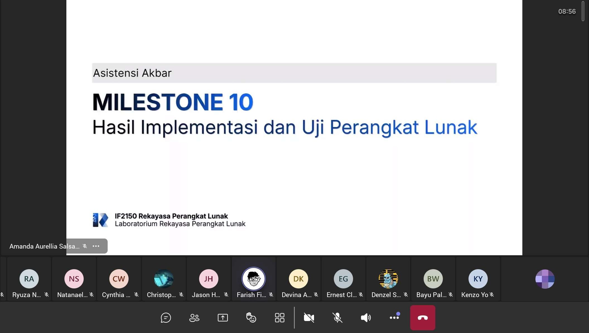

# Form Asistensi

## Tugas Besar IF2150 - Rekayasa Perangkat Lunak

| Informasi | Keterangan |
| --- | --- |
| **Hari** | Senin |
| **Tanggal** | 16/11/2026 |
| **Kelas** | 03 |
| **Nomor Kelompok** | 03 |
| **Nama Kelompok** | 0x43 |
| **Nama Perangkat Lunak** | Commitment Issues |
| **Dokumen** | K03_G03_HIUPL.md |

### Anggota Kelompok

| NIM | Nama |
| --- | --- |
| 13525012 | Steve Bradley Hoeij |
| 13525072 | Fahrezy Fitriansyah |
| 13525084 | Ariq Ulwan Hammam |
| 13525132 | Zidane Uland Fakhry |
| 13525135 | Ananda Aulia Nurramadhan |
| 10124063 | Dominick Vincent Devict |

### Catatan

| Catatan |
| --- |
| 1. Pengujian manual dilakukan pada pengujian _use case_ dan sebagian KNF, sedangkan pengujian otomatis dilakukan pada pengujian unit dan integrasi. |
| 2. Tingkat pengujian dibagi menjadi _unit testing_, _integration testing_, _system testing_, dan _acceptance testing_. |
| 3. Untuk melakukan pengujian kelas, tingkat kedalaman masing-masing kelas harus ditentukan terlebih dahulu, di antara mendalam, sedang, atau tidak perlu. Kelas tingkat mendalam memuat logika bisnis, perhitungan, dan/atau validasi, yang perlu diuji dengan 3 kasus uji (normal, _boundary_, dan _negative_/_invalid_) terhadap setiap operasi _public_; kelas tingkat sedang melakukan koordinasi dengan sedikit logika, yang perlu diuji dengan 2 kasus uji (normal dan _negative_) terhadap setiap operasi _public_; dan kelas tidak perlu berupa _entity_ tanpa logika, atau konfigurasi dan tidak perlu kasus uji spesifik. |

## Dokumentasi

<!--  -->

  

  <i>Gambar 1. Dokumentasi kegiatan asistensi.</i>

