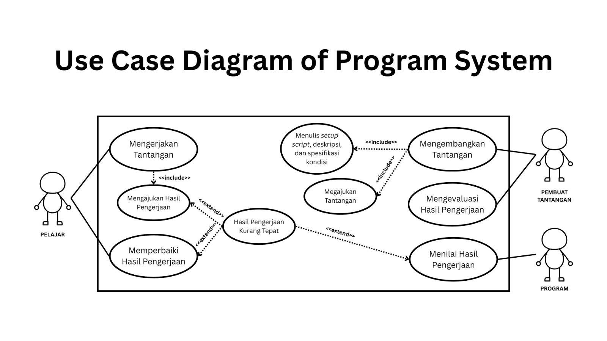
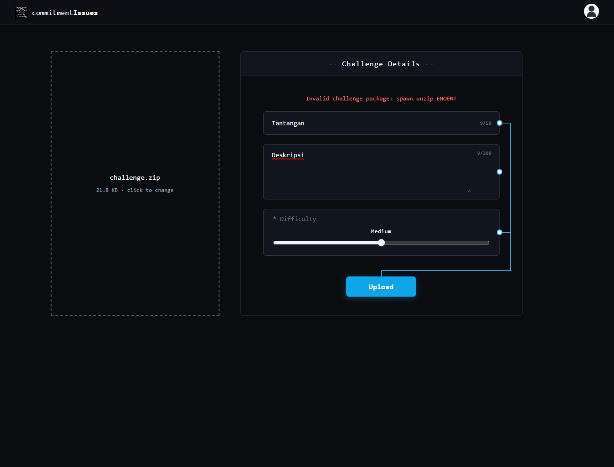
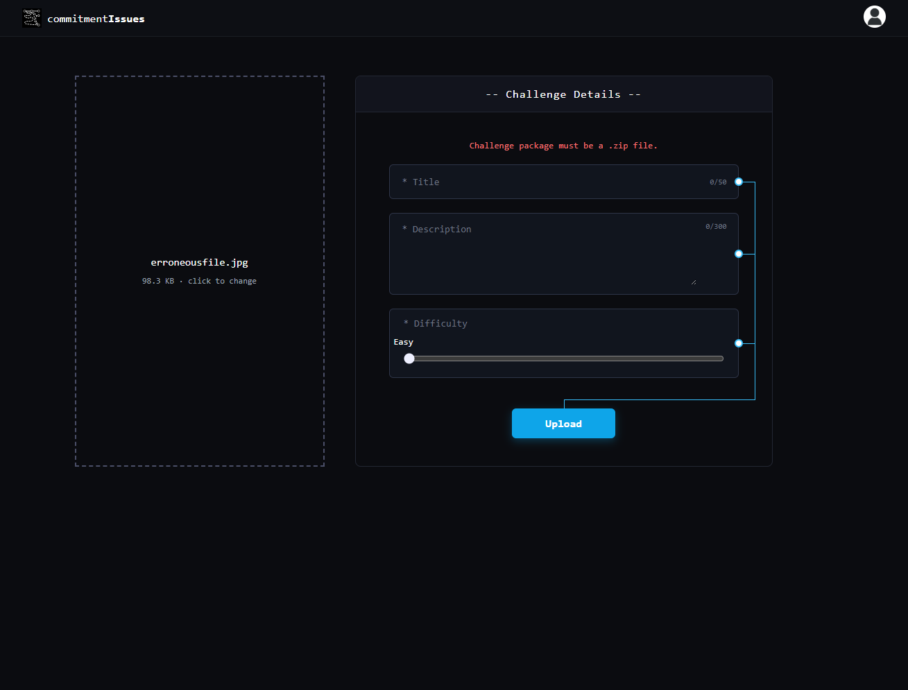
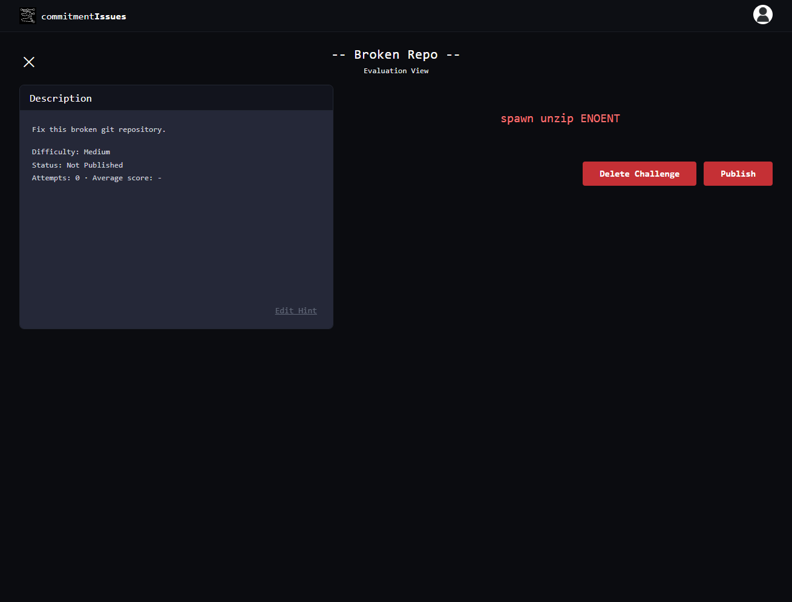
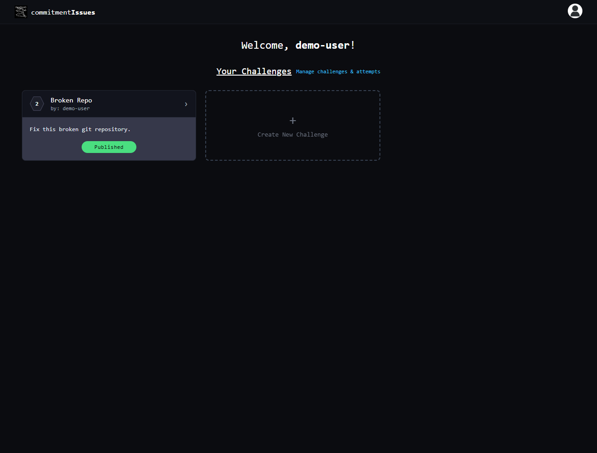
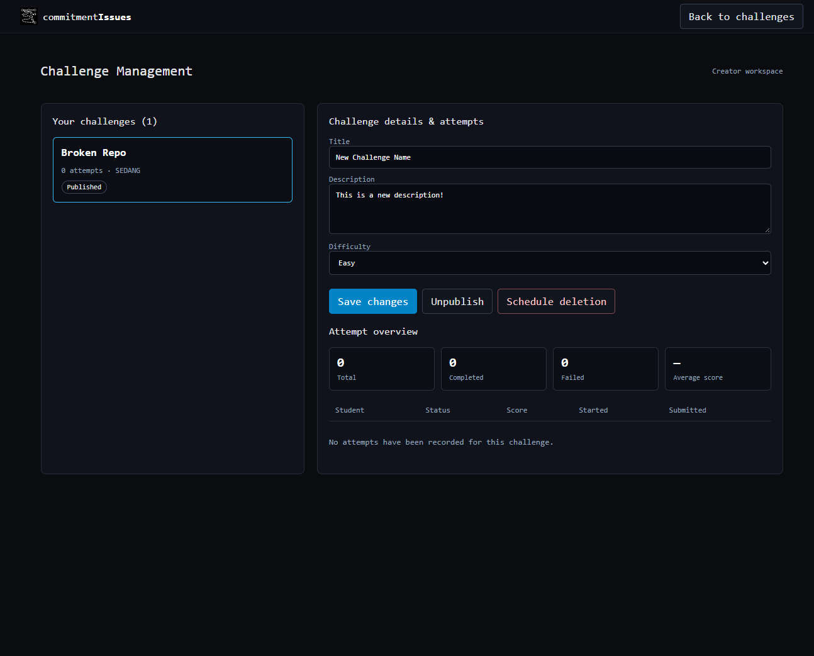

<h1>
IF2150 REKAYASA PERANGKAT LUNAK
 
TUGAS 10
 
HASIL IMPLEMENTASI DAN UJI PERANGKAT LUNAK (HIUPL)
</h1>
 

## *Commitment Issues*

### Untuk: *Made Branenda Jordhy*

Dipersiapkan oleh:
| Informasi | Keterangan |
| --- | --- |
| Kelas | 03 |
| Kelompok | 03 |

| NIM | Nama |
|---|---|
| 13525012 | Steve Bradley Hoeij |
| 13525072 | Fahrezy Fitriansyah |
| 13525084 | Ariq Ulwan Hammam |
| 13525132 | Zidane Uland Fakhry |
| 13525135 | Ananda Aulia Nurramadhan |
| 10124063 | Dominick Vincent Devict |

---

## Daftar Isi

- [BAB 1: Pendahuluan](#bab-1-pendahuluan)
  - [1.1 Tujuan Penulisan Dokumen](#11-tujuan-penulisan-dokumen)
  - [1.2 Lingkup Masalah](#12-lingkup-masalah)
  - [1.3 Definisi, Istilah, dan Singkatan](#13-definisi-istilah-dan-singkatan)
  - [1.4 Aturan Penomoran](#14-aturan-penomoran)
  - [1.5 Referensi](#15-referensi)
  - [1.6 Deskripsi Umum Dokumen (Ikhtisar)](#16-deskripsi-umum-dokumen-ikhtisar)
- [BAB 2: Deskripsi Umum Perangkat Lunak](#bab-2-deskripsi-umum-perangkat-lunak)
- [BAB 3: Implementasi](#bab-3-implementasi)
  - [3.1 Lingkungan Implementasi](#31-lingkungan-implementasi)
  - [3.2 Implementasi Modul](#32-implementasi-modul)
  - [3.3 Implementasi Antarmuka](#33-implementasi-antarmuka)
  - [3.4 File Lain](#34-file-lain)
- [BAB 4: Hasil Pengujian](#bab-4-hasil-pengujian)
  - [4.1 Strategi dan Kedalaman Pengujian Kelas](#41-strategi-dan-kedalaman-pengujian-kelas)
  - [4.2 Pengujian Unit Kelas](#42-pengujian-unit-kelas)
  - [4.3 Pengujian Integrasi](#43-pengujian-integrasi)
  - [4.4 Pengujian Use Case](#44-pengujian-use-case)
  - [4.5 Pengujian Kebutuhan Non-Fungsional (KNF)](#45-pengujian-kebutuhan-non-fungsional-knf)
  - [4.6 Tangkapan Layar dan Bukti Hasil Pengujian](#46-tangkapan-layar-dan-bukti-hasil-pengujian)
- [BAB 5: Traceability](#bab-5-traceability)

---

## Daftar Perubahan

| Revisi | Deskripsi |
| :--- | :--- |
| *A* | *Deskripsikan perubahan yang dilakukan dari dokumen sebelumnya pada dokumen ini. Jika tidak terdapat perubahan, harap kosongkan tabel.* |
| *B* |  |
| *C* |  |
| ... |  |

---

# BAB 1: Pendahuluan

## 1.1 Tujuan Penulisan Dokumen
Dokumen HIUPL adalah dokumentasi dari hasil implementasi dan pengujian perangkat lunak _Commitment Issues_ yang dibuat sebagai titik acuan atau panduan selama proses pengembangan. Dokumen ini diperuntukan para pengembang perangkat lunak _Commitment Issues_ dan semua guru, dosen, atau pengajar lainnya yang ingin menggunakan perangkat lunak _Commitment Issues_ dalam proses pengajaran Git.

## 1.2 Lingkup Masalah
_Commitment Issues_ merupakan aplikasi pembelajaran Git berbasis web. Aplikasi ini menyediakan tantangan yang melatih penggunaan Git dalam project nyata. Pembuat Tantangan dapat mengunggah, menguji, mengevaluasi, dan mengelola tantangan. Pelajar dapat memilih tantangan, menjalankan perintah Git pada lingkungan pengerjaan tantangan, mengirimkan solusi, dan melihat riwayat pengerjaan.

Sistem menggunakan arsitektur client-server. Antarmuka web berkomunikasi dengan server melalui HTTP API dan WebSocket. Server mengelola autentikasi, data tantangan dan percobaan, arsip paket tantangan, sesi repository, terminal terbatas, serta verifikasi solusi. Data persisten dikelola menggunakan PostgreSQL, sedangkan repository tantangan dijalankan pada direktori sandbox di sisi server.

## 1.3 Definisi, Istilah, dan Singkatan

Tabel 1.3. Definisi Istilah dan Singkatan

| Singkatan, Akronim, atau Istilah | Penjelasan |
| :--- | :--- |
| *P/L* | *Singkatan dari Perangkat Lunak, yaitu aplikasi yang memberikan perintah kepada komputer untuk menjalankan tugas tertentu.* |
| *SKPL* | *Singkatan dari Spesifikasi Kebutuhan Perangkat Lunak, yaitu dokumen yang merangkum kriteria-kriteria yang diperlukan untuk membangun aplikasi menjalankan tugasnya.* |
| *DPPL* | *Singkatan dari Deskripsi Perancangan Perangkat Lunak, yaitu dokumen yang menjelaskan rancangan arsitektur, kelas, dan antarmuka P/L.* |
| *HIUPL* | *Singkatan dari Hasil Implementasi dan Uji Perangkat Lunak, yaitu dokumen yang melaporkan hasil implementasi dan pengujian P/L.* |
| *KF* | *Singkatan dari Kebutuhan Fungsional.* |
| *KNF* | *Singkatan dari Kebutuhan Non-Fungsional.* |
| *UC* | *Singkatan dari Use Case.* |
| *TC* | *Singkatan dari Test Case, yaitu satu kasus uji untuk skenario tertentu.* |
| *UT* | *Singkatan dari Unit Test, yaitu test case tingkat kelas/operasi.* |
| *INT* | *Singkatan dari Integration Test, yaitu test case yang menguji interaksi antarkomponen.* |
| *Boundary* | *Kasus uji pada nilai batas masukan, misalnya nilai minimum, maksimum, atau tepat di ambang aturan.* |
| *Coverage* | *Persentase baris/cabang kode yang dieksekusi oleh pengujian.* |

## 1.4 Aturan Penomoran

Tabel 1.4. Aturan Penomoran

| Hal/Bagian | Penomoran | Keterangan |
| :--- | :--- | :--- |
| *Kebutuhan Fungsional* | *KFXX* | *Sesuai SKPL* |
| *Kebutuhan Non-Fungsional* | *KNFXX* | *Sesuai SKPL* |
| *Use Case* | *UCXX* | *Sesuai SKPL* |
| *Kelas* | *CXX* | *Sesuai DPPL* |
| *Antarmuka* | *I-XX* | *Sesuai DPPL* |
| *Test Case Unit* | *CXX-UTYY* | *XX adalah nomor kelas, YY adalah nomor urut test case unit pada kelas tersebut* |
| *Test Case Integrasi* | *INT-TCYY* | *YY adalah nomor urut test case integrasi* |
| *Test Case Use Case* | *UCXX-TCYY* | *XX adalah nomor use case, YY adalah nomor urut test case pada use case tersebut* |
| *Test Case KNF* | *KNFXX-TCYY* | *XX adalah nomor KNF, YY adalah nomor urut test case pada KNF tersebut* |

## 1.5 Referensi
- [Dokumen SKPL](../M5/K03_G03_SKPL.md)
- [Dokumen APL](../M6/K03_G03_APL.md)
- [Dokumen DPPL](../M8/K03_G03_DPPL2.md)
- [Dokumen Implementasi](../M10/K03_G03_Implementasi.md)
- [Dokumentasi Node.js](https://nodejs.org/api)
- [Dokumentasi React](https://react.dev)
- [Dokumentasi PostgreSQL](https://www.postgresql.org/docs)
- [Dokumentasi Git](https://git-scm.org/docs)
- Chacon, S. & Straub, B. (2014). Pro Git (edisi ke-2). Apress. Tersedia di: [https://git-scm.com/book/en/v2](https://git-scm.com/book/en/v2)
- Git Practice. (t.thn.). Git Practice: Interactive Git Learning. Diakses pada 30 Agustus 2026, dari [https://git-practice.com](https://git-practice.com)
- Peter C. (t.thn.). Learn Git Branching. Diambil kembali dari [https://learngitbranching.js.org](https://learngitbranching.js.org)
- Object Management Group. (2017). Unified Modeling Language (UML) Version 2.5.1. Tersedia di: [https://www.omg.org/spec/UML/2.5.1/](https://www.omg.org/spec/UML/2.5.1/)
- PlantUML. (t.thn.). Sequence Diagram dan Class Diagram. Tersedia di: [https://plantuml.com](https://plantuml.com)

## 1.6 Deskripsi Umum Dokumen (Ikhtisar)

Dokumen ini terdiri atas pendahuluan dokumen (bab 1), deskripsi umum P/L (bab 2), penjelasan hasil implementasi P/L (bab 3), tabulasi dan dokumentasi hasil pengujian P/L (bab 4), dan tabulasi keterlacakan KF dan KNF dalam hasil pengujian P/L (bab 5).

 

---

# BAB 2: Deskripsi Umum Perangkat Lunak

_Commitment Issues_ merupakan aplikasi pembelajaran Git dimana pelajar dapat mengerjakan berbagai tantangan yang didesain untuk menyimulasikan skenario-skenario realistis yang mungkin ditemukan ketika menggunakan Git. Untuk menyimpan data Pelajar, seperti biodata Pelajar dan riwayat tantangan-tantangan yang sudah pernah diselesaikan atau sedang dikerjakan, sistem akan berinteraksi dengan suatu **Database**. Sistem akan mengirimkan perubahan riwayat pelajar ke **Database** setiap kali Pelajar menyelesaikan suatu tantangan atau keluar dari tampilan pengerjaan tantangan. **Database** juga akan menyimpan data para Pembuat Tantangan, yaitu biodata pengguna dan informasi dari tantangan-tantangan yang pernah dibuat oleh Pembuat Tantangan tersebut.

Dalam menginisiasi sebuah repository untuk tantangan, sistem akan mengextract sebuah zip setup yang telah dibuat oleh Pembuat Tantangan. File zip tersebut berisikan data repositori Git untuk tantangan tersebut, beserta script-script untuk menginisiasi repository tantangan, mengulang tantangan, dan memverifikasi jawaban. Repository tantangan disimpan pada environment sandbox yang berada di server sistem.

Saat seorang Pelajar mengerjakan suatu tantangan atau seorang Pembuat Tantangan sedang mengevaluasi suatu tantangan, Pelajar/Pembuat Tantangan akan mengirimkan command-command Git melalui suatu _Command Line Interface_. Command-command yang dijalankan oleh Pengguna lewat CLI tersebut akan diterima dan dijalankan oleh server.

<i>Gambar 2.1. Use Case Diagram Commitment Issues</i>

 

---

# BAB 3: Implementasi

> Bagian ini diisi dengan informasi tentang elemen P/L yang dikembangkan (*executable files*, *configuration files*, *data files*, dan sebagainya) serta perubahannya terhadap rancangan pada DPPL (jika ada).

## 3.1 Lingkungan Implementasi

Tabel 3.1. Lingkungan Implementasi

| Aspek | Keterangan |
| :--- | :--- |
| *Hardware* | HP Prodesk 600 G1 SFF Intel Core i3-4170 CPU @ 3.70GHz dengan RAM 4GB |
| *Operating System* | Server: NixOS 25.06. Client: lintas platform, cukup mendukung web browser Mozilla Firefox 150+. |
| *Bahasa Pemrograman* | JavaScript dengan runtime NodeJS 24 LTS untuk backend; JavaScript, JSX, HTML, dan CSS untuk frontend. |
| *Framework/Library* | React dan React DOM, Vite dan plugin React; ws untuk WebSocket; pg untuk PostgreSQL; dotenv; @xterm/xterm dan @xterm/addon-fit untuk terminal. |
| *DBMS* | PostgreSQL 18, untuk data persisten: data pengguna, tantangan, riwayat pengerjaan, percobaan, nilai, dan status kelulusan. |
| *Development Tools* | Git 2.54.0 dan GitHub untuk kendali versi kode; Nginx sebagai server web; draw.io/StarUML dan PlantUML untuk pemodelan UML. |
| *Testing Tools* | Manual (untuk pengujian use case) |

## 3.2 Implementasi Modul

> Daftar modul/kelas yang **TELAH** diimplementasikan. Gunakan nama dan ID kelas yang sama dengan DPPL, dan konsisten dengan Tabel B.5 pada dokumen Implementasi (Tugas 9).

Tabel 3.2. Implementasi Modul

| No | ID Kelas | Nama Modul/Kelas | Nama File Fisik | Nama File Executable |
| :--- | :--- | :--- | :--- | :--- |
| 1 | C01 | PembuatTantangan | src/backend/repositories/userRepository.js | - |
| 2 | C02 | Pelajar | src/backend/repositories/userRepository.js | - |
| 3 | C03 | Tantangan | src/backend/repositories/challengeRepository.js | - |
| 4 | C04 | WindowEdit | src/frontend/UploadPage.jsx | - |
| 5 | C05 | EditController | src/frontend/challengeApi.js | - |
| 6 | C06 | WindowEnvironment | src/frontend/ChallengePage.jsx | - |
| 7 | C07 | EnvironmentController | src/backend/services/terminalService.js | - |
| 8 | C08 | WindowRiwayat | src/frontend/HistoryModal.jsx | - |
| 9 | C09 | RiwayatTantangan | src/backend/repositories/challengeRepository.js | - |

<!--
| Kelas | Use Case Terkait |
| :--- | :--- |
| C01 - PembuatTantangan | UC01 - Mengembangkan Tantangan, UC02 - Mengevaluasi Tantangan, UC04 - Cek Riwayat |
| C02 - Pelajar | UC03 - Mengerjakan Tantangan, UC04 - Cek Riwayat |
| C03 - Tantangan | UC01 - Mengembangkan Tantangan, UC02 - Mengevaluasi Tantangan, UC03 - Mengerjakan Tantangan |
| C04 - WindowEdit | UC01 - Mengembangkan Tantangan |
| C05 - EditController | UC01 - Mengembangkan Tantangan |
| C06 - WindowEnvironment | UC02 - Mengevaluasi Tantangan, UC03 - Mengerjakan Tantangan, UC04 - Cek Riwayat |
| C07 - EnvironmentController | UC02 - Mengevaluasi Tantangan, UC03 - Mengerjakan Tantangan |
| C08 - WindowRiwayat | UC04 - Cek Riwayat |
| C09 - RiwayatTantangan | UC03 - Mengerjakan Tantangan, UC04 - Cek Riwayat |
-->

## 3.3 Implementasi Antarmuka

Tabel 3.3. Implementasi Antarmuka

| No | ID Antarmuka | Nama Antarmuka | Nama File Fisik | Nama File Executable |
| :--- | :--- | :--- | :--- | :--- |
| 1 | I-01 | Landing Page | frontend/LandingPage.jsx | - |
| 2 | I-02 | Signup | frontend/SignupPage.jsx | - |
| 3 | I-03 | Login | frontend/LoginPage.jsx | - |
| 4 | I-04 | Main Menu | frontend/MainPage.jsx | - |
| 5 | I-05 | Filter Challenges Modal | frontend/FilterModal.jsx | - |
| 6 | I-06 | Profile Options Modal | frontend/ProfileModal.jsx | - |
| 7 | I-07 | History | frontend/HistoryModal.jsx | - |
| 8 | I-08 | Challenge Upload | frontend/UploadPage.jsx, frontend/UploadModal.jsx | - |
| 9 | I-09 | Challenge Environment | frontend/ChallengePage.jsx, frontend/components/terminal/ChallengeTerminal.jsx | - |
| 10 | I-10 | Evaluation Environment | frontend/EvaluationPage.jsx, src/frontend/CreatorEvaluationPage.jsx | - |

## 3.4 File Lain

Tabel 3.4. File Lain

| No | Nama File | Keterangan |
| :--- | :--- | :--- |
| 1 | backend/db.js | Konfigurasi koneksi/pool PostgreSQL dan fungsi query. |
| 2 | backend/services/authService.js | Pembuatan hash password dan autentikasi login. |
| 3 | backend/services/challengeSessionService.js | Validasi paket zip, ekstraksi paket, dan inisialisasi sesi repositori tantangan. |
| 4 | backend/services/challengeVerificationService.js | Eksekusi verify.sh dan interpretasi skor dari exit code. |
| 5 | backend/services/gitService.js | Pembuatan sesi repositori dan eksekusi perintah Git yang diizinkan. |
| 6 | backend/services/terminalService.js | Terminal WebSocket terbatas, validasi path, dan pemrosesan perintah. |
| 7 | backend/repositories/userRepository.js | Query data pengguna. |
| 8 | backend/repositories/challengeRepository.js | Query tantangan, percobaan, dan riwayat. |
| 9 | server.js | HTTP server, API, autentikasi sesi, dan WebSocket. |
| 10 | package.json | Metadata project, dependensi, dan perintah npm. |
| 11 | vite.config.js | Konfigurasi Vite dan proxy API/WebSocket. |
| 12 | scripts/test-core.test.js | Tes otomatis untuk pengujian inti. |
| 13 | scripts/test-auth.js | Pengujian autentikasi manual. |
| 14 | scripts/test-challenge-session.js | Pengujian sesi tantangan. |
| 15 | scripts/test-db.js | Pengujian koneksi/database. |
| 16 | scripts/test-git.js | Pengujian gitService. |
| 17 | scripts/test-package-storage.js | Pengujian penyimpanan paket. |
| 18 | README.org | Petunjuk menjalankan backend, frontend, dan CLI. |

 

---

# BAB 4: Hasil Pengujian

> Bab ini melaporkan hasil pengujian P/L pada level unit, integrasi, dan sistem. Pengujian dilakukan pada tag release terakhir Tugas 9. Hasil aktual diisi berdasarkan pengamatan saat pengujian. Kesimpulan diisi `Pass` atau `Fail`, dan untuk `Fail` dilengkapi penyebab serta usulan perbaikan.

## 4.1 Strategi dan Kedalaman Pengujian Kelas

> Setiap kelas perancangan pada Tabel 4.1 DPPL diklasifikasikan ke dalam tiga tingkat kedalaman pengujian. Tingkat **Mendalam** diberikan pada kelas yang memuat logika bisnis, perhitungan, validasi, aturan status, algoritma, integrasi eksternal, atau keamanan. Tingkat **Sedang** diberikan pada kelas yang hanya mengoordinasikan atau mendelegasikan proses. Tingkat **Tidak perlu** diberikan pada kelas tanpa logika, seperti *entity/DTO* dan kelas konfigurasi, yang teruji secara tidak langsung melalui test case use case. Seluruh kelas wajib dicantumkan beserta alasan penentuan tingkatnya.

Tabel 4.1.1. Identifikasi Tingkat Pengujian Kelas

| ID Kelas | Nama Kelas | Tingkat | Alasan | Test Case Terkait |
| :--- | :--- | :--- | :--- | :--- |
| *C01* | PembuatTantangan | Sedang | Representasi pengguna/pembuat tantangan; operasi data didelegasikan ke repositori dan server. | C01-UT01 s.d. C01-UT03 |
| *C02* | Pelajar | Sedang | Representasi pengguna/pelajar; operasi data didelegasikan ke repositori dan server. | C02-UT01 s.d. C02-UT04 |
| *C03* | Tantangan | Sedang | Memuat penyimpanan/pengambilan tantangan, status publikasi, dan pengelolaan paket. | C03-UT01 s.d. C03-UT06 |
| *C04* | WindowEdit | Sedang | Boundary untuk input metadata dan unggah berkas. | C04-UT01 |
| *C05* | EditController | Mendalam | Validasi paket dan proses penyimpanan/unggah merupakan aturan penting. | C05-UT01 s.d. C05-UT10 |
| *C06* | WindowEnvironment | Sedang | Boundary untuk terminal, aksi pengerjaan, reset, submit, dan keluar. | C06-UT01 |
| *C07* | EnvironmentController | Mendalam | Menjalankan perintah, membatasi akses repository, menginisialisasi sesi, dan memverifikasi solusi. | C07-UT01 s.d. C07-UT24 |
| *C08* | WindowRiwayat | Sedang | Boundary untuk daftar/detail riwayat dan aksi mengerjakan ulang. | C08-UT01 s.d. C08-UT05 |
| *C09* | RiwayatTantangan | Sedang | Menyimpan/mengambil data percobaan dan riwayat terminal dari database. | C09-UT01 s.d. C09-UT07 |

## 4.2 Pengujian Unit Kelas

> Pengujian unit dilakukan pada kelas bertingkat Mendalam dan Sedang. Kelas Mendalam diuji pada seluruh operasi public dengan kasus normal, batas, dan negatif, serta mencapai *coverage* minimal 70%. Kelas Sedang diuji minimal dengan satu kasus normal dan satu kasus gagal pada operasi public utama.

Cara menjalankan unit test: `npm test`.

Lokasi file test: `src/scripts/`.

Unit test repository (C01, C02, C03, C09) memakai pool basis data tiruan melalui `mock.module` sehingga `npm test` dijalankan dengan flag `--experimental-test-module-mocks`. Unit test kelas antarmuka (C04, C06, C08) me-render komponen React melalui Vite SSR dan otomatis dilewati apabila Vite tidak dapat dimuat. Unit test C05 dan C07 yang memakai `zip`, `unzip`, `bash`, dan `git` membutuhkan lingkungan Linux seperti server produksi.

### 4.2.1 Kelas EditController

**ID Kelas:** C05
**Nama Kelas:** EditController
**Tingkat:** Mendalam

Tabel 4.2.1. Hasil Pengujian Unit Kelas C05

| ID Pengujian | Operasi yang Diuji | Jenis Kasus | Prosedur/Masukan | Hasil yang Diharapkan | Hasil Pengujian | Kesimpulan |
| :--- | :--- | :--- | :--- | :--- | :--- | :--- |
| C05-UT01 | `validateChallengePackageBuffer()` | Negatif/batas | Memberi string dan Buffer kosong sebagai input. | Input yang bukan Buffer dan paket kosong ditolak. | Test `package validator rejects non-Buffer and empty input` berhasil. | Pass |
| C05-UT02 | `validateChallengePackageBuffer()` | Normal | Membuat outer ZIP berisi `repo.zip` yang memuat direktori `repo/` dan `.git`. | Paket dengan struktur repository yang valid diterima. | Test `package validator accepts outer ZIP with repo.zip containing repo/.git` berhasil. | Pass |
| C05-UT03 | `validateChallengePackageBuffer()` | Negatif | Outer ZIP yang hanya berisi `verify.sh` tanpa `repo.zip`. | Paket ditolak sebagai paket tantangan tidak valid. | Test berhasil. | Pass |
| C05-UT04 | `validateChallengePackageBuffer()` | Batas atas | Buffer berukuran 25 MB + 1 byte. | Paket ditolak karena melebihi 25 MB. | Test berhasil. | Pass |
| C05-UT05 | `uploadChallenge()` | Normal | Unggah berkas dengan judul, deskripsi, dan tingkat kesulitan ke `fetch` tiruan. | Permintaan POST multipart ke `/api/challenges` memuat seluruh field dan berkas. | Test berhasil. | Pass |
| C05-UT06 | `uploadChallenge()` | Negatif | Server membalas 400 dengan pesan error. | Pesan error dari server diteruskan ke pengguna. | Test berhasil. | Pass |
| C05-UT07 | `uploadChallenge()` | Negatif | Server membalas 500 tanpa body JSON. | Pesan cadangan `Failed to upload challenge.` dipakai. | Test berhasil. | Pass |
| C05-UT08 | `getCreatorChallenge()` | Normal/negatif | Daftar tantangan dengan ID berupa string dan angka; ID yang tidak ada. | Tantangan yang cocok dikembalikan; `null` bila tidak ada. | Test berhasil. | Pass |
| C05-UT09 | `changeChallengeStatus()` | Negatif | Server membalas 401. | Pengguna diarahkan ke `/login` dan fungsi mengembalikan `null`. | Test berhasil. | Pass |
| C05-UT10 | `changeChallengeStatus()` | Normal | Aksi `publish` untuk tantangan 12. | POST dikirim ke `/api/creator/challenges/12/publish` dan hasilnya dikembalikan. | Test berhasil. | Pass |

Tabel 4.2.1b. Ringkasan Cakupan Kelas C05

| Informasi | Keterangan |
| :--- | :--- |
| Daftar operasi public pada DPPL | `ambilDaftarTantangan()`, `validasiBerkas()`, `simpanTantangan()` |
| Operasi yang diuji | `validasiBerkas()` melalui `validateChallengePackageBuffer()` (C05-UT01 s.d. C05-UT04); `simpanTantangan()` melalui `uploadChallenge()` (C05-UT05 s.d. C05-UT07); `ambilDaftarTantangan()` melalui `getCreatorChallenge()` (C05-UT08); perubahan status tantangan melalui `changeChallengeStatus()` (C05-UT09, C05-UT10). |
| ID Algoritma yang tercakup | Algo-02 (`validasiBerkas`) dan Algo-03 (`simpanTantangan`) pada sisi klien; penyimpanan ke basis data pada Algo-03 diuji melalui INT-TC06. |
| Coverage (wajib ≥ 70%) | `src/frontend/challengeApi.js` 100% baris; `src/backend/services/challengeSessionService.js` 93,33% baris (`node --test --experimental-test-coverage`). |

### 4.2.2 Kelas EnvironmentController

**ID Kelas:** C07
**Nama Kelas:** EnvironmentController
**Tingkat:** Mendalam

Tabel 4.2.2. Hasil Pengujian Unit Kelas C07

| ID Pengujian | Operasi yang Diuji | Jenis Kasus | Prosedur/Masukan | Hasil yang Diharapkan | Hasil Pengujian | Kesimpulan |
| :--- | :--- | :--- | :--- | :--- | :--- | :--- |
| C07-UT01 | `createSession()` | Normal | Buat repository Git dengan direktori `.git`, lalu buat sesi. | Sesi dibuat dan direktori repository dikenali. | Test `git session accepts a directory containing .git` berhasil. | Pass |
| C07-UT02 | `createSession()` | Negatif | Berikan direktori tanpa `.git`. | Operasi ditolak karena direktori bukan repository Git valid. | Test `git session rejects a directory without .git` berhasil. | Pass |
| C07-UT03 | `runGitCommand()` | Normal | Jalankan `status` dan `log` pada repository valid. | Kedua perintah berhasil dan menghasilkan output yang sesuai. | Test `git status and log return successful output` berhasil. | Pass |
| C07-UT04 | `runGitCommand()` | Negatif | Jalankan command `push` yang tidak diizinkan. | Command ditolak oleh allowlist. | Test `git command allowlist rejects unknown commands` berhasil. | Pass |
| C07-UT05 | `runGitCommand()` | Negatif/boundary | Jalankan `add` dengan path `../outside` dan argumen `--force`. | Path traversal dan option injection ditolak. | Test `git add rejects path traversal and option injection` berhasil. | Pass |
| C07-UT06 | `runGitCommand()` | Normal | Tambahkan file relatif `new.txt`. | File berhasil di-stage. | Test `git add stages a valid relative file` berhasil. | Pass |
| C07-UT07 | `verifyChallengeRepository()` | Negatif | Berikan path `verify.sh` yang tidak ada. | Hasil menunjukkan verifikasi gagal, skor 0, dan pesan file tidak ditemukan. | Test `verification returns not-found result when verify.sh is absent` berhasil. | Pass |
| C07-UT08 | `verifyChallengeRepository()` | Normal/batas atas | Script mencetak `all-good` lalu exit code 100. | Hasil verifikasi `ok:true`, `passed:true`, skor 100. | Test `verification interprets exit code 100 as passed` berhasil. | Pass |
| C07-UT09 | `verifyChallengeRepository()` | Batas bawah | Script berakhir dengan exit code 0. | Hasil valid, tidak lulus, skor 0. | Test `verification interprets exit code 0 as a valid zero score` berhasil. | Pass |
| C07-UT10 | `verifyChallengeRepository()` | Normal parsial | Script berakhir dengan exit code 65. | Hasil valid, tidak lulus, skor 65. | Test `verification preserves partial scores from exit codes 1 through 99` berhasil. | Pass |
| C07-UT11 | `createRestrictedTerminalSession()` | Normal | Buat sesi terminal dan kirim perintah `pwd` serta `help`. | Terminal siap dan menampilkan direktori serta daftar perintah. | Test `terminal initializes and supports pwd and help` berhasil. | Pass |
| C07-UT12 | `createRestrictedTerminalSession()` | Negatif keamanan | Kirim perintah `cd ..` dari root repository. | Terminal menolak perpindahan keluar root repository. | Test `terminal blocks attempts to leave repository root` berhasil. | Pass |
| C07-UT13 | `createRestrictedTerminalSession()` | Negatif | Kirim payload WebSocket berupa JSON tidak valid. | Terminal menampilkan pesan input tidak valid. | Test `terminal rejects malformed input messages` berhasil. | Pass |
| C07-UT14 | `initializeChallengeSession()` | Normal | Paket berisi `setup.sh`, `verify.sh`, dan `repo.zip`. | `setup.sh` dijalankan dan sesi mengembalikan repository Git hasil ekstraksi. | Test berhasil. | Pass |
| C07-UT15 | `initializeChallengeSession()` | Negatif | Tantangan tidak ditemukan (paket `null`). | Inisialisasi ditolak dengan pesan tantangan tidak ditemukan. | Test berhasil. | Pass |
| C07-UT16 | `initializeChallengeSession()` | Negatif | `setup.sh` berakhir dengan exit code 3. | Inisialisasi ditolak dan direktori sementara dihapus. | Test berhasil. | Pass |
| C07-UT17 | `initializeChallengeSession()` | Negatif | Paket tanpa `repo.zip`. | Inisialisasi ditolak karena `repo.zip` tidak ada. | Test berhasil. | Pass |
| C07-UT18 | `createRestrictedTerminalSession()` | Normal | Perintah `mkdir`, `cd`, `touch`, `ls`, `pwd`, dan `cat`. | Berkas dan direktori dibuat serta dibaca di dalam repository. | Test berhasil. | Pass |
| C07-UT19 | `createRestrictedTerminalSession()` | Normal | Perintah `add`, `commit -m`, `log`, `branch`, dan `status`. | Commit dibuat dan riwayat tampil pada branch `main`. | Test berhasil. | Pass |
| C07-UT20 | `createRestrictedTerminalSession()` | Normal/negatif | `diff` dan `restore` pada berkas yang diubah; `checkout` ke branch yang tidak ada. | Perubahan tampil dan dapat dipulihkan; branch tidak valid ditolak. | Test berhasil. | Pass |
| C07-UT21 | `createRestrictedTerminalSession()` | Negatif keamanan | Perintah tidak dikenal, path absolut, `touch ../escape.txt`, dan kutip tidak tertutup. | Seluruh masukan ditolak dan tidak ada berkas di luar repository. | Test berhasil. | Pass |
| C07-UT22 | `createRestrictedTerminalSession()` | Negatif keamanan | `cat` pada symlink yang menunjuk ke luar repository. | Akses ditolak dan isi berkas tidak tampil. | Test berhasil. | Pass |
| C07-UT23 | `createRestrictedTerminalSession()` | Normal/batas | Backspace, tombol panah, Ctrl+C, `clear`, dan perintah 4.097 karakter. | Penyuntingan baris benar, riwayat perintah tercatat, perintah terlalu panjang ditolak. | Test berhasil. | Pass |
| C07-UT24 | `createRestrictedTerminalSession()` | Negatif | Direktori tanpa `.git`. | Inisialisasi terminal gagal dan socket ditutup dengan kode 1011. | Test berhasil. | Pass |

Tabel 4.2.2b. Ringkasan Cakupan Kelas C07

| Informasi | Keterangan |
| :--- | :--- |
| Daftar operasi public pada DPPL | `muatTantangan()`, `siapkanLingkungan()`, `eksekusiCommandUji()`, `prosesCommand()`, `validasiSolusi()`, `simpanSolusi()`, `publikasiTantangan()`, `hapusTantangan()`, `akhiriPengerjaan()`, `initiateRepo()` |
| Operasi yang diuji | `siapkanLingkungan()`/`initiateRepo()` melalui `initializeChallengeSession()` (C07-UT14 s.d. C07-UT17); `eksekusiCommandUji()` melalui `runGitCommand()` (C07-UT03 s.d. C07-UT06); `prosesCommand()` melalui `createRestrictedTerminalSession()` (C07-UT11 s.d. C07-UT13, C07-UT18 s.d. C07-UT24); `validasiSolusi()` melalui `verifyChallengeRepository()` (C07-UT07 s.d. C07-UT10). `publikasiTantangan()`, `hapusTantangan()`, `simpanSolusi()`, dan `akhiriPengerjaan()` berada pada route `server.js` dan diuji melalui INT-TC09 s.d. INT-TC12 serta UC02-TC05 dan UC03-TC06. |
| ID Algoritma yang tercakup | Algo-04 (`validasiSolusi`): interpretasi exit code diuji pada tingkat unit; pembaruan status dan nilai di basis data diuji melalui INT-TC11. |
| Coverage (wajib ≥ 70%) | `terminalService.js` 95,52%, `gitService.js` 79,75%, `challengeVerificationService.js` 100%, `challengeSessionService.js` 93,33% baris (`node --test --experimental-test-coverage`). |

### 4.2.3 Kelas PembuatTantangan

**ID Kelas:** C01
**Nama Kelas:** PembuatTantangan
**Tingkat:** Sedang

Tabel 4.2.3. Hasil Pengujian Unit Kelas C01

| ID Pengujian | Operasi yang Diuji | Jenis Kasus | Prosedur/Masukan | Hasil yang Diharapkan | Hasil Pengujian | Kesimpulan |
| :--- | :--- | :--- | :--- | :--- | :--- | :--- |
| C01-UT01 | `createUser()` | Normal | Membuat akun dengan role `PEMBUAT`. | Query INSERT ke `users` menerima role `PEMBUAT` dan baris akun dikembalikan. | Test berhasil. | Pass |
| C01-UT02 | `findUser()` | Negatif | Identifier yang tidak terdaftar. | Fungsi mengembalikan `null`. | Test berhasil. | Pass |
| C01-UT03 | `findUser()` | Normal | Identifier dengan huruf kapital berbeda. | Pencarian email/username tidak membedakan huruf besar-kecil. | Test berhasil. | Pass |

### 4.2.4 Kelas Pelajar

**ID Kelas:** C02
**Nama Kelas:** Pelajar
**Tingkat:** Sedang

Tabel 4.2.4. Hasil Pengujian Unit Kelas C02

| ID Pengujian | Operasi yang Diuji | Jenis Kasus | Prosedur/Masukan | Hasil yang Diharapkan | Hasil Pengujian | Kesimpulan |
| :--- | :--- | :--- | :--- | :--- | :--- | :--- |
| C02-UT01 | `createUser()` | Normal | Membuat akun tanpa menyebut role. | Role bawaan `PELAJAR` dipakai. | Test berhasil. | Pass |
| C02-UT02 | `authenticateLogin()` | Normal | Username dengan spasi di awal/akhir dan password benar. | Data pengguna dikembalikan tanpa `password_hash`. | Test berhasil. | Pass |
| C02-UT03 | `authenticateLogin()` | Negatif | Password salah. | Login ditolak. | Test berhasil. | Pass |
| C02-UT04 | `authenticateLogin()` | Negatif | Identifier bukan string. | Login ditolak tanpa query ke basis data. | Test berhasil. | Pass |

### 4.2.5 Kelas Tantangan

**ID Kelas:** C03
**Nama Kelas:** Tantangan
**Tingkat:** Sedang

Tabel 4.2.5. Hasil Pengujian Unit Kelas C03

| ID Pengujian | Operasi yang Diuji | Jenis Kasus | Prosedur/Masukan | Hasil yang Diharapkan | Hasil Pengujian | Kesimpulan |
| :--- | :--- | :--- | :--- | :--- | :--- | :--- |
| C03-UT01 | `saveChallengePackage()` (`simpanTantangan()`) | Normal | Metadata tantangan dan buffer paket. | Seluruh metadata dan buffer paket dikirim ke INSERT `challenges`. | Test berhasil. | Pass |
| C03-UT02 | `getChallengePackage()` (`muatTantangan()`) | Normal | Tantangan yang dapat diakses pengguna. | Paket tersimpan dikembalikan. | Test berhasil. | Pass |
| C03-UT03 | `getChallengePackage()` (`muatTantangan()`) | Negatif | Tantangan yang tidak dapat diakses. | Fungsi mengembalikan `null`. | Test berhasil. | Pass |
| C03-UT04 | `updateChallengeStatus()` (`publikasikan()`) | Normal | Status `TERPUBLIKASI` oleh pemilik tantangan. | Status diperbarui dan baris dikembalikan. | Test berhasil. | Pass |
| C03-UT05 | `updateChallengeStatus()` (`jadwalkanHapus()`) | Negatif | Status `DIJADWALKAN_HAPUS` oleh pembuat lain. | Fungsi mengembalikan `null`. | Test berhasil. | Pass |
| C03-UT06 | `updateCreatorChallenge()` | Negatif | Mengubah tantangan yang dijadwalkan hapus. | Query mengecualikan status `DIJADWALKAN_HAPUS` dan mengembalikan `null`. | Test berhasil. | Pass |

### 4.2.6 Kelas WindowEdit

**ID Kelas:** C04
**Nama Kelas:** WindowEdit
**Tingkat:** Sedang

Tabel 4.2.6. Hasil Pengujian Unit Kelas C04

| ID Pengujian | Operasi yang Diuji | Jenis Kasus | Prosedur/Masukan | Hasil yang Diharapkan | Hasil Pengujian | Kesimpulan |
| :--- | :--- | :--- | :--- | :--- | :--- | :--- |
| C04-UT01 | `tampilkanForm()` (`UploadPage`) | Normal | Render awal `UploadPage` melalui Vite SSR. | Status memuat akun tampil tanpa pesan error. | Belum dijalankan dengan Vite pada mesin tim (dilewati di lingkungan penyusun karena binding native Vite untuk Windows); assertion sudah dicocokkan dengan markup komponen. | - |

Kasus gagal `periksaValiditas()` dan `tampilkanPesan()` hanya muncul setelah interaksi pengguna, sehingga tidak dapat dijangkau oleh render SSR tanpa pustaka DOM. Perilaku tersebut diuji melalui INT-TC07 dan UC01-TC04.

### 4.2.7 Kelas WindowEnvironment

**ID Kelas:** C06
**Nama Kelas:** WindowEnvironment
**Tingkat:** Sedang

Tabel 4.2.7. Hasil Pengujian Unit Kelas C06

| ID Pengujian | Operasi yang Diuji | Jenis Kasus | Prosedur/Masukan | Hasil yang Diharapkan | Hasil Pengujian | Kesimpulan |
| :--- | :--- | :--- | :--- | :--- | :--- | :--- |
| C06-UT01 | `pilihTantangan()` (`ChallengePage`) | Normal | Render awal `ChallengePage` untuk tantangan 5 melalui Vite SSR. | Status pembuatan sesi tantangan tampil. | Belum dijalankan dengan Vite pada mesin tim; assertion sudah dicocokkan dengan markup komponen. | - |

Operasi `kirim()`, `kirimSolusi()`, `reset()`, dan `keluar()` membutuhkan sesi dan interaksi pengguna, sehingga diuji melalui INT-TC11, UC03-TC04, UC03-TC05, dan UC03-TC06.

### 4.2.8 Kelas WindowRiwayat

**ID Kelas:** C08
**Nama Kelas:** WindowRiwayat
**Tingkat:** Sedang

Tabel 4.2.8. Hasil Pengujian Unit Kelas C08

| ID Pengujian | Operasi yang Diuji | Jenis Kasus | Prosedur/Masukan | Hasil yang Diharapkan | Hasil Pengujian | Kesimpulan |
| :--- | :--- | :--- | :--- | :--- | :--- | :--- |
| C08-UT01 | `tampilkanDaftarRiwayat()` (`HistoryModal`) | Normal | Riwayat berstatus `SELESAI` dan `BERLANGSUNG`. | Status, nilai, judul cadangan, dan tautan kerjakan ulang tampil. | Belum dijalankan dengan Vite pada mesin tim; assertion sudah dicocokkan dengan markup komponen. | - |
| C08-UT02 | `tampilkanDaftarRiwayat()` | Batas | Daftar riwayat kosong. | Pesan riwayat kosong tampil. | Sama seperti C08-UT01. | - |
| C08-UT03 | `tampilkanDaftarRiwayat()` | Negatif | Pesan error pemuatan riwayat. | Pesan error tampil sebagai alert. | Sama seperti C08-UT01. | - |
| C08-UT04 | `tampilkanDaftarRiwayat()` | Negatif | Modal dalam keadaan tertutup. | Tidak ada elemen yang di-render. | Sama seperti C08-UT01. | - |
| C08-UT05 | `tampilkanDetail()` | Normal | Tantangan buatan pengguna dan buatan orang lain. | Hanya tantangan buatan pengguna tampil dengan tautan evaluasi. | Sama seperti C08-UT01. | - |

### 4.2.9 Kelas RiwayatTantangan

**ID Kelas:** C09
**Nama Kelas:** RiwayatTantangan
**Tingkat:** Sedang

Tabel 4.2.9. Hasil Pengujian Unit Kelas C09

| ID Pengujian | Operasi yang Diuji | Jenis Kasus | Prosedur/Masukan | Hasil yang Diharapkan | Hasil Pengujian | Kesimpulan |
| :--- | :--- | :--- | :--- | :--- | :--- | :--- |
| C09-UT01 | `createAttempt()` (`simpanPengerjaan()`) | Normal | Percobaan baru untuk pelajar 3 pada tantangan 10. | Percobaan disimpan dengan status `BERLANGSUNG` dan nilai 0. | Test berhasil. | Pass |
| C09-UT02 | `finishAttempt()` | Batas | Nilai 0 dan 100. | Kedua nilai batas diterima. | Test berhasil. | Pass |
| C09-UT03 | `finishAttempt()` | Batas/negatif | Nilai -1, 101, 50,5, dan string `"80"`. | Seluruh nilai ditolak tanpa query ke basis data. | Test berhasil. | Pass |
| C09-UT04 | `finishAttempt()` | Negatif | Status `BERLANGSUNG`. | Status ditolak. | Test berhasil. | Pass |
| C09-UT05 | `finishAttempt()` | Negatif | Percobaan yang sudah tidak aktif. | Fungsi mengembalikan `null`. | Test berhasil. | Pass |
| C09-UT06 | `getStudentHistory()` (`ambilDataRiwayat()`) | Normal | Riwayat pelajar 3. | Riwayat pelajar dikembalikan dari yang terbaru (Algo-05). | Test berhasil. | Pass |
| C09-UT07 | `saveTerminalHistory()` | Batas | Perintah tanpa keluaran. | Keluaran disimpan sebagai `null`. | Test berhasil. | Pass |

 

## 4.3 Pengujian Integrasi

> Pengujian integrasi memeriksa interaksi antarkomponen yang melewati batas, yaitu *Controller* ke *Model*, aplikasi ke basis data, dan aplikasi ke sistem eksternal. Daftar antarmuka mengacu pada dokumen DPPL, dengan minimal satu test case untuk setiap antarmuka. Pengujian memakai komponen nyata, bukan *mock*. Apabila ada antarmuka tambahan yang belum didaftarkan pada dokumen DPPL, cantumkan juga.

Tabel 4.3.1. Daftar Antarmuka Antarkomponen

| ID Antarmuka | Komponen Asal | Komponen Tujuan | Jenis Batas | Test Case |
| :--- | :--- | :--- | :--- | :--- |
| I-01 | Landing Page (`LandingPage.jsx`) | `GET /api/me` (`server.js`) | Aplikasi - sesi login | INT-TC01 |
| I-02 | Signup (`SignupPage.jsx`) | `POST /api/auth/signup` → `userRepository` → tabel `users` | Aplikasi - Basis data | INT-TC02, INT-TC03 |
| I-03 | Login (`LoginPage.jsx`) | `POST /api/login` → `authService` → tabel `users` | Aplikasi - Basis data | INT-TC04, INT-TC05 |
| I-04 | Main Menu (`MainPage.jsx`) | `GET /api/challenges` → `challengeRepository` → tabel `challenges` | Aplikasi - Basis data | INT-TC09 |
| I-05 | Filter Challenges Modal (`FilterModal.jsx`) | Nilai `difficulty` dari `POST /api/challenges` dan `GET /api/challenges` | Aplikasi - Basis data | INT-TC08 |
| I-06 | Profile Options Modal (`ProfileModal.jsx`, `AppHeader.jsx`) | `POST /api/logout` (`server.js`) | Aplikasi - sesi login | INT-TC13 |
| I-07 | History (`HistoryModal.jsx`) | `GET /api/history` → tabel `attempts` | Aplikasi - Basis data | INT-TC12 |
| I-08 | Challenge Upload (`UploadPage.jsx`, `challengeApi.js`) | `POST /api/challenges` → `challengeSessionService` (`unzip`) → tabel `challenges` | Aplikasi - Basis data - sistem eksternal | INT-TC06, INT-TC07 |
| I-09 | Challenge Environment (`ChallengePage.jsx`, `ChallengeTerminal.jsx`) | `POST /api/sessions`, WebSocket terminal, `POST /api/sessions/:id/submit` → `bash`/`git` → tabel `attempts`, `terminal_history` | Aplikasi - Basis data - sistem eksternal | INT-TC11 |
| I-10 | Evaluation Environment (`EvaluationPage.jsx`, `CreatorEvaluationPage.jsx`) | `POST /api/creator/sessions`, WebSocket terminal, `POST /api/creator/sessions/:id/verify` | Aplikasi - sistem eksternal | INT-TC10 |

Tabel 4.3.2. Hasil Pengujian Integrasi

Seluruh test case integrasi berada pada `src/scripts/test-integration.test.js`. Test menjalankan `server.js` asli, PostgreSQL dari `.env`, serta `bash`, `git`, `zip`, dan `unzip`, lalu menghapus data uji setelah selesai.

| ID Pengujian | ID Antarmuka | Skenario | Prosedur/Masukan | Hasil yang Diharapkan | Hasil Pengujian | Kesimpulan |
| :--- | :--- | :--- | :--- | :--- | :--- | :--- |
| INT-TC01 | I-01 | Normal/negatif: status login | `GET /api/me` tanpa cookie dan dengan cookie pembuat tantangan | 401 untuk pengunjung; data pengguna untuk pengguna yang login | Belum dijalankan terhadap PostgreSQL tim; test otomatis dilewati karena basis data tidak terjangkau di lingkungan penyusun. | - |
| INT-TC02 | I-02 | Normal: daftar akun | `POST /api/auth/signup` dengan email, username, dan password valid | 201, role `PELAJAR`, `password_hash` tersimpan sebagai hash scrypt | Belum dijalankan terhadap PostgreSQL tim; test otomatis dilewati karena basis data tidak terjangkau di lingkungan penyusun. | - |
| INT-TC03 | I-02 | Gagal: data duplikat/tidak valid | Username yang sudah dipakai; password 7 karakter | 409 untuk duplikat; 400 untuk password pendek | Belum dijalankan terhadap PostgreSQL tim; test otomatis dilewati karena basis data tidak terjangkau di lingkungan penyusun. | - |
| INT-TC04 | I-03 | Normal: login | `POST /api/login` dengan email dan password benar | 200, cookie `ci_session` dibuat, `/api/me` mengembalikan pengguna yang sama | Belum dijalankan terhadap PostgreSQL tim; test otomatis dilewati karena basis data tidak terjangkau di lingkungan penyusun. | - |
| INT-TC05 | I-03 | Gagal: password salah | `POST /api/login` dengan password salah | Login ditolak dengan pesan error dan tanpa cookie | Belum dijalankan terhadap PostgreSQL tim; test otomatis dilewati karena basis data tidak terjangkau di lingkungan penyusun. | - |
| INT-TC06 | I-08 | Normal: unggah paket | Unggah paket ZIP valid sebagai pembuat tantangan | 201, status `DRAF`, ukuran `package_data` sama dengan berkas | Belum dijalankan terhadap PostgreSQL tim; test otomatis dilewati karena basis data tidak terjangkau di lingkungan penyusun. | - |
| INT-TC07 | I-08 | Gagal: unggahan tidak valid | Berkas `.txt`, judul 51 karakter, unggahan oleh pelajar | 400, 400, dan 403 | Belum dijalankan terhadap PostgreSQL tim; test otomatis dilewati karena basis data tidak terjangkau di lingkungan penyusun. | - |
| INT-TC08 | I-05 | Batas: tingkat kesulitan | Tingkat 1, 3, 4, 7, 8, 10, dan 11 | 1-3 → `MUDAH`, 4-7 → `SEDANG`, 8-10 → `SULIT`; 11 ditolak 400 | Belum dijalankan terhadap PostgreSQL tim; test otomatis dilewati karena basis data tidak terjangkau di lingkungan penyusun. | - |
| INT-TC09 | I-04 | Normal: katalog pelajar | Draf baru, lalu dipublikasikan | Draf tidak tampil untuk pelajar; tampil setelah dipublikasikan | Belum dijalankan terhadap PostgreSQL tim; test otomatis dilewati karena basis data tidak terjangkau di lingkungan penyusun. | - |
| INT-TC10 | I-10 | Normal: lingkungan evaluasi | Buat sesi evaluasi, jalankan `status`, verifikasi dua kali, tutup sesi | Output `## main`, verifikasi lulus dengan skor 100, verifikasi kedua 409, sesi ditutup 200 | Belum dijalankan terhadap PostgreSQL tim; test otomatis dilewati karena basis data tidak terjangkau di lingkungan penyusun. | - |
| INT-TC11 | I-09 | Normal: pengerjaan tantangan | Buat sesi, jalankan `status`, submit | Percobaan `BERLANGSUNG` → `SELESAI` skor 100; perintah tersimpan di `terminal_history` | Belum dijalankan terhadap PostgreSQL tim; test otomatis dilewati karena basis data tidak terjangkau di lingkungan penyusun. | - |
| INT-TC12 | I-07 | Alternatif: keluar dari pengerjaan | Buat sesi lalu hapus sesi, buka riwayat | Riwayat memuat percobaan `GAGAL` dengan skor 0 | Belum dijalankan terhadap PostgreSQL tim; test otomatis dilewati karena basis data tidak terjangkau di lingkungan penyusun. | - |
| INT-TC13 | I-06 | Normal: logout | `POST /api/logout`, lalu `GET /api/me` | Logout 200 dan sesi tidak berlaku lagi (401) | Belum dijalankan terhadap PostgreSQL tim; test otomatis dilewati karena basis data tidak terjangkau di lingkungan penyusun. | - |

 

## 4.4 Pengujian Use Case

Test case UC01-TC01 s.d. UC04-TC02 merupakan pengujian manual tim. Test case berlabel "otomatis" berada pada `src/scripts/test-usecase.test.js` dan menjalankan alur yang sama melalui API serta terminal WebSocket.

### 4.4.1 Use Case Mengembangkan Tantangan

**ID Use Case:** UC01
**Nama Use Case:** Mengembangkan Tantangan

| ID Pengujian | ID KF | Skenario | Prosedur Pengujian | Masukan | Hasil yang Diharapkan | Hasil Pengujian | Kesimpulan |
| :--- | :--- | :--- | :--- | :--- | :--- | :--- | :--- |
| *UC01-TC01* | *KF01, KF03* | *Normal* | *1. Buka halaman login. 2. Masukkan kredensial. 3. Klik tombol "Log In". 4. Klik tombol "Create New Challenge". 5. Unggah file pada kotak "Upload your challenge here (.zip)."* | *Username: user-demo Password: password123 File: test/challenge.zip* | *File diterima dan dapat diunggah.* | *File diterima namun tidak dapat diunggah.* | *Fail: Sistem sudah bisa menverifikasi bahwa file yang diunggah adalah file .zip, namun bermasalah dalam pemrosesan file tersebut (terlihat via pesan error "Invalid challenge package: spawn unzip ENOENT").* |
| *UC01-TC02* | *KF01, KF03* | *Alternatif 1: Berkas Tantangan Gagal Diproses* | *1. Buka halaman login. 2. Masukkan kredensial. 3. Klik tombol "Log In". 4. Klik tombol "Create New Challenge". 5. Unggah file pada kotak "Upload your challenge here (.zip)."* | *Username: user-demo Password: password123 File: (File bukan .zip)* | *Pengguna mendapatkan peringatan bahwa file tantangan tidak valid.* | *Pengguna mendapatkan peringatan bahwa file tantangan tidak valid.* | *Pass* |
| UC01-TC03 | KF01, KF03 | Normal (otomatis) | 1. Login sebagai pembuat tantangan. 2. Unggah paket tantangan. 3. Buka daftar tantangan pembuat. | Paket ZIP valid, tingkat kesulitan 2 | Tantangan tampil sebagai `DRAF` dengan judul, deskripsi, dan tingkat `MUDAH`. | Belum dijalankan terhadap PostgreSQL tim; test otomatis dilewati karena basis data tidak terjangkau di lingkungan penyusun. | - |
| UC01-TC04 | KF01, KF03 | Alternatif 1 (otomatis): Berkas Tantangan Gagal Diproses | 1. Login sebagai pembuat tantangan. 2. Unggah ZIP tanpa `repo.zip`. | ZIP tanpa `repo.zip` | Unggahan ditolak 400 dengan pesan paket tidak valid. | Belum dijalankan terhadap PostgreSQL tim; test otomatis dilewati karena basis data tidak terjangkau di lingkungan penyusun. | - |

### 4.4.2 Use Case Mengevaluasi Tantangan

**ID Use Case:** UC02
**Nama Use Case:** Mengevaluasi Tantangan

Tabel 4.4.2. Hasil Pengujian Use Case UC02

| ID Pengujian | ID KF | Skenario | Prosedur Pengujian | Masukan | Hasil yang Diharapkan | Hasil Pengujian | Kesimpulan |
| :--- | :--- | :--- | :--- | :--- | :--- | :--- | :--- |
| *UC02-TC01* | *KF02* | *Normal* | *1. Buka halaman login. 2. Masukkan kredensial. 3. Klik tombol "Log In". 4. Klik tombol tantangan "Broken Repo". 5. Kirim command valid melalui Terminal. 6. Publikasikan tantangan.* | *Username: user-demo Password: password123 * | *Sistem akan melakukan perubahan terhadap repository sesuai command, lalu menambahkan tantangan ke bank tantangan secara publik.* | *Tantangan tidak dapat dimuat sehingga Terminal tidak dapat diakses, namun tantangan dapat dipublikasi.* | *Fail: Pemrosesan file tantangan masih bermasalah.* |
| *UC02-TC02* | *KF02* | *Alternatif 1: Mengubah Tantangan yang Sudah Dipublikasikan* | *1. Buka halaman login. 2. Masukkan kredensial. 3. Klik tombol "Log In". 4. Klik tombol "Manage challenges & attempts". 5. Lakukan perubahan pada kolom Title, Description, dan/atau Difficulty. 6. Klik tombol "Save changes".* | *Username: user-demo Password: password123 * | *Perubahan pada tantangan disimpan.* | *Perubahan pada tantangan disimpan.* | *Pass* |
| *UC02-TC03* | *KF02* | *Alternatif 2: Menghapus Tantangan yang Sudah Dipublikasikan* | *1. Buka halaman login. 2. Masukkan kredensial. 3. Klik tombol "Log In". 4. Klik tombol "Manage challenges & attempts". 5. Klik tombol "Schedule deletion".* | *Username: user-demo Password: password123 * | *Tantangan dihapus dari bank tantangan.* | *-* | *-* |
| UC02-TC04 | KF02 | Normal (otomatis) | 1. Buat sesi evaluasi. 2. Jalankan `touch`, `add`, `commit` di terminal. 3. Verifikasi. 4. Publikasikan. | Paket dengan `verify.sh` yang memeriksa commit `add solution` | Verifikasi skor 100, tantangan `TERPUBLIKASI` dan tampil di katalog pelajar. | Belum dijalankan terhadap PostgreSQL tim; test otomatis dilewati karena basis data tidak terjangkau di lingkungan penyusun. | - |
| UC02-TC05 | KF02 | Alternatif 1 dan 2 (otomatis): Mengubah lalu Menghapus Tantangan | 1. Ubah judul, deskripsi, dan tingkat kesulitan. 2. Jadwalkan penghapusan. 3. Coba ubah lagi. | Tingkat kesulitan 9 | Perubahan tersimpan, status `DIJADWALKAN_HAPUS`, tantangan hilang dari katalog, perubahan berikutnya ditolak 404. | Belum dijalankan terhadap PostgreSQL tim; test otomatis dilewati karena basis data tidak terjangkau di lingkungan penyusun. | - |

<!--
| *UC02-TC01* | *KF01, KF03* | *Normal* | *1. Buka halaman login. 2. Masukkan kredensial. 3. Klik tombol "Log In". 4. Klik tombol "Create New Challenge". 5. Unggah file pada kotak "Upload your challenge here (.zip)."* | *Username: user-demo Password: password123 File: test/challenge.zip* | *File diterima dan dapat diunggah.* | *File diterima namun tidak dapat diunggah.* | *Fail: Sistem sudah bisa menverifikasi bahwa file yang diunggah adalah file .zip, namun bermasalah dalam pemrosesan file tersebut (terlihat via pesan error "Invalid challenge package: spawn unzip ENOENT").* |
| *UC02-TC02* | *KF* | *Alternatif 1: * | *Langkah* | *Input* | *Harapan* | *Hasil* | *Pass* |
-->

### 4.4.3 Use Case Mengerjakan Tantangan

**ID Use Case:** UC03
**Nama Use Case:** Mengerjakan Tantangan

Tabel 4.4.3. Hasil Pengujian Use Case UC03

| ID Pengujian | ID KF | Skenario | Prosedur Pengujian | Masukan | Hasil yang Diharapkan | Hasil Pengujian | Kesimpulan |
| :--- | :--- | :--- | :--- | :--- | :--- | :--- | :--- |
| *UC03-TC01* | *KF04, KF05, KF06, KF07, KF08, KF09, KF10* | *Normal* | *1. Buka halaman signup. 2. Buat akun pelajar baru. 3. Klik tantangan yang tersedia. 4. Kirim command valid via Terminal. 5. Klik tombol "Submit".* | *-* | *Sistem melakukan perubahan pada repository sesuai command, dan mengevaluasi environment ketika hasil pekerjaan pelajar di-submit.* | *Tantangan tidak dapat dimuat.* | *Fail: Pemrosesan file tantangan masih bermasalah.* |
| *UC03-TC02* | *KF04* | *Alternatif 1: Pelajar Keluar di Tengah Pengerjaan* | *1. Buka halaman signup. 2. Buat akun pelajar baru. 3. Klik tantangan yang tersedia. 4. Keluar dari halaman pengerjaan tantangan.* | *-* | *Pelajar akan dibawa ke halaman Dashboard dan progress pengerjaan, jika ada, akan hilang.* | *Tantangan tidak dapat dimuat.* | *Fail: Pemrosesan file tantangan masih bermasalah.* |
| *UC03-TC03* | *KF04* | *Alternatif 2: Pelajar Mengulang Pengerjaan* | *1. Buka halaman signup. 2. Buat akun pelajar baru. 3. Klik tantangan yang tersedia. 4. Ulang attempt pengerjaan tantangan.* | *-* | *Sistem me-reset lingkungan tantangan dan progress pelajar akan terhapus.* | *Tantangan tidak dapat dimuat.* | *Fail: Pemrosesan file tantangan masih bermasalah.* |
| UC03-TC04 | KF04, KF05, KF06, KF07, KF10 | Normal (otomatis) | 1. Mulai sesi. 2. Jalankan `touch`, `add`, `commit` di terminal. 3. Submit. | Paket dengan `verify.sh` yang memeriksa commit `add solution` | Skor 100, status `SELESAI`, umpan balik `[v] solution commit found`; submit kedua ditolak 409. | Belum dijalankan terhadap PostgreSQL tim; test otomatis dilewati karena basis data tidak terjangkau di lingkungan penyusun. | - |
| UC03-TC05 | KF07, KF08, KF09, KF10 | Alternatif 2 (otomatis): Pelajar Mengulang Pengerjaan | 1. Mulai sesi. 2. Restart. 3. Submit tanpa commit solusi. | - | Sesi dan percobaan baru dibuat; percobaan lama `GAGAL` skor 0; submit memberi skor 40 dengan umpan balik `[x] missing solution commit`. | Belum dijalankan terhadap PostgreSQL tim; test otomatis dilewati karena basis data tidak terjangkau di lingkungan penyusun. | - |
| UC03-TC06 | KF09 | Alternatif 1 (otomatis): Pelajar Keluar di Tengah Pengerjaan | 1. Mulai sesi. 2. Keluar dari sesi. 3. Coba submit. | - | Percobaan `GAGAL` skor 0 dan submit ditolak 404. | Belum dijalankan terhadap PostgreSQL tim; test otomatis dilewati karena basis data tidak terjangkau di lingkungan penyusun. | - |

### 4.4.4 Use Case Cek Riwayat

**ID Use Case:** UC04
**Nama Use Case:** Cek Riwayat

Tabel 4.4.1. Hasil Pengujian Use Case UC04

| ID Pengujian | ID KF | Skenario | Prosedur Pengujian | Masukan | Hasil yang Diharapkan | Hasil Pengujian | Kesimpulan |
| :--- | :--- | :--- | :--- | :--- | :--- | :--- | :--- |
| *UC04-TC01* | *KF11, KF12* | *Normal* | *1. Buka halaman signup. 2. Buat akun pelajar baru. 3. Klik icon profil. 4. Klik tombol "History".* | *-* | *Pengguna berada di halaman riwayat pengerjaan tantangan, dan dapat melihat tantangan yang sudah dikerjakan.* | *Pengguna berada di halaman riwayat pengerjaan tantangan, dan dapat melihat tantangan yang sudah dikerjakan.* | *Pass* |
| *UC04-TC02* | *KF11, KF12* | *Alternatif 1: Pelajar Mengulang Tantangan* | *1. Buka halaman signup. 2. Buat akun pelajar baru. 3. Klik icon profil. 4. Klik tombol "History". 5. Klik pada tantangan yang sudah pernah dikerjakan. Klik tombol kerjakan ulang.* | *-* | *Pengguna dapat mengerjakan ulangan tantangan dari halaman riwayat.* | *-* | *Fail: Tidak dapat diuji, karena tantangan tidak dapat dimuat.* |
| UC04-TC03 | KF11, KF12 | Normal (otomatis) | 1. Pelajar menyelesaikan satu percobaan dan meninggalkan satu percobaan. 2. Pelajar membuka riwayat. 3. Pembuat membuka rekap percobaan. | - | Riwayat memuat `SELESAI` 100 dan `GAGAL` 0; rekap: total 2, selesai 1, gagal 1, aktif 0, rata-rata 50; pelajar ditolak 403. | Belum dijalankan terhadap PostgreSQL tim; test otomatis dilewati karena basis data tidak terjangkau di lingkungan penyusun. | - |

 

## 4.5 Pengujian Kebutuhan Non-Fungsional (KNF)

> Setiap KNF pada Tabel 3.2 SKPL diuji secara terukur berdasarkan parameter yang telah didefinisikan. Setiap pengujian memuat target terukur, metode dan alat yang sesuai dengan parameter (misalnya Chrome DevTools untuk *response time* dan inspeksi basis data untuk *security*), serta hasil aktual berupa angka atau data. KNF yang belum dipenuhi atau tidak diimplementasikan dicantumkan beserta alasan dan rencana perbaikan.

Tabel 4.5. Hasil Pengujian KNF

| ID Pengujian | ID KNF | Parameter | Target Terukur | Metode dan Alat | Hasil Aktual | Kesimpulan |
| :--- | :--- | :--- | :--- | :--- | :--- | :--- |
| KNF01-TC01 | KNF01 | Security | `setup.sh` tidak dapat menulis berkas di luar direktori sesinya | `src/scripts/test-knf.test.js`: `setup.sh` menulis ke direktori sementara lain, lalu keberadaan berkas diperiksa | Berkas berhasil dibuat di luar direktori sesi; `setup.sh` berjalan dengan hak akses pengguna server | Fail: isolasi hak akses belum diimplementasikan. Usulan: jalankan `setup.sh` dengan pengguna terbatas atau sandbox (mis. `bwrap`/container). Test ditandai `todo` agar `npm test` tetap hijau sampai perbaikan dibuat. |
| KNF01-TC02 | KNF01 | Security | `setup.sh` yang berjalan terus dihentikan dalam batas 10 detik | `setup.sh` berisi `sleep 30`, waktu penolakan diukur | Inisialisasi ditolak setelah sekitar 10 detik | Pass |
| KNF02-TC01 | KNF02 | Reliability | 100% dari 60 verifikasi (12 paralel) mengembalikan hasil valid tanpa crash | `src/scripts/test-knf.test.js`: campuran exit code 100, 0, 65, 150, proses di-kill, dan `verify.sh` tidak ada | 60 dari 60 verifikasi mengembalikan hasil yang sesuai; 0 crash | Pass |
| KNF03-TC01 | KNF03 | Reliability | 50 percobaan dari 25 pelajar yang disimpan paralel tersimpan seluruhnya tanpa duplikat | `src/scripts/test-knf-database.test.js`: inspeksi tabel `attempts` dan riwayat tiap pelajar | Belum dijalankan terhadap PostgreSQL tim; test otomatis dilewati karena basis data tidak terjangkau di lingkungan penyusun. | - |
| KNF04-TC01 | KNF04 | Ergonomy | Daftar dashboard pembuat memuat rekap jumlah percobaan, jumlah selesai, dan rata-rata nilai yang benar | `src/scripts/test-knf-database.test.js`: `listCreatorChallenges()` pada data 3 percobaan | Belum dijalankan terhadap PostgreSQL tim; test otomatis dilewati karena basis data tidak terjangkau di lingkungan penyusun. Aspek intuitif tampilan tetap memerlukan evaluasi pengguna secara manual. | - |
| - | KNF05 | Compatibility | Ekspor nilai dan status kelulusan ke CSV | - | Tidak diuji: fitur ekspor CSV belum diimplementasikan di `src/` | Fail: belum diimplementasikan |

 

## 4.6 Tangkapan Layar dan Bukti Hasil Pengujian

> Bukti pengujian dilampirkan sesuai ID Pengujian pada Subbab 4.2 sampai 4.5, berupa tangkapan layar aplikasi, keluaran *test runner*, laporan *coverage* untuk setiap kelas Mendalam, atau hasil alat ukur.

Tabel 4.6. Bukti Hasil Pengujian

| ID Pengujian | Bukti Hasil Pengujian |
| :--- | :--- |
| *UC01-TC01* |  |
| *UC01-TC02* |  |
| *UC02-TC01* |   |
| *UC02-TC02* |  |
| *UC02-TC03* | - |
| *UC03-TC01* |  |
| *UC03-TC02* |  |
| *UC03-TC03* |  |
| *UC04-TC01* |  |
| *UC04-TC02* |  |
| C01-UT01 s.d. C01-UT03, C02-UT01 s.d. C02-UT04, C03-UT01 s.d. C03-UT06, C09-UT01 s.d. C09-UT07 | Keluaran `npm test` (`src/scripts/test-unit-repository.test.js`): 20 test `ok`. |
| C05-UT01 s.d. C05-UT10 | Keluaran `npm test` (`test-core.test.js`, `test-unit-session.test.js`, `test-unit-ui.test.js`): 10 test `ok`; coverage `challengeApi.js` 100% dan `challengeSessionService.js` 93,33%. |
| C07-UT01 s.d. C07-UT24 | Keluaran `npm test` (`test-core.test.js`, `test-unit-session.test.js`, `test-unit-terminal.test.js`): 24 test `ok`; coverage `terminalService.js` 95,52%, `gitService.js` 79,75%, `challengeVerificationService.js` 100%. |
| C04-UT01, C06-UT01, C08-UT01 s.d. C08-UT05 | Belum ada bukti dari mesin tim (dilewati karena Vite tidak dapat dimuat di lingkungan penyusun). |
| INT-TC01 s.d. INT-TC13 | Belum ada bukti dari PostgreSQL tim (dilewati karena basis data tidak terjangkau di lingkungan penyusun). |
| UC01-TC03, UC01-TC04, UC02-TC04, UC02-TC05, UC03-TC04 s.d. UC03-TC06, UC04-TC03 | Belum ada bukti dari PostgreSQL tim. |
| KNF01-TC01 | Keluaran `npm test`: `not ok ... # TODO` dengan pesan `Missing expected rejection.` (berkas di luar direktori sesi berhasil dibuat). |
| KNF01-TC02, KNF02-TC01 | Keluaran `npm test`: 2 test `ok`. |
| KNF03-TC01, KNF04-TC01 | Belum ada bukti dari PostgreSQL tim. |

 

---

# BAB 5: Traceability

> Petakan setiap KF ke KNF, use case, kelas perancangan, file implementasi, dan test case. Tabel traceability berikut akan menjadi sarana verifikasi KF. Setiap KF memiliki minimal satu test case dan dinyatakan terpenuhi apabila **seluruh** test case terkaitnya berkesimpulan `Pass`. KF yang tidak diimplementasikan tetap dicantumkan beserta alasannya.

Tabel 5.1. Matriks Kerunutan KF terhadap Implementasi dan Pengujian

| KF ID | KNF Terkait | Use Case ID | Kelas Terkait | Implementasi File Terkait | Test Case (UC) | Test Case (Unit/Integrasi/KNF) | Status KF |
| :--- | :--- | :--- | :--- | :--- | :--- | :--- | :--- |
| KF01 | - | UC01 | C01 - PembuatTantangan C03 - Tantangan C04 - WindowEdit C05 - EditController | `src/frontend/UploadPage.jsx` `src/frontend/challengeApi.js` - `uploadChallenge()` `src/server.js` - `POST /api/challenges` `src/backend/services/challengeSessionService.js` - `validateChallengePackageBuffer()` `src/backend/repositories/challengeRepository.js` - `saveChallengePackage()` | UC01-TC01, UC01-TC02, UC01-TC03, UC01-TC04 | C03-UT01, C04-UT01, C05-UT01 s.d. C05-UT07, INT-TC06, INT-TC07, INT-TC08 | Belum terpenuhi (UC01-TC01 Fail; C04-UT01 dan test otomatis berbasis PostgreSQL belum dijalankan pada lingkungan tim) |
| KF02 | - | UC02 | C01 - PembuatTantangan C03 - Tantangan C06 - WindowEnvironment C07 - EnvironmentController | `src/frontend/EvaluationPage.jsx` `src/frontend/CreatorEvaluationPage.jsx` `src/frontend/CreatorDashboard.jsx` `src/frontend/challengeApi.js` - `changeChallengeStatus()` `src/server.js` - `POST /api/creator/sessions`, `POST /api/creator/sessions/:id/verify`, `PUT /api/creator/challenges/:id`, `POST /api/creator/challenges/:id/(publish\|unpublish\|schedule-delete)` `src/backend/services/terminalService.js` - `createRestrictedTerminalSession()` `src/backend/services/challengeVerificationService.js` - `verifyChallengeRepository()` `src/backend/repositories/challengeRepository.js` - `updateCreatorChallenge()`, `updateChallengeStatus()` | UC02-TC01, UC02-TC02, UC02-TC03, UC02-TC04, UC02-TC05 | C03-UT04 s.d. C03-UT06, C05-UT08 s.d. C05-UT10, C07-UT07 s.d. C07-UT13, INT-TC10 | Belum terpenuhi (UC02-TC01 Fail, UC02-TC03 belum dieksekusi; test otomatis berbasis PostgreSQL belum dijalankan pada lingkungan tim) |
| KF03 | KNF01 | UC01 | C03 - Tantangan C05 - EditController C07 - EnvironmentController | `src/backend/services/challengeSessionService.js` - `initializeChallengeSession()` `src/backend/services/gitService.js` - `createSession()` | UC01-TC01, UC01-TC02 | C07-UT01, C07-UT02, C07-UT14 s.d. C07-UT17, KNF01-TC01, KNF01-TC02 | Belum terpenuhi (UC01-TC01 Fail, KNF01-TC01 Fail) |
| KF04 | - | UC03 | C02 - Pelajar C06 - WindowEnvironment | `src/frontend/MainPage.jsx` `src/frontend/FilterModal.jsx` `src/frontend/ChallengePage.jsx` `src/frontend/components/terminal/ChallengeTerminal.jsx` `src/server.js` - `GET /api/challenges`, `POST /api/sessions` `src/backend/repositories/challengeRepository.js` - `listChallenges()` `src/backend/services/terminalService.js` - `createRestrictedTerminalSession()` `src/backend/services/gitService.js` - `runGitCommand()` | UC03-TC01, UC03-TC02, UC03-TC03, UC03-TC04 | C03-UT02, C03-UT03, C06-UT01, C07-UT03 s.d. C07-UT06, C07-UT11 s.d. C07-UT13, C07-UT18 s.d. C07-UT24, INT-TC09, INT-TC11 | Belum terpenuhi (UC03-TC01 s.d. UC03-TC03 Fail; C06-UT01 dan test otomatis berbasis PostgreSQL belum dijalankan pada lingkungan tim) |
| KF05 | - | UC03 | C02 - Pelajar C07 - EnvironmentController | `src/frontend/ChallengePage.jsx` `src/server.js` - `POST /api/sessions/:id/submit` `src/backend/services/challengeVerificationService.js` - `verifyChallengeRepository()` `src/backend/repositories/challengeRepository.js` - `finishAttempt()` | UC03-TC01, UC03-TC04 | C07-UT07 s.d. C07-UT10, C09-UT02 s.d. C09-UT05, INT-TC11 | Belum terpenuhi (UC03-TC01 Fail; test otomatis berbasis PostgreSQL belum dijalankan pada lingkungan tim) |
| KF06 | KNF02 | UC03 | C02 - Pelajar C03 - Tantangan C06 - WindowEnvironment C07 - EnvironmentController | `src/frontend/components/terminal/ChallengeTerminal.jsx` `src/backend/services/terminalService.js` - `createRestrictedTerminalSession()` `src/backend/services/gitService.js` - `createSession()`, `runGitCommand()` `src/backend/services/challengeVerificationService.js` - `verifyChallengeRepository()` | UC03-TC01, UC03-TC04 | C07-UT01 s.d. C07-UT13, C07-UT18 s.d. C07-UT24, INT-TC11, KNF02-TC01 | Belum terpenuhi (UC03-TC01 Fail; test otomatis berbasis PostgreSQL belum dijalankan pada lingkungan tim) |
| KF07 | - | UC03 | C02 - Pelajar C06 - WindowEnvironment C07 - EnvironmentController | `src/frontend/ChallengePage.jsx` `src/backend/services/challengeVerificationService.js` - `verifyChallengeRepository()` | UC03-TC01, UC03-TC04, UC03-TC05 | C07-UT07, C07-UT08 | Belum terpenuhi (UC03-TC01 Fail; test otomatis berbasis PostgreSQL belum dijalankan pada lingkungan tim) |
| KF08 | - | UC03 | C02 - Pelajar C06 - WindowEnvironment C07 - EnvironmentController | `src/frontend/ChallengePage.jsx` - `restartChallenge()` `src/server.js` - `POST /api/sessions/:id/restart` `src/backend/services/challengeSessionService.js` - `initializeChallengeSession()` `src/backend/repositories/challengeRepository.js` - `createAttempt()` | UC03-TC01, UC03-TC05 | C09-UT01 | Belum terpenuhi (UC03-TC01 Fail; test otomatis berbasis PostgreSQL belum dijalankan pada lingkungan tim) |
| KF09 | - | UC03 | C02 - Pelajar C07 - EnvironmentController C09 - RiwayatTantangan | `src/server.js` - `POST /api/sessions/:id/restart`, `removeSession()`, pembersihan sesi tidak aktif (`SESSION_IDLE_TTL`) `src/backend/repositories/challengeRepository.js` - `createAttempt()` | UC03-TC01, UC03-TC05, UC03-TC06 | C09-UT01 | Belum terpenuhi (UC03-TC01 Fail; test otomatis berbasis PostgreSQL belum dijalankan pada lingkungan tim) |
| KF10 | KNF03 | UC03 | C02 - Pelajar C07 - EnvironmentController C09 - RiwayatTantangan | `src/backend/repositories/challengeRepository.js` - `createAttempt()`, `finishAttempt()`, `saveTerminalHistory()` `src/server.js` - pencatatan perintah terminal (`onCommand`) | UC03-TC01, UC03-TC05 | C09-UT01, C09-UT07, INT-TC11, KNF03-TC01 | Belum terpenuhi (UC03-TC01 Fail; test otomatis berbasis PostgreSQL belum dijalankan pada lingkungan tim) |
| KF11 | KNF04 | UC04 | C01 - PembuatTantangan C08 - WindowRiwayat C09 - RiwayatTantangan | `src/frontend/CreatorDashboard.jsx` `src/server.js` - `GET /api/creator/challenges/:id/attempts` `src/backend/repositories/challengeRepository.js` - `getCreatorChallengeAttempts()` | UC04-TC01, UC04-TC02, UC04-TC03 | KNF04-TC01 | Belum terpenuhi (UC04-TC02 Fail; test otomatis berbasis PostgreSQL belum dijalankan pada lingkungan tim) |
| KF12 | KNF05 | UC04 | C02 - Pelajar C08 - WindowRiwayat C09 - RiwayatTantangan | `src/frontend/HistoryModal.jsx` `src/server.js` - `GET /api/history` `src/backend/repositories/challengeRepository.js` - `getStudentHistory()`, `finishAttempt()` | UC04-TC01, UC04-TC02, UC04-TC03 | C08-UT01 s.d. C08-UT03, C09-UT02, C09-UT06, INT-TC12 | Belum terpenuhi (UC04-TC02 Fail; C08 dan test otomatis berbasis PostgreSQL belum dijalankan pada lingkungan tim) |

Catatan Tabel 5.1:
- Relasi KF ke Use Case diambil dari Tabel 4.2 SKPL, relasi KF ke kelas dari Tabel 6.1 SKPL, dan relasi KNF ke KF dari kesamaan ID Kebutuhan pada Tabel 3.1 dan 3.2 SKPL. KNF01 (R03) tidak memiliki KF dengan ID Kebutuhan yang sama, sehingga dikaitkan dengan KF03 berdasarkan deskripsinya yang membahas eksekusi setup script.
- Test case use case diambil dari kolom ID KF pada Subbab 4.4; test case unit, integrasi, dan KNF diambil dari Subbab 4.2, 4.3, dan 4.5 berdasarkan fungsi yang diuji serta pemakaian fungsi tersebut di kode.
- Matriks ini juga tersedia dalam bentuk data pada `src/scripts/traceability.js`. Test `src/scripts/test-traceability.test.js` memastikan setiap KF/KNF terpetakan, setiap file implementasi ada, setiap ID test case ada sebagai test otomatis atau test manual di HIUPL, dan setiap test otomatis tertelusur ke kelas, antarmuka, atau kebutuhan.
- Belum ada KF yang dapat dinyatakan terpenuhi karena setiap KF memiliki test case manual yang Fail atau belum dieksekusi, dan test otomatis berbasis PostgreSQL belum dijalankan pada lingkungan tim.

Tabel 5.2. Matriks Kerunutan KNF terhadap Pengujian

| ID KNF | Parameter | KF/UC Terkait | Test Case | Metode Verifikasi | Status |
| :--- | :--- | :--- | :--- | :--- | :--- |
| KNF01 | Security | KF03 / UC01 | KNF01-TC01, KNF01-TC02 | Eksekusi `setup.sh` yang mencoba menulis ke luar direktori sesi dan `setup.sh` yang berjalan terus (`src/scripts/test-knf.test.js`) | Belum terpenuhi: KNF01-TC01 Fail (tidak ada isolasi hak akses), KNF01-TC02 Pass (batas waktu 10 detik) |
| KNF02 | Reliability | KF06 / UC03 | KNF02-TC01 | 60 verifikasi paralel dengan berbagai exit code dan kegagalan skrip (`src/scripts/test-knf.test.js`) | Terpenuhi: 60/60 hasil valid, 0 crash |
| KNF03 | Reliability | KF10 / UC03 | KNF03-TC01 | 50 percobaan paralel dari 25 pelajar, lalu inspeksi tabel `attempts` (`src/scripts/test-knf-database.test.js`) | Belum diverifikasi: test belum dijalankan terhadap PostgreSQL tim |
| KNF04 | Ergonomy | KF11 / UC04 | KNF04-TC01 | Pemeriksaan rekap percobaan pada data dashboard pembuat (`src/scripts/test-knf-database.test.js`) | Belum diverifikasi: test belum dijalankan terhadap PostgreSQL tim; aspek intuitif tampilan perlu evaluasi pengguna manual |
| KNF05 | Compatibility | KF12 / UC04 | - | - | Belum diimplementasikan: tidak ada fitur ekspor nilai dan status kelulusan ke CSV di `src/` |

Catatan Tabel 5.2:
- KNF01: `setup.sh` dijalankan melalui `bash` dengan batas waktu 10 detik pada direktori sementara (`initializeChallengeSession()`), tetapi KNF01-TC01 membuktikan bahwa skrip masih dapat menulis berkas di luar direktori sesi. C07-UT05, C07-UT12, C07-UT21, dan C07-UT22 menguji pembatasan path pada perintah terminal, bukan eksekusi setup script, sehingga tidak dipakai sebagai verifikasi KNF01.
- KNF02: C07-UT07 s.d. C07-UT10 menguji kebenaran interpretasi hasil `verify.sh` satu per satu, sedangkan KNF02-TC01 mengukur ketahanan saat banyak verifikasi berjalan bersamaan.
- KNF05: belum ditemukan fitur ekspor nilai dan status kelulusan ke format CSV pada `src/`, sehingga tidak ada test case yang dapat dibuat tanpa menambahkan fitur baru.
