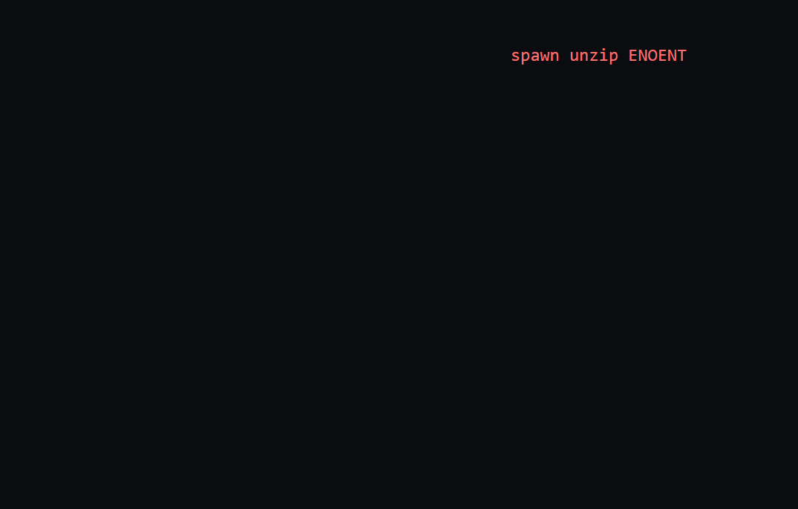
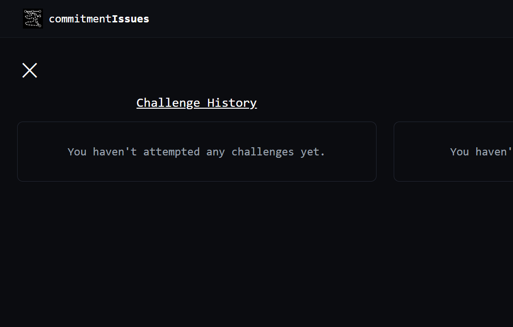

<h1>
IF2150 REKAYASA PERANGKAT LUNAK
 
TUGAS 10
 
HASIL IMPLEMENTASI DAN UJI PERANGKAT LUNAK (HIUPL)
</h1>
 

## *Commitment Issues*

### Untuk: *Made Branenda Jordhy*

Dipersiapkan oleh:
| Informasi | Keterangan |
| --- | --- |
| Kelas | 03 |
| Kelompok | 03 |

| NIM | Nama |
|---|---|
| 13525012 | Steve Bradley Hoeij |
| 13525072 | Fahrezy Fitriansyah |
| 13525084 | Ariq Ulwan Hammam |
| 13525132 | Zidane Uland Fakhry |
| 13525135 | Ananda Aulia Nurramadhan |
| 10124063 | Dominick Vincent Devict |

---

## Daftar Isi

- [BAB 1: Pendahuluan](#bab-1-pendahuluan)
  - [1.1 Tujuan Penulisan Dokumen](#11-tujuan-penulisan-dokumen)
  - [1.2 Lingkup Masalah](#12-lingkup-masalah)
  - [1.3 Definisi, Istilah, dan Singkatan](#13-definisi-istilah-dan-singkatan)
  - [1.4 Aturan Penomoran](#14-aturan-penomoran)
  - [1.5 Referensi](#15-referensi)
  - [1.6 Deskripsi Umum Dokumen (Ikhtisar)](#16-deskripsi-umum-dokumen-ikhtisar)
- [BAB 2: Deskripsi Umum Perangkat Lunak](#bab-2-deskripsi-umum-perangkat-lunak)
- [BAB 3: Implementasi](#bab-3-implementasi)
  - [3.1 Lingkungan Implementasi](#31-lingkungan-implementasi)
  - [3.2 Implementasi Modul](#32-implementasi-modul)
  - [3.3 Implementasi Antarmuka](#33-implementasi-antarmuka)
  - [3.4 File Lain](#34-file-lain)
- [BAB 4: Hasil Pengujian](#bab-4-hasil-pengujian)
  - [4.1 Strategi dan Kedalaman Pengujian Kelas](#41-strategi-dan-kedalaman-pengujian-kelas)
  - [4.2 Pengujian Unit Kelas](#42-pengujian-unit-kelas)
  - [4.3 Pengujian Integrasi](#43-pengujian-integrasi)
  - [4.4 Pengujian Use Case](#44-pengujian-use-case)
  - [4.5 Pengujian Kebutuhan Non-Fungsional (KNF)](#45-pengujian-kebutuhan-non-fungsional-knf)
  - [4.6 Tangkapan Layar dan Bukti Hasil Pengujian](#46-tangkapan-layar-dan-bukti-hasil-pengujian)
- [BAB 5: Traceability](#bab-5-traceability)

---

## Daftar Perubahan

| Revisi | Deskripsi |
| :--- | :--- |
| *A* | *Deskripsikan perubahan yang dilakukan dari dokumen sebelumnya pada dokumen ini. Jika tidak terdapat perubahan, harap kosongkan tabel.* |
| *B* |  |
| *C* |  |
| ... |  |

---

# BAB 1: Pendahuluan

## 1.1 Tujuan Penulisan Dokumen
Dokumen HIUPL adalah dokumentasi dari hasil implementasi dan pengujian perangkat lunak _Commitment Issues_ yang dibuat sebagai titik acuan atau panduan selama proses pengembangan. Dokumen ini diperuntukan para pengembang perangkat lunak _Commitment Issues_ dan semua guru, dosen, atau pengajar lainnya yang ingin menggunakan perangkat lunak _Commitment Issues_ dalam proses pengajaran Git.

## 1.2 Lingkup Masalah
_Commitment Issues_ merupakan aplikasi pembelajaran Git berbasis web. Aplikasi ini menyediakan tantangan yang melatih penggunaan Git dalam project nyata. Pembuat Tantangan dapat mengunggah, menguji, mengevaluasi, dan mengelola tantangan. Pelajar dapat memilih tantangan, menjalankan perintah Git pada lingkungan pengerjaan tantangan, mengirimkan solusi, dan melihat riwayat pengerjaan.

Sistem menggunakan arsitektur client-server. Antarmuka web berkomunikasi dengan server melalui HTTP API dan WebSocket. Server mengelola autentikasi, data tantangan dan percobaan, arsip paket tantangan, sesi repository, terminal terbatas, serta verifikasi solusi. Data persisten dikelola menggunakan PostgreSQL, sedangkan repository tantangan dijalankan pada direktori sandbox di sisi server.

## 1.3 Definisi, Istilah, dan Singkatan

Tabel 1.3. Definisi Istilah dan Singkatan

| Singkatan, Akronim, atau Istilah | Penjelasan |
| :--- | :--- |
| *P/L* | *Singkatan dari Perangkat Lunak, yaitu aplikasi yang memberikan perintah kepada komputer untuk menjalankan tugas tertentu.* |
| *SKPL* | *Singkatan dari Spesifikasi Kebutuhan Perangkat Lunak, yaitu dokumen yang merangkum kriteria-kriteria yang diperlukan untuk membangun aplikasi menjalankan tugasnya.* |
| *DPPL* | *Singkatan dari Deskripsi Perancangan Perangkat Lunak, yaitu dokumen yang menjelaskan rancangan arsitektur, kelas, dan antarmuka P/L.* |
| *HIUPL* | *Singkatan dari Hasil Implementasi dan Uji Perangkat Lunak, yaitu dokumen yang melaporkan hasil implementasi dan pengujian P/L.* |
| *KF* | *Singkatan dari Kebutuhan Fungsional.* |
| *KNF* | *Singkatan dari Kebutuhan Non-Fungsional.* |
| *UC* | *Singkatan dari Use Case.* |
| *TC* | *Singkatan dari Test Case, yaitu satu kasus uji untuk skenario tertentu.* |
| *UT* | *Singkatan dari Unit Test, yaitu test case tingkat kelas/operasi.* |
| *INT* | *Singkatan dari Integration Test, yaitu test case yang menguji interaksi antarkomponen.* |
| *Boundary* | *Kasus uji pada nilai batas masukan, misalnya nilai minimum, maksimum, atau tepat di ambang aturan.* |
| *Coverage* | *Persentase baris/cabang kode yang dieksekusi oleh pengujian.* |

## 1.4 Aturan Penomoran

Tabel 1.4. Aturan Penomoran

| Hal/Bagian | Penomoran | Keterangan |
| :--- | :--- | :--- |
| *Kebutuhan Fungsional* | *KFXX* | *Sesuai SKPL* |
| *Kebutuhan Non-Fungsional* | *KNFXX* | *Sesuai SKPL* |
| *Use Case* | *UCXX* | *Sesuai SKPL* |
| *Kelas* | *CXX* | *Sesuai DPPL* |
| *Antarmuka* | *I-XX* | *Sesuai DPPL* |
| *Test Case Unit* | *CXX-UTYY* | *XX adalah nomor kelas, YY adalah nomor urut test case unit pada kelas tersebut* |
| *Test Case Integrasi* | *INT-TCYY* | *YY adalah nomor urut test case integrasi* |
| *Test Case Use Case* | *UCXX-TCYY* | *XX adalah nomor use case, YY adalah nomor urut test case pada use case tersebut* |
| *Test Case KNF* | *KNFXX-TCYY* | *XX adalah nomor KNF, YY adalah nomor urut test case pada KNF tersebut* |

## 1.5 Referensi
- [Dokumen SKPL](../M5/K03_G03_SKPL.md)
- [Dokumen APL](../M6/K03_G03_APL.md)
- [Dokumen DPPL](../M8/K03_G03_DPPL2.md)
- [Dokumen Implementasi](../M10/K03_G03_Implementasi.md)
- [Dokumentasi Node.js](https://nodejs.org/api)
- [Dokumentasi React](https://react.dev)
- [Dokumentasi PostgreSQL](https://www.postgresql.org/docs)
- [Dokumentasi Git](https://git-scm.org/docs)

- SKPL Commitment Issues
- APL Commitment Issues
- DPPL Commitment Issues
- Implementasi Commitment Issues
- Chacon, S. & Straub, B. (2014). Pro Git (edisi ke-2). Apress. Tersedia di: [https://git-scm.com/book/en/v2](https://git-scm.com/book/en/v2)
- Git Practice. (t.thn.). Git Practice: Interactive Git Learning. Diakses pada 30 Agustus 2026, dari [https://git-practice.com](https://git-practice.com)
- Peter C. (t.thn.). Learn Git Branching. Diambil kembali dari [https://learngitbranching.js.org](https://learngitbranching.js.org)
- Object Management Group. (2017). Unified Modeling Language (UML) Version 2.5.1. Tersedia di: [https://www.omg.org/spec/UML/2.5.1/](https://www.omg.org/spec/UML/2.5.1/)
- PlantUML. (t.thn.). Sequence Diagram dan Class Diagram. Tersedia di: [https://plantuml.com](https://plantuml.com)

## 1.6 Deskripsi Umum Dokumen (Ikhtisar)

Dokumen ini terdiri atas pendahuluan dokumen (bab 1), deskripsi umum P/L (bab 2), penjelasan hasil implementasi P/L (bab 3), tabulasi dan dokumentasi hasil pengujian P/L (bab 4), dan tabulasi keterlacakan KF dan KNF dalam hasil pengujian P/L (bab 5).

 

---

# BAB 2: Deskripsi Umum Perangkat Lunak

_Commitment Issues_ merupakan aplikasi pembelajaran Git dimana pelajar dapat mengerjakan berbagai tantangan yang didesain untuk menyimulasikan skenario-skenario realistis yang mungkin ditemukan ketika menggunakan Git. Untuk menyimpan data Pelajar, seperti biodata Pelajar dan riwayat tantangan-tantangan yang sudah pernah diselesaikan atau sedang dikerjakan, sistem akan berinteraksi dengan suatu **Database**. Sistem akan mengirimkan perubahan riwayat pelajar ke **Database** setiap kali Pelajar menyelesaikan suatu tantangan atau keluar dari tampilan pengerjaan tantangan. **Database** juga akan menyimpan data para Pembuat Tantangan, yaitu biodata pengguna dan informasi dari tantangan-tantangan yang pernah dibuat oleh Pembuat Tantangan tersebut.

Dalam menginisiasi sebuah repository untuk tantangan, sistem akan mengextract sebuah zip setup yang telah dibuat oleh Pembuat Tantangan. File zip tersebut berisikan data repositori Git untuk tantangan tersebut, beserta script-script untuk menginisiasi repository tantangan, mengulang tantangan, dan memverifikasi jawaban. Repository tantangan disimpan pada environment sandbox yang berada di server sistem.

Saat seorang Pelajar mengerjakan suatu tantangan atau seorang Pembuat Tantangan sedang mengevaluasi suatu tantangan, Pelajar/Pembuat Tantangan akan mengirimkan command-command Git melalui suatu _Command Line Interface_. Command-command yang dijalankan oleh Pengguna lewat CLI tersebut akan diterima dan dijalankan oleh server.

<i>Gambar 2.1. Use Case Diagram Commitment Issues</i>

 

---

# BAB 3: Implementasi

> Bagian ini diisi dengan informasi tentang elemen P/L yang dikembangkan (*executable files*, *configuration files*, *data files*, dan sebagainya) serta perubahannya terhadap rancangan pada DPPL (jika ada).

## 3.1 Lingkungan Implementasi

Tabel 3.1. Lingkungan Implementasi

| Aspek | Keterangan |
| :--- | :--- |
| *Hardware* | HP Prodesk 600 G1 SFF Intel Core i3-4170 CPU @ 3.70GHz dengan RAM 4GB |
| *Operating System* | Server: NixOS 25.06. Client: lintas platform, cukup mendukung web browser Mozilla Firefox 150+. |
| *Bahasa Pemrograman* | JavaScript dengan runtime NodeJS 24 LTS untuk backend; JavaScript, JSX, HTML, dan CSS untuk frontend. |
| *Framework/Library* | React dan React DOM, Vite dan plugin React; ws untuk WebSocket; pg untuk PostgreSQL; dotenv; @xterm/xterm dan @xterm/addon-fit untuk terminal. |
| *DBMS* | PostgreSQL 18, untuk data persisten: data pengguna, tantangan, riwayat pengerjaan, percobaan, nilai, dan status kelulusan. |
| *Development Tools* | Git 2.54.0 dan GitHub untuk kendali versi kode; Nginx sebagai server web; draw.io/StarUML dan PlantUML untuk pemodelan UML. |
| *Testing Tools* | Manual (untuk pengujian use case) |

## 3.2 Implementasi Modul

> Daftar modul/kelas yang **TELAH** diimplementasikan. Gunakan nama dan ID kelas yang sama dengan DPPL, dan konsisten dengan Tabel B.5 pada dokumen Implementasi (Tugas 9).

Tabel 3.2. Implementasi Modul

| No | ID Kelas | Nama Modul/Kelas | Nama File Fisik | Nama File Executable |
| :--- | :--- | :--- | :--- | :--- |
| 1 | C01 | PembuatTantangan | src/backend/repositories/userRepository.js | - |
| 2 | C02 | Pelajar | src/backend/repositories/userRepository.js | - |
| 3 | C03 | Tantangan | src/backend/repositories/challengeRepository.js | - |
| 4 | C04 | WindowEdit | src/frontend/UploadPage.jsx | - |
| 5 | C05 | EditController | src/frontend/challengeApi.js | - |
| 6 | C06 | WindowEnvironment | src/frontend/ChallengePage.jsx | - |
| 7 | C07 | EnvironmentController | src/backend/services/terminalService.js | - |
| 8 | C08 | WindowRiwayat | src/frontend/HistoryModal.jsx | - |
| 9 | C09 | RiwayatTantangan | src/backend/repositories/challengeRepository.js | - |

<!--
| Kelas | Use Case Terkait |
| :--- | :--- |
| C01 - PembuatTantangan | UC01 - Mengembangkan Tantangan, UC02 - Mengevaluasi Tantangan, UC04 - Cek Riwayat |
| C02 - Pelajar | UC03 - Mengerjakan Tantangan, UC04 - Cek Riwayat |
| C03 - Tantangan | UC01 - Mengembangkan Tantangan, UC02 - Mengevaluasi Tantangan, UC03 - Mengerjakan Tantangan |
| C04 - WindowEdit | UC01 - Mengembangkan Tantangan |
| C05 - EditController | UC01 - Mengembangkan Tantangan |
| C06 - WindowEnvironment | UC02 - Mengevaluasi Tantangan, UC03 - Mengerjakan Tantangan, UC04 - Cek Riwayat |
| C07 - EnvironmentController | UC02 - Mengevaluasi Tantangan, UC03 - Mengerjakan Tantangan |
| C08 - WindowRiwayat | UC04 - Cek Riwayat |
| C09 - RiwayatTantangan | UC03 - Mengerjakan Tantangan, UC04 - Cek Riwayat |
-->

## 3.3 Implementasi Antarmuka

Tabel 3.3. Implementasi Antarmuka

| No | ID Antarmuka | Nama Antarmuka | Nama File Fisik | Nama File Executable |
| :--- | :--- | :--- | :--- | :--- |
| 1 | I-01 | Landing Page | frontend/LandingPage.jsx | - |
| 2 | I-02 | Signup | frontend/SignupPage.jsx | - |
| 3 | I-03 | Login | frontend/LoginPage.jsx | - |
| 4 | I-04 | Main Menu | frontend/MainPage.jsx | - |
| 5 | I-05 | Filter Challenges Modal | frontend/FilterModal.jsx | - |
| 6 | I-06 | Profile Options Modal | frontend/ProfileModal.jsx | - |
| 7 | I-07 | History | frontend/HistoryModal.jsx | - |
| 8 | I-08 | Challenge Upload | frontend/UploadPage.jsx, frontend/UploadModal.jsx | - |
| 9 | I-09 | Challenge Environment | frontend/ChallengePage.jsx, frontend/components/terminal/ChallengeTerminal.jsx | - |
| 10 | I-10 | Evaluation Environment | frontend/EvaluationPage.jsx, src/frontend/CreatorEvaluationPage.jsx | - |

## 3.4 File Lain

Tabel 3.4. File Lain

| No | Nama File | Keterangan |
| :--- | :--- | :--- |
| 1 | backend/db.js | Konfigurasi koneksi/pool PostgreSQL dan fungsi query. |
| 2 | backend/services/authService.js | Pembuatan hash password dan autentikasi login. |
| 3 | backend/services/challengeSessionService.js | Validasi paket zip, ekstraksi paket, dan inisialisasi sesi repositori tantangan. |
| 4 | backend/services/challengeVerificationService.js | Eksekusi verify.sh dan interpretasi skor dari exit code. |
| 5 | backend/services/gitService.js | Pembuatan sesi repositori dan eksekusi perintah Git yang diizinkan. |
| 6 | backend/services/terminalService.js | Terminal WebSocket terbatas, validasi path, dan pemrosesan perintah. |
| 7 | backend/repositories/userRepository.js | Query data pengguna. |
| 8 | backend/repositories/challengeRepository.js | Query tantangan, percobaan, dan riwayat. |
| 9 | server.js | HTTP server, API, autentikasi sesi, dan WebSocket. |
| 10 | package.json | Metadata project, dependensi, dan perintah npm. |
| 11 | vite.config.js | Konfigurasi Vite dan proxy API/WebSocket. |
| 12 | scripts/test-core.test.js | Tes otomatis untuk pengujian inti. |
| 13 | scripts/test-auth.js | Pengujian autentikasi manual. |
| 14 | scripts/test-challenge-session.js | Pengujian sesi tantangan. |
| 15 | scripts/test-db.js | Pengujian koneksi/database. |
| 16 | scripts/test-git.js | Pengujian gitService. |
| 17 | scripts/test-package-storage.js | Pengujian penyimpanan paket. |
| 18 | README.org | Petunjuk menjalankan backend, frontend, dan CLI. |

 

---

# BAB 4: Hasil Pengujian

> Bab ini melaporkan hasil pengujian P/L pada level unit, integrasi, dan sistem. Pengujian dilakukan pada tag release terakhir Tugas 9. Hasil aktual diisi berdasarkan pengamatan saat pengujian. Kesimpulan diisi `Pass` atau `Fail`, dan untuk `Fail` dilengkapi penyebab serta usulan perbaikan.

## 4.1 Strategi dan Kedalaman Pengujian Kelas

> Setiap kelas perancangan pada Tabel 4.1 DPPL diklasifikasikan ke dalam tiga tingkat kedalaman pengujian. Tingkat **Mendalam** diberikan pada kelas yang memuat logika bisnis, perhitungan, validasi, aturan status, algoritma, integrasi eksternal, atau keamanan. Tingkat **Sedang** diberikan pada kelas yang hanya mengoordinasikan atau mendelegasikan proses. Tingkat **Tidak perlu** diberikan pada kelas tanpa logika, seperti *entity/DTO* dan kelas konfigurasi, yang teruji secara tidak langsung melalui test case use case. Seluruh kelas wajib dicantumkan beserta alasan penentuan tingkatnya.

Tabel 4.1.1. Identifikasi Tingkat Pengujian Kelas

| ID Kelas | Nama Kelas | Tingkat | Alasan | Test Case Terkait |
| :--- | :--- | :--- | :--- | :--- |
| *C01* | PembuatTantangan | Sedang | Representasi pengguna/pembuat tantangan; operasi data didelegasikan ke repositori dan server. | - |
| *C02* | Pelajar | Sedang | Representasi pengguna/pelajar; operasi data didelegasikan ke repositori dan server. | - |
| *C03* | Tantangan | Sedang | Memuat penyimpanan/pengambilan tantangan, status publikasi, dan pengelolaan paket. | - |
| *C04* | WindowEdit | Sedang | Boundary untuk input metadata dan unggah berkas. | - |
| *C05* | EditController | Mendalam | Validasi paket dan proses penyimpanan/unggah merupakan aturan penting. | C05-UT01 s.d. C05-UT02 |
| *C06* | WindowEnvironment | Sedang | Boundary untuk terminal, aksi pengerjaan, reset, submit, dan keluar. | - |
| *C07* | EnvironmentController | Mendalam | Menjalankan perintah, membatasi akses repository, menginisialisasi sesi, dan memverifikasi solusi. | C07-UT01 s.d. C07-UT12 |
| *C08* | WindowRiwayat | Sedang | Boundary untuk daftar/detail riwayat dan aksi mengerjakan ulang. | - |
| *C09* | RiwayatTantangan | Sedang | Menyimpan/mengambil data percobaan dan riwayat terminal dari database. | - |

## 4.2 Pengujian Unit Kelas

> Pengujian unit dilakukan pada kelas bertingkat Mendalam dan Sedang. Kelas Mendalam diuji pada seluruh operasi public dengan kasus normal, batas, dan negatif, serta mencapai *coverage* minimal 70%. Kelas Sedang diuji minimal dengan satu kasus normal dan satu kasus gagal pada operasi public utama.

Cara menjalankan unit test: `npm test`.

Lokasi file test: `src/scripts/`.

### 4.2.1 Kelas EditController

**ID Kelas:** C05
**Nama Kelas:** EditController
**Tingkat:** Mendalam

Tabel 4.2.1. Hasil Pengujian Unit Kelas C05

| ID Pengujian | Operasi yang Diuji | Jenis Kasus | Prosedur/Masukan | Hasil yang Diharapkan | Hasil Pengujian | Kesimpulan |
| :--- | :--- | :--- | :--- | :--- | :--- | :--- |
| C05-UT01 | `validateChallengePackageBuffer()` | Negatif/batas | Memberi string dan Buffer kosong sebagai input. | Input yang bukan Buffer dan paket kosong ditolak. | Test `package validator rejects non-Buffer and empty input` berhasil. | Pass |
| C05-UT02 | `validateChallengePackageBuffer()` | Normal | Membuat outer ZIP berisi `repo.zip` yang memuat direktori `repo/` dan `.git`. | Paket dengan struktur repository yang valid diterima. | Test `package validator accepts outer ZIP with repo.zip containing repo/.git` berhasil. | Pass |

Tabel 4.2.1b. Ringkasan Cakupan Kelas C05

| Informasi | Keterangan |
| :--- | :--- |
| Daftar operasi public pada DPPL | `ambilDaftarTantangan()`, `validasiBerkas()`, `simpanTantangan()` |
| Operasi yang diuji | Validasi paket melalui `validateChallengePackageBuffer()`; operasi simpan dan pengambilan daftar belum diuji. |
| ID Algoritma yang tercakup | Tidak ada ID algoritma DPPL yang dapat dinyatakan tercakup sepenuhnya oleh dua test ini. |
| Coverage (wajib ≥ 70%) | - |

### 4.2.2 Kelas EnvironmentController

**ID Kelas:** C07
**Nama Kelas:** EnvironmentController
**Tingkat:** Mendalam

Tabel 4.2.2. Hasil Pengujian Unit Kelas C07

| ID Pengujian | Operasi yang Diuji | Jenis Kasus | Prosedur/Masukan | Hasil yang Diharapkan | Hasil Pengujian | Kesimpulan |
| :--- | :--- | :--- | :--- | :--- | :--- | :--- |
| C07-UT01 | `createSession()` | Normal | Buat repository Git dengan direktori `.git`, lalu buat sesi. | Sesi dibuat dan direktori repository dikenali. | Test `git session accepts a directory containing .git` berhasil. | Pass |
| C07-UT02 | `createSession()` | Negatif | Berikan direktori tanpa `.git`. | Operasi ditolak karena direktori bukan repository Git valid. | Test `git session rejects a directory without .git` berhasil. | Pass |
| C07-UT03 | `runGitCommand()` | Normal | Jalankan `status` dan `log` pada repository valid. | Kedua perintah berhasil dan menghasilkan output yang sesuai. | Test `git status and log return successful output` berhasil. | Pass |
| C07-UT04 | `runGitCommand()` | Negatif | Jalankan command `push` yang tidak diizinkan. | Command ditolak oleh allowlist. | Test `git command allowlist rejects unknown commands` berhasil. | Pass |
| C07-UT05 | `runGitCommand()` | Negatif/boundary | Jalankan `add` dengan path `../outside` dan argumen `--force`. | Path traversal dan option injection ditolak. | Test `git add rejects path traversal and option injection` berhasil. | Pass |
| C07-UT06 | `runGitCommand()` | Normal | Tambahkan file relatif `new.txt`. | File berhasil di-stage. | Test `git add stages a valid relative file` berhasil. | Pass |
| C07-UT07 | `verifyChallengeRepository()` | Negatif | Berikan path `verify.sh` yang tidak ada. | Hasil menunjukkan verifikasi gagal, skor 0, dan pesan file tidak ditemukan. | Test `verification returns not-found result when verify.sh is absent` berhasil. | Pass |
| C07-UT08 | `verifyChallengeRepository()` | Normal/batas atas | Script mencetak `all-good` lalu exit code 100. | Hasil verifikasi `ok:true`, `passed:true`, skor 100. | Test `verification interprets exit code 100 as passed` berhasil. | Pass |
| C07-UT09 | `verifyChallengeRepository()` | Batas bawah | Script berakhir dengan exit code 0. | Hasil valid, tidak lulus, skor 0. | Test `verification interprets exit code 0 as a valid zero score` berhasil. | Pass |
| C07-UT10 | `verifyChallengeRepository()` | Normal parsial | Script berakhir dengan exit code 65. | Hasil valid, tidak lulus, skor 65. | Test `verification preserves partial scores from exit codes 1 through 99` berhasil. | Pass |
| C07-UT11 | `createRestrictedTerminalSession()` | Normal | Buat sesi terminal dan kirim perintah `pwd` serta `help`. | Terminal siap dan menampilkan direktori serta daftar perintah. | Test `terminal initializes and supports pwd and help` berhasil. | Pass |
| C07-UT12 | `createRestrictedTerminalSession()` | Negatif keamanan | Kirim perintah `cd ..` dari root repository. | Terminal menolak perpindahan keluar root repository. | Test `terminal blocks attempts to leave repository root` berhasil. | Pass |
| C07-UT13 | `createRestrictedTerminalSession()` | Negatif | Kirim payload WebSocket berupa JSON tidak valid. | Terminal menampilkan pesan input tidak valid. | Test `terminal rejects malformed input messages` berhasil. | Pass |

Tabel 4.2.2b. Ringkasan Cakupan Kelas C07

| Informasi | Keterangan |
| :--- | :--- |
| Daftar operasi public pada DPPL | `muatTantangan()`, `siapkanLingkungan()`, `eksekusiCommandUji()`, `prosesCommand()`, `validasiSolusi()`, `simpanSolusi()`, `publikasiTantangan()`, `hapusTantangan()`, `akhiriPengerjaan()`, `initiateRepo()` |
| Operasi yang diuji | Fungsi service terkait sesi Git, eksekusi command Git, verifikasi repository, dan terminal terbatas. Tidak seluruh operasi public DPPL diuji. |
| ID Algoritma yang tercakup | Sebagian perilaku verifikasi solusi terkait Algo-04 diuji melalui interpretasi exit code; integrasi pembaruan database pada algoritma belum diuji. |
| Coverage (wajib ≥ 70%) | - |

 

## 4.3 Pengujian Integrasi

> Pengujian integrasi memeriksa interaksi antarkomponen yang melewati batas, yaitu *Controller* ke *Model*, aplikasi ke basis data, dan aplikasi ke sistem eksternal. Daftar antarmuka mengacu pada dokumen DPPL, dengan minimal satu test case untuk setiap antarmuka. Pengujian memakai komponen nyata, bukan *mock*. Apabila ada antarmuka tambahan yang belum didaftarkan pada dokumen DPPL, cantumkan juga.

Tabel 4.3.1. Daftar Antarmuka Antarkomponen

| ID Antarmuka | Komponen Asal | Komponen Tujuan | Jenis Batas | Test Case |
| :--- | :--- | :--- | :--- | :--- |
| *I-01* | *KeranjangController* | *Keranjang (Model)* | *Controller - Model* | *INT-TC01, INT-TC02* |
| *I-02* | *Pesanan (Model)* | *Database* | *Aplikasi - Basis data* | *INT-TC03* |
| *I-03* | *PaymentGatewayAdapter* | *Payment Gateway (dummy)* | *Aplikasi - Sistem eksternal* | *INT-TC04, INT-TC05* |
| *[I-XX]* | *[Komponen asal]* | *[Komponen tujuan]* | *[Jenis batas]* | *[ID test case]* |
| *...* | *...* | *...* | *...* | *...* |

Tabel 4.3.2. Hasil Pengujian Integrasi

| ID Pengujian | ID Antarmuka | Skenario | Prosedur/Masukan | Hasil yang Diharapkan | Hasil Pengujian | Kesimpulan |
| :--- | :--- | :--- | :--- | :--- | :--- | :--- |
| *INT-TC01* | *I-01* | *Normal: tambah item ke keranjang* | *Panggil `tambahItem()` melalui KeranjangController dengan produk valid* | *Item tersimpan pada Keranjang dan tampil pada daftar item* | *[Hasil aktual]* | *Pass/Fail* |
| *INT-TC03* | *I-02* | *Normal: simpan pesanan* | *Buat pesanan, lalu baca ulang langsung dari basis data* | *Baris pesanan ada dengan nilai total dan status yang sama* | *[...]* | *Pass/Fail* |
| *INT-TC05* | *I-03* | *Gagal: gateway mengembalikan status gagal* | *Kirim otorisasi dengan saldo dummy tidak cukup* | *Status pesanan tidak berubah menjadi "Lunas", pesan gagal diteruskan ke pengguna* | *[...]* | *Pass/Fail* |
| *...* | *...* | *...* | *...* | *...* | *...* | *...* |

 

## 4.4 Pengujian Use Case

### 4.4.1 Use Case Mengembangkan Tantangan

**ID Use Case:** UC01
**Nama Use Case:** Mengembangkan Tantangan

| ID Pengujian | ID KF | Skenario | Prosedur Pengujian | Masukan | Hasil yang Diharapkan | Hasil Pengujian | Kesimpulan |
| :--- | :--- | :--- | :--- | :--- | :--- | :--- | :--- |
| *UC01-TC01* | *KF01, KF03* | *Normal* | *1. Buka halaman login. 2. Masukkan kredensial. 3. Klik tombol "Log In". 4. Klik tombol "Create New Challenge". 5. Unggah file pada kotak "Upload your challenge here (.zip)."* | *Username: user-demo Password: password123 File: test/challenge.zip* | *File diterima dan dapat diunggah.* | *File diterima namun tidak dapat diunggah.* | *Fail: Sistem sudah bisa menverifikasi bahwa file yang diunggah adalah file .zip, namun bermasalah dalam pemrosesan file tersebut (terlihat via pesan error "Invalid challenge package: spawn unzip ENOENT").* |
| *UC01-TC02* | *KF01, KF03* | *Alternatif 1: Berkas Tantangan Gagal Diproses* | *1. Buka halaman login. 2. Masukkan kredensial. 3. Klik tombol "Log In". 4. Klik tombol "Create New Challenge". 5. Unggah file pada kotak "Upload your challenge here (.zip)."* | *Username: user-demo Password: password123 File: (File bukan .zip)* | *Pengguna mendapatkan peringatan bahwa file tantangan tidak valid.* | *Pengguna mendapatkan peringatan bahwa file tantangan tidak valid.* | *Pass* |

### 4.4.2 Use Case Mengevaluasi Tantangan

**ID Use Case:** UC02
**Nama Use Case:** Mengevaluasi Tantangan

Tabel 4.4.2. Hasil Pengujian Use Case UC02

| ID Pengujian | ID KF | Skenario | Prosedur Pengujian | Masukan | Hasil yang Diharapkan | Hasil Pengujian | Kesimpulan |
| :--- | :--- | :--- | :--- | :--- | :--- | :--- | :--- |
| *UC02-TC01* | *KF02* | *Normal* | *1. Buka halaman login. 2. Masukkan kredensial. 3. Klik tombol "Log In". 4. Klik tombol tantangan "Broken Repo". 5. Kirim command valid melalui Terminal. 6. Publikasikan tantangan.* | *Username: user-demo Password: password123 * | *Sistem akan melakukan perubahan terhadap repository sesuai command, lalu menambahkan tantangan ke bank tantangan secara publik.* | *Tantangan tidak dapat dimuat sehingga Terminal tidak dapat diakses, namun tantangan dapat dipublikasi.* | *Fail: Pemrosesan file tantangan masih bermasalah.* |
| *UC02-TC02* | *KF02* | *Alternatif 1: Mengubah Tantangan yang Sudah Dipublikasikan* | *1. Buka halaman login. 2. Masukkan kredensial. 3. Klik tombol "Log In". 4. Klik tombol "Manage challenges & attempts". 5. Lakukan perubahan pada kolom Title, Description, dan/atau Difficulty. 6. Klik tombol "Save changes".* | *Username: user-demo Password: password123 * | *Username: user-demo Password: password123 * | *Perubahan pada tantangan disimpan.* | *Perubahan pada tantangan disimpan.* | *Pass* |
| *UC02-TC03* | *KF02* | *Alternatif 2: Menghapus Tantangan yang Sudah Dipublikasikan* | *1. Buka halaman login. 2. Masukkan kredensial. 3. Klik tombol "Log In". 4. Klik tombol "Manage challenges & attempts". 5. Klik tombol "Schedule deletion".* | *Username: user-demo Password: password123 * | *Tantangan dihapus dari bank tantangan.* | *-* | *-* |

<!--
| *UC02-TC01* | *KF01, KF03* | *Normal* | *1. Buka halaman login. 2. Masukkan kredensial. 3. Klik tombol "Log In". 4. Klik tombol "Create New Challenge". 5. Unggah file pada kotak "Upload your challenge here (.zip)."* | *Username: user-demo Password: password123 File: test/challenge.zip* | *File diterima dan dapat diunggah.* | *File diterima namun tidak dapat diunggah.* | *Fail: Sistem sudah bisa menverifikasi bahwa file yang diunggah adalah file .zip, namun bermasalah dalam pemrosesan file tersebut (terlihat via pesan error "Invalid challenge package: spawn unzip ENOENT").* |
| *UC02-TC02* | *KF* | *Alternatif 1: * | *Langkah* | *Input* | *Harapan* | *Hasil* | *Pass* |
-->

### 4.4.3 Use Case Mengerjakan Tantangan

**ID Use Case:** UC03
**Nama Use Case:** Mengerjakan Tantangan

Tabel 4.4.3. Hasil Pengujian Use Case UC03

| ID Pengujian | ID KF | Skenario | Prosedur Pengujian | Masukan | Hasil yang Diharapkan | Hasil Pengujian | Kesimpulan |
| :--- | :--- | :--- | :--- | :--- | :--- | :--- | :--- |
| *UC03-TC01* | *KF04, KF05, KF06, KF07, KF08, KF09, KF10* | *Normal* | *1. Buka halaman signup. 2. Buat akun pelajar baru. 3. Klik tantangan yang tersedia. 4. Kirim command valid via Terminal. 5. Klik tombol "Submit".* | *-* | *Sistem melakukan perubahan pada repository sesuai command, dan mengevaluasi environment ketika hasil pekerjaan pelajar di-submit.* | *Tantangan tidak dapat dimuat.* | *Fail: Pemrosesan file tantangan masih bermasalah.* |
| *UC03-TC02* | *KF04* | *Alternatif 1: Pelajar Keluar di Tengah Pengerjaan* | *1. Buka halaman signup. 2. Buat akun pelajar baru. 3. Klik tantangan yang tersedia. 4. Keluar dari halaman pengerjaan tantangan.* | *-* | *Pelajar akan dibawa ke halaman Dashboard dan progress pengerjaan, jika ada, akan hilang.* | *Tantangan tidak dapat dimuat.* | *Fail: Pemrosesan file tantangan masih bermasalah.* |
| *UC03-TC03* | *KF04* | *Alternatif 2: Pelajar Mengulang Pengerjaan* | *1. Buka halaman signup. 2. Buat akun pelajar baru. 3. Klik tantangan yang tersedia. 4. Ulang attempt pengerjaan tantangan.* | *-* | *Sistem me-reset lingkungan tantangan dan progress pelajar akan terhapus.* | *Tantangan tidak dapat dimuat.* | *Fail: Pemrosesan file tantangan masih bermasalah.* |

### 4.4.4 Use Case Cek Riwayat

**ID Use Case:** UC04
**Nama Use Case:** Cek Riwayat

Tabel 4.4.1. Hasil Pengujian Use Case UC04

| ID Pengujian | ID KF | Skenario | Prosedur Pengujian | Masukan | Hasil yang Diharapkan | Hasil Pengujian | Kesimpulan |
| :--- | :--- | :--- | :--- | :--- | :--- | :--- | :--- |
| *UC04-TC01* | *KF11, KF12* | *Normal* | *1. Buka halaman signup. 2. Buat akun pelajar baru. 3. Klik icon profil. 4. Klik tombol "History".* | *-* | *Pengguna berada di halaman riwayat pengerjaan tantangan, dan dapat melihat tantangan yang sudah dikerjakan.* | *Pengguna berada di halaman riwayat pengerjaan tantangan, dan dapat melihat tantangan yang sudah dikerjakan.* | *Pass* |
| *UC04-TC02* | *KF11, KF12* | *Alternatif 1: Pelajar Mengulang Tantangan* | *1. Buka halaman signup. 2. Buat akun pelajar baru. 3. Klik icon profil. 4. Klik tombol "History". 5. Klik pada tantangan yang sudah pernah dikerjakan. Klik tombol kerjakan ulang.* | *-* | *Pengguna dapat mengerjakan ulangan tantangan dari halaman riwayat.* | *-* | *Fail: Tidak dapat diuji, karena tantangan tidak dapat dimuat.* |

 

## 4.5 Pengujian Kebutuhan Non-Fungsional (KNF)

> Setiap KNF pada Tabel 3.2 SKPL diuji secara terukur berdasarkan parameter yang telah didefinisikan. Setiap pengujian memuat target terukur, metode dan alat yang sesuai dengan parameter (misalnya Chrome DevTools untuk *response time* dan inspeksi basis data untuk *security*), serta hasil aktual berupa angka atau data. KNF yang belum dipenuhi atau tidak diimplementasikan dicantumkan beserta alasan dan rencana perbaikan.

Tabel 4.5. Hasil Pengujian KNF

| ID Pengujian | ID KNF | Parameter | Target Terukur | Metode dan Alat | Hasil Aktual | Kesimpulan |
| :--- | :--- | :--- | :--- | :--- | :--- | :--- |
| *KNF01-TC01* | *KNF01* | *Reliability* | *Tidak ada data hilang/ganda saat jaringan putus di tengah transaksi* | *Simulasi putus koneksi saat bayar, lalu cek status di DB* | *[Hasil aktual]* | *Pass/Fail* |
| *KNF02-TC01* | *KNF02* | *Security* | *Password tersimpan sebagai hash, bukan plain-text* | *Inspeksi tabel pengguna di DB* | *[...]* | *Pass/Fail* |
| *KNFXX-TC01* | *KNFXX* | *Response time* | *Halaman tampil ≤ 4 detik* | *Chrome DevTools, 5 kali ukur, ambil rata-rata* | *[Rata-rata ... detik, maks ... detik]* | *Pass/Fail* |
| *...* | *...* | *...* | *...* | *...* | *...* | *...* |

 

## 4.6 Tangkapan Layar dan Bukti Hasil Pengujian

> Bukti pengujian dilampirkan sesuai ID Pengujian pada Subbab 4.2 sampai 4.5, berupa tangkapan layar aplikasi, keluaran *test runner*, laporan *coverage* untuk setiap kelas Mendalam, atau hasil alat ukur.

Tabel 4.6. Bukti Hasil Pengujian

| ID Pengujian | Bukti Hasil Pengujian |
| :--- | :--- |
| *UC01-TC01* |  |
| *UC01-TC02* |  |
| *UC02-TC01* |   |
| *UC02-TC02* |  |
| *UC02-TC03* | - |
| *UC03-TC01* |  |
| *UC03-TC02* |  |
| *UC03-TC03* |  |
| *UC04-TC01* |  |
| *UC04-TC02* |  |

 

---

# BAB 5: Traceability

> Petakan setiap KF ke KNF, use case, kelas perancangan, file implementasi, dan test case. Tabel traceability berikut akan menjadi sarana verifikasi KF. Setiap KF memiliki minimal satu test case dan dinyatakan terpenuhi apabila **seluruh** test case terkaitnya berkesimpulan `Pass`. KF yang tidak diimplementasikan tetap dicantumkan beserta alasannya.

Tabel 5.1. Matriks Kerunutan KF terhadap Implementasi dan Pengujian

| KF ID | KNF Terkait | Use Case ID | Kelas Terkait | Implementasi File Terkait | Test Case (UC) | Test Case (Unit/Integrasi/KNF) |
| :--- | :--- | :--- | :--- | :--- | :--- | :--- |
| *KF05* | *KNF01* | *UC03* | *C02 - Pesanan* | *`src/...`* | *UC03-TC01* | *C02-UT05, INT-TC04, KNF01-TC01* |
| *KF01* | *-* | *UC01 UC02* | *[C01 - Nama kelas] [C02 - Nama kelas]* | *[path/ke/file1] [path/ke/file2]* | *UC01-TC01, UC01-TC02 UC02-TC01* | *-* |
| *KF02* | *[KNFXX atau -]* | *[UCXX]* | *[CXX - Nama kelas]* | *[path/ke/file]* | *[UCXX-TCYY]* | *[CXX-UTYY, INT-TCYY, KNFXX-TCYY atau -]* |
| *KFXX* | *-* | *[UCXX atau -]* | *[CXX - Nama kelas atau -]* | *Tidak diimplementasikan: [alasan]* | *-* | *-* |
| *...* | *...* | *...* | *...* | *...* | *...* | *...* |

Tabel 5.2. Matriks Kerunutan KNF terhadap Pengujian

| ID KNF | Parameter | KF/UC Terkait | Test Case |
| :--- | :--- | :--- | :--- |
| *KNF01* | *Reliability* | *KF05 / UC03* | *KNF01-TC01* |
| *KNFXX* | *[Parameter]* | *[KFXX / UCXX atau -]* | *[KNFXX-TCYY]* |
| *...* | *...* | *...* | *...* |