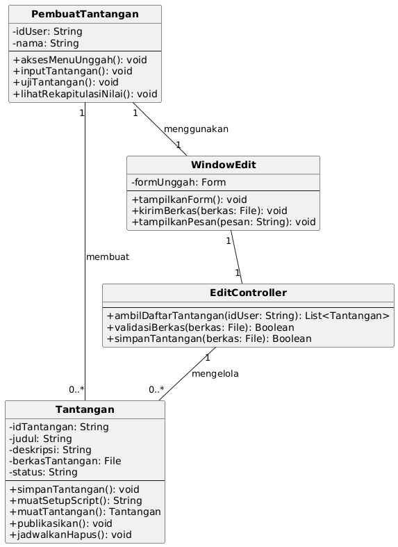
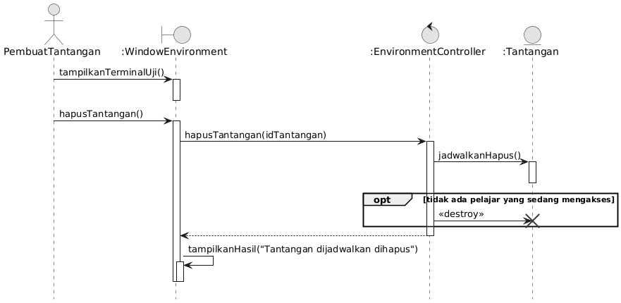
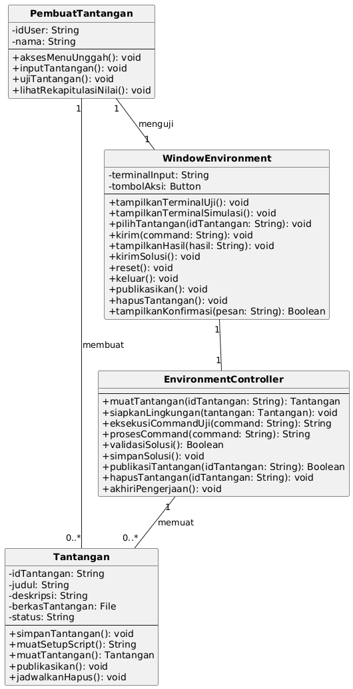
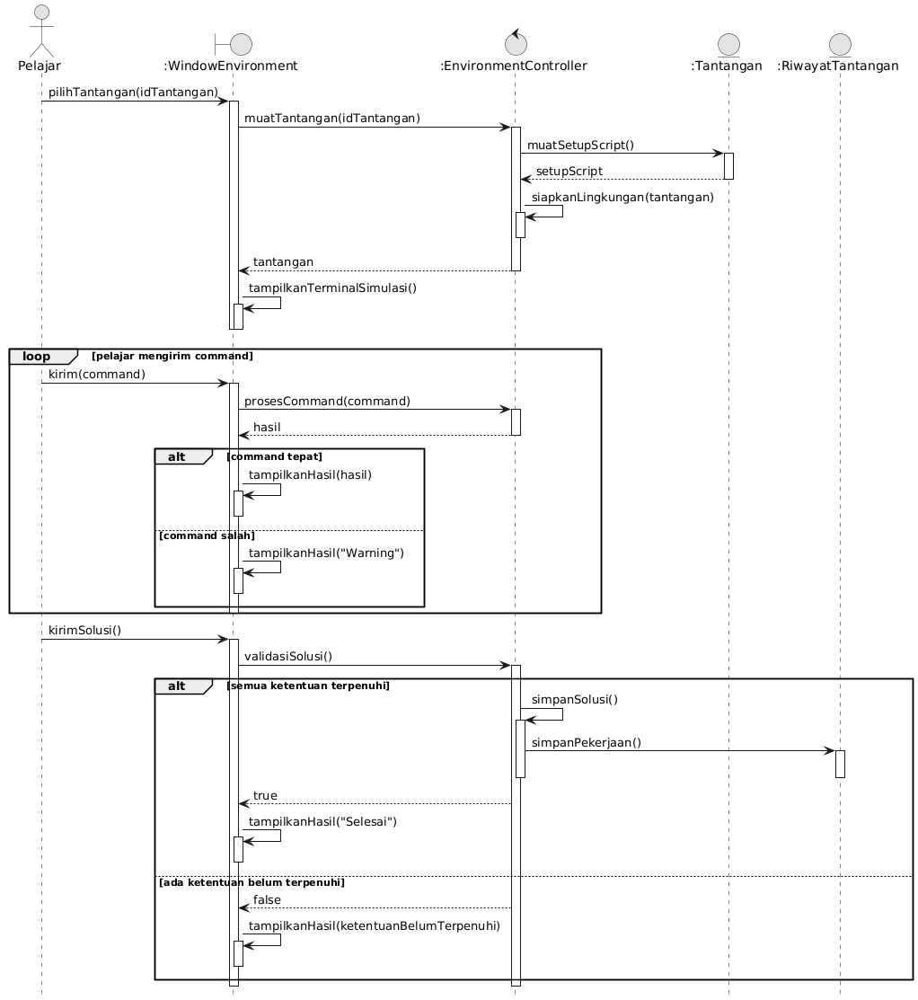
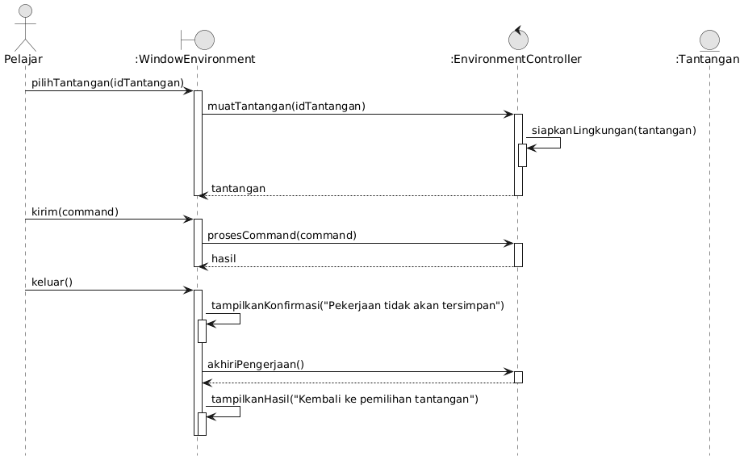
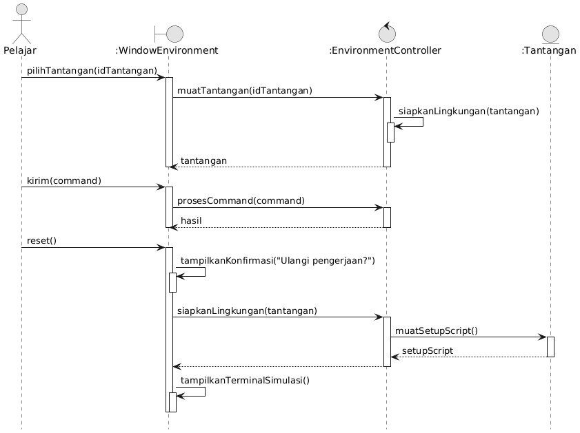
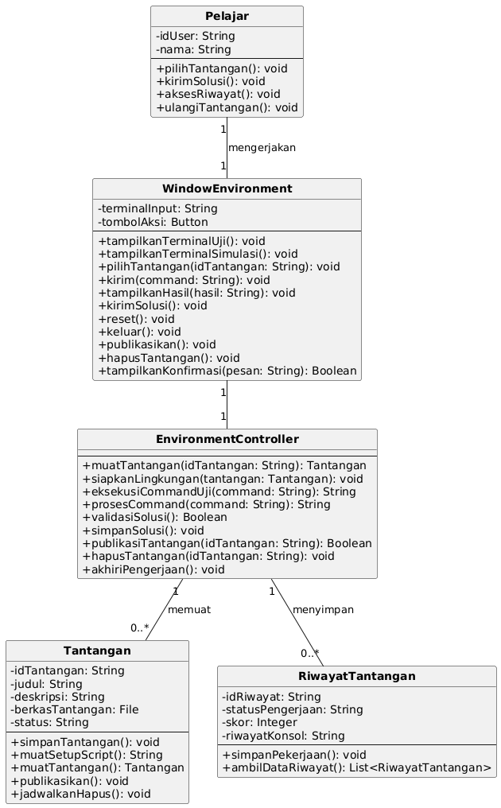
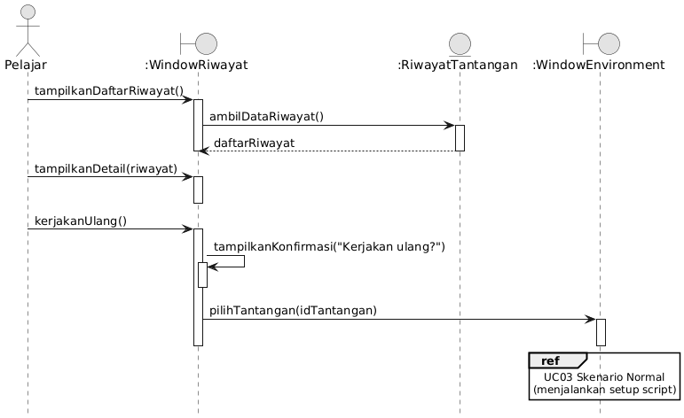
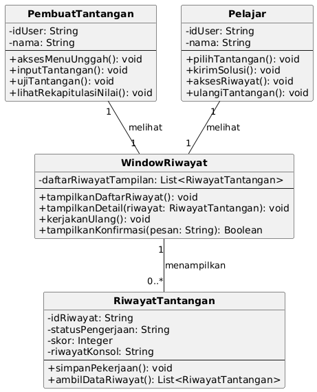
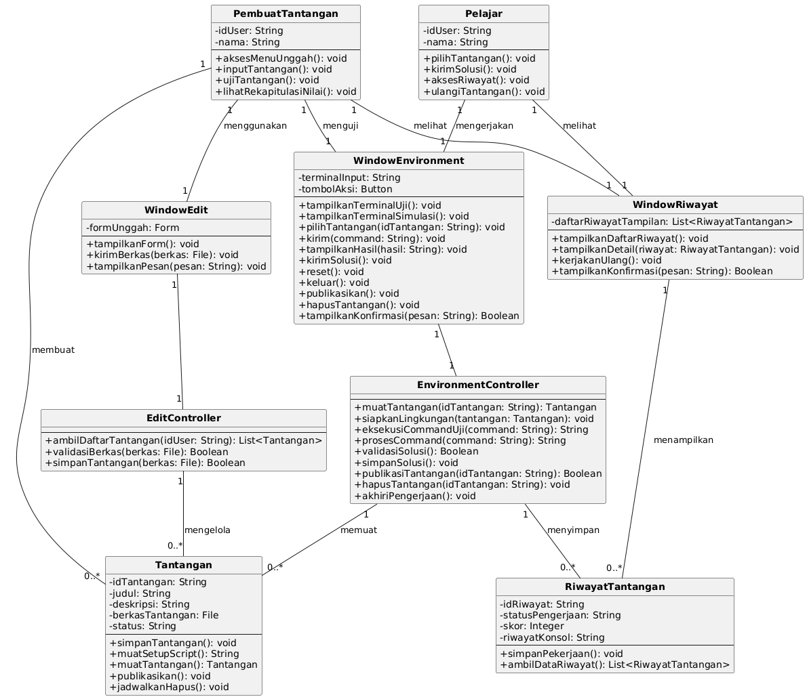

<h1>
IF2150 REKAYASA PERANGKAT LUNAK
 
TUGAS 5
 
DESKRIPSI PERANCANGAN PERANGKAT LUNAK (DPPL)
</h1>
 

## *Commitment Issues*
### *[Logo Perangkat Lunak]*

### Untuk: *Made Branenda Jordhy*

Dipersiapkan oleh:
| Informasi | Keterangan |
| --- | --- |
| Kelas | 03 |
| Kelompok | 03 |

| NIM | Nama |
|---|---|
| 13525012 | Steve Bradley Hoeij |
| 13525072 | Fahrezy Fitriansyah |
| 13525084 | Ariq Ulwan Hammam |
| 13525132 | Zidane Uland Fakhry |
| 13525135 | Ananda Aulia Nurramadhan |
| 10124063 | Dominick Vincent Devict |
---

## Daftar Perubahan

| Revisi | Deskripsi |
| :--- | :--- |
| - | - |

---

 

# BAB 1: Pendahuluan

## 1.1 Tujuan Penulisan Dokumen

Dokumen DPPL ini dibuat sebagai titik acuan atau panduan selama proses pengembangan perangkat lunak _Commitment Issues_. Dokumen ini diperuntukan para pengembang perangkat lunak _Commitment Issues_ dan semua guru, dosen, atau pengajar lainnya yang ingin menggunakan perangkat lunak _Commitment Issues_ dalam proses pengajaran Git.

## 1.2 Lingkup Masalah

Git adalah sistem kendali versi yang memungkinkan penggunanya untuk melacak perubahan pada kode dan mengatur proyek menggunakan perintah-perintah sederhana. Menurut Stack Overflow Developer Survey pada 2022 yang mengakumulasi jawaban dari 70.000 developer, 93,87% responden mengadopsi Git sebagai sistem kendali versi. _Commitment Issues_ bertujuan untuk menyediakan sarana pembelajaran interaktif yang menyimulasikan penerapan Git dalam suatu proyek yang realistis, sehingga memberikan pengalaman belajar yang lebih relevan dan mudah diterapkan bagi pelajar. Perangkat lunak ini akan berfokus untuk menguji pelajar dalam menghadapi skenario-skenario yang sering ditemukan saat menggunakan Git, contohnya penanganan konflik.

## 1.3 Definisi, Istilah, dan Singkatan

Tabel 1.3. Definisi Istilah dan Singkatan

| Singkatan, Akronim, atau Istilah | Penjelasan |
| :--- | :--- |
| *P/L* | *Singkatan dari Perangkat Lunak, yaitu aplikasi yang memberikan perintah kepada komputer untuk menjalankan tugas tertentu.* |
| *SKPL* | *Singkatan dari Spesifikasi Kebutuhan Perangkat Lunak, yaitu dokumen yang merangkum kriteria-kriteria yang diperlukan untuk membangun aplikasi menjalankan tugasnya.* |
| *APL* | *Singkatan dari Arsitektur Perangkat Lunak.* |
| *DPPL* | *Singkatan dari Deskripsi Perancangan Perangkat Lunak.* |
| *KF* | *Singkatan dari Kebutuhan Fungsional.* |
| *UC* | *Singkatan dari Use Case.* |
| *CLI* | *Singkatan dari Command Line Interface, yaitu antarmuka berbasis teks tempat pengguna mengetikkan command Git.* |
| *Sandbox* | *Lingkungan terisolasi di sisi server tempat repositori tantangan diekstrak dan command Git dijalankan dengan hak akses terbatas.* |
| *Setup/reset/verify script* | *Script di dalam arsip tantangan (`setup.sh`, `reset.sh`, `verify.sh`) untuk menyiapkan kondisi awal repositori, mengulang pengerjaan, dan memeriksa jawaban.* |
| *Boundary, Control, Entity* | *Stereotipe kelas perancangan: boundary menangani interaksi dengan pengguna, control mengatur alur use case, dan entity menyimpan informasi domain.* |
| *Sequence Diagram* | *Diagram UML yang menggambarkan urutan pesan antarobjek dalam satu skenario use case.* |

## 1.4 Aturan Penomoran

Tabel 1.4. Aturan Penomoran

| Hal/Bagian | Penomoran | Keterangan |
| :--- | :--- | :--- |
| *Kebutuhan Fungsional* | *KFXX* | KF merupakan singkatan dari kebutuhan fungsional. XX merupakan nomor urut kebutuhan fungsional, dimulai dari 01. Contoh: KF01, KF99, dan sebagainya. |
| *Use Case* | *UCXX* | UC merupakan singkatan dari use case. XX merupakan nomor urut use case yang teridentifikasi di dalam sistem, dimulai dari 01. Contoh: UC01, UC02, dan sebagainya. |
| *Kelas* | *CXX* | C merupakan singkatan dari kelas. XX merupakan nomor urut kelas yang teridentifikasi di dalam sistem, dimulai dari 01. Contoh: C01, C02, dan sebagainya. |

## 1.5 Referensi

- SKPL Commitment Issues
- APL Commitment Issues
- Chacon, S. & Straub, B. (2014). Pro Git (edisi ke-2). Apress. Tersedia di: [https://git-scm.com/book/en/v2](https://git-scm.com/book/en/v2)
- Git Practice. (t.thn.). Git Practice: Interactive Git Learning. Diakses pada 30 Agustus 2026, dari [https://git-practice.com](https://git-practice.com)
- Peter C. (t.thn.). Learn Git Branching. Diambil kembali dari [https://learngitbranching.js.org](https://learngitbranching.js.org)
- Object Management Group. (2017). Unified Modeling Language (UML) Version 2.5.1. Tersedia di: [https://www.omg.org/spec/UML/2.5.1/](https://www.omg.org/spec/UML/2.5.1/)
- PlantUML. (t.thn.). Sequence Diagram dan Class Diagram. Tersedia di: [https://plantuml.com](https://plantuml.com)

## 1.6 Deskripsi Umum Dokumen (Ikhtisar)

Dokumen ini terdiri atas lima bab. Bab 1 berisi pendahuluan, yaitu tujuan, lingkup masalah, istilah, aturan penomoran, dan referensi. Bab 2 berisi perancangan arsitektur, yaitu lingkungan implementasi, style arsitektur Client-Server yang diambil dari APL, identifikasi komponen, dan logical view. Bab 3 berisi realisasi setiap use case (UC01–UC04) dalam bentuk identifikasi kelas perancangan, sequence diagram untuk setiap skenario normal dan alternatif pada SKPL, serta diagram kelas per use case. Bab 4 berisi diagram kelas perancangan keseluruhan beserta daftar atribut dan metode setiap kelas. Bab 5 berisi matriks kerunutan yang memetakan kelas perancangan ke use case terkait.

 

---

# BAB 2: Perancangan Arsitektur

## 2.1 Rancangan Lingkungan Implementasi

Lingkungan implementasi mengikuti lingkungan operasi pada SKPL (Tabel 2.2) dan APL (Tabel 1.1).

Tabel 2.1. Rancangan Lingkungan Implementasi

| Komponen | Spesifikasi |
| :--- | :--- |
| *Operating system* | Server: NixOS 25.06. Client: lintas platform, cukup mendukung web browser Mozilla Firefox 150+. |
| *DBMS* | PostgreSQL 18, untuk data persisten: data pengguna, tantangan, riwayat pengerjaan, percobaan, nilai, dan status kelulusan. |
| *Bahasa pemrograman* | JavaScript di atas runtime NodeJS 24 LTS untuk sisi server; HTML, CSS, dan JavaScript untuk sisi client yang berjalan di web browser. |
| *Development tools* | Git 2.54.0 dan GitHub untuk kendali versi kode; Nginx sebagai server web; draw.io/StarUML dan PlantUML untuk pemodelan UML. |
| *Filing system* | Data terstruktur disimpan di PostgreSQL. Arsip tantangan (`.zip`) disimpan pada sistem berkas server (direktori arsip), lalu diekstrak ke direktori kerja Sandbox yang terpisah untuk setiap pengguna. Repositori simulasi tidak disimpan di perangkat pengguna (Batasan 4 SKPL). |

## 2.2 Style/Pattern Arsitektur Acuan

<i>Gambar 2.2. Arsitektur Client-Server</i>

Untuk P/L ini, dipilih style/pattern **Client-Server**. Style/pattern ini dipilih karena perangkat lunak ini berbasis web yang didesain digunakan banyak pengguna yang dapat saling berinteraksi, melalui pembuatan dan pengerjaan tantangan, secara sekaligus. Selain itu, proses penggunaan pelajar ataupun pembuat tantangan terbatas pada mengirimkan request berupa command Git (KF04 dan KF06) atau pembaharuan data tantangan (KF01 dan KF02) kepada server, sehingga style/pattern ini sangat cocok. 

Server bertanggung jawab untuk menjalankan setup tantangan, memproses command Git yang dikirim pengguna saat pengerjaan tantangan atau evaluasi tantangan, memeriksa validitas jawaban pelajar, memperbaharui riwayat pengerjaan, dan menyimpan perubahan tantangan.

## 2.3 Identifikasi Komponen / Modul / Subsistem

Tabel 2.3. Identifikasi Komponen/Modul/Subsistem

| Nama Komponen/Modul/Subsistem | Jenis                 | Penjelasan                                                                                                           |
| :---------------------------- | :-------------------- | :------------------------------------------------------------------------------------------------------------------- |
| *WindowEdit*                  | *Client*              | *Menyediakan antarmuka untuk membuat, mengubah, dan mengunggah berkas tantangan bagi PembuatTantangan.* |
| *WindowEnvironment*           | *Client*              | *Menyediakan antarmuka lingkungan pengerjaan dan pengujian tantangan sehingga pengguna dapat mengerjakan tantangan atau menguji tantangan.* |
| *WindowRiwayat*               | *Client*              | *Menampilkan riwayat pengerjaan, hasil, nilai, dan status kelulusan tantangan kepada Pelajar atau PembuatTantangan.* |
| *EditController*              | *Server*              | *Menangani proses dari WindowEdit, yaitu menerima unggahan berkas tantangan, memproses data tantangan, menjalankan proses setup, dan menyimpan informasi tantangan.* |
| *EnvironmentController*       | *Server*              | *Menangani proses eksekusi lingkungan tantangan, melakukan verifikasi kondisi repositori, serta memproses hasil pengerjaan pengguna.* |
| *PembuatTantangan*            | *Model*               | *Merepresentasikan data dan informasi Pembuat Tantangan yang menggunakan sistem untuk membuat, menguji, mengelola, dan memantau hasil tantangan.* |
| *Pelajar*                     | *Model*               | *Merepresentasikan data dan informasi Pelajar yang menggunakan sistem untuk memilih, mengerjakan, mengirimkan hasil, dan melihat riwayat tantangan.* |
| *Tantangan*                   | *Model*               | *Merepresentasikan data sebuah tantangan, seperti judul, deskripsi, aturan pengerjaan, berkas repositori, serta arsip yang diperlukan untuk proses setup, pengujian, dan verifikasi.* |
| *RiwayatTantangan*            | *Model*               | *Menyimpan dan merepresentasikan hasil pengerjaan tantangan, termasuk riwayat percobaan, hasil pengumpulan, nilai, dan status kelulusan Pelajar.* |
| *Database*                    | *Data*                | *Menyimpan data persisten sistem, seperti biodata pengguna, informasi tantangan, riwayat pengerjaan, hasil percobaan, nilai, dan status kelulusan.* |
| *Git*                         | *Integrasi Eksternal* | *Menyediakan mekanisme pengelolaan repositori dan eksekusi perintah Git yang digunakan dalam proses pengujian dan pengerjaan tantangan.* |
| *Sandbox*                     | *Integrasi Eksternal* | *Menyediakan lingkungan terisolasi di sisi server untuk menyimpan dan menjalankan repositori tantangan sehingga repositori simulasi tidak disimpan pada perangkat pengguna dan proses eksekusi dapat dibatasi.* |

## 2.4 Model Arsitektur Perangkat Lunak

### 2.4.1 Logical View

Logical view digunakan untuk menggambarkan struktur logis perangkat lunak ini. View ini dipilih karena dapat memperlihatkan pemisahan tanggung jawab antara sisi client dan server.

<i>Gambar 2.4. Logical View Sistem</i>

 

---

# BAB 3: Realisasi Use Case

Kelas perancangan pada bab ini mengikuti sembilan kelas analisis pada SKPL (C01–C09) dengan nama yang sama. Pada tahap perancangan, setiap atribut dan operasi dilengkapi visibilitas, parameter, dan tipe data, serta ditambahkan beberapa operasi yang diperlukan oleh skenario use case. Kelas *Window* berperan sebagai *boundary* (sisi client), kelas *Controller* sebagai *control* (sisi server), dan kelas lainnya sebagai *entity*.

## 3.1 Use Case Mengembangkan Tantangan

**ID Use Case:** *UC01*  
**Nama Use Case:** *Mengembangkan Tantangan*

### 3.1.1 Identifikasi Kelas

Tabel 3.1. Identifikasi Kelas Use Case UC01

| No | Nama Kelas Perancangan | Nama Kelas Analisis Terkait |
|:--- | :--- | :--- |
| 1 | PembuatTantangan | C01 - PembuatTantangan |
| 2 | WindowEdit | C04 - WindowEdit |
| 3 | EditController | C05 - EditController |
| 4 | Tantangan | C03 - Tantangan |

### 3.1.2 Sequence Diagram

- **Skenario Normal**

<i>Gambar 3.1.2.1. Sequence Diagram UC01</i>

- **Skenario Alternatif 1: Berkas Tantangan Gagal Diproses**

<i>Gambar 3.1.2.2. Sequence Diagram UC01 - Berkas Tantangan Gagal Diproses</i>

### 3.1.3 Diagram Kelas

<i>Gambar 3.1.3. Diagram Kelas Mengembangkan Tantangan</i>

## 3.2 Use Case Mengevaluasi Tantangan

**ID Use Case:** *UC02*  
**Nama Use Case:** *Mengevaluasi Tantangan*

### 3.2.1 Identifikasi Kelas

Tabel 3.2. Identifikasi Kelas Use Case UC02

| No | Nama Kelas Perancangan | Nama Kelas Analisis Terkait |
|:--- | :--- | :--- |
| 1 | PembuatTantangan | C01 - PembuatTantangan |
| 2 | WindowEnvironment | C06 - WindowEnvironment |
| 3 | EnvironmentController | C07 - EnvironmentController |
| 4 | Tantangan | C03 - Tantangan |

### 3.2.2 Sequence Diagram

- **Skenario Normal**

<i>Gambar 3.2.2.1. Sequence Diagram UC02</i>

- **Skenario Alternatif 1: Mengubah Tantangan yang Sudah Dipublikasikan**

<i>Gambar 3.2.2.2. Sequence Diagram UC02 - Mengubah Tantangan yang Sudah Dipublikasikan</i>

- **Skenario Alternatif 2: Menghapus Tantangan yang Sudah Dipublikasikan**

<i>Gambar 3.2.2.3. Sequence Diagram UC02 - Menghapus Tantangan yang Sudah Dipublikasikan</i>

### 3.2.3 Diagram Kelas

<i>Gambar 3.2.3. Diagram Kelas Mengevaluasi Tantangan</i>

## 3.3 Use Case Mengerjakan Tantangan

**ID Use Case:** *UC03*  
**Nama Use Case:** *Mengerjakan Tantangan*

### 3.3.1 Identifikasi Kelas

Tabel 3.3. Identifikasi Kelas Use Case UC03

| No | Nama Kelas Perancangan | Nama Kelas Analisis Terkait |
|:--- | :--- | :--- |
| 1 | Pelajar | C02 - Pelajar |
| 2 | WindowEnvironment | C06 - WindowEnvironment |
| 3 | EnvironmentController | C07 - EnvironmentController |
| 4 | Tantangan | C03 - Tantangan |
| 5 | RiwayatTantangan | C09 - RiwayatTantangan |

### 3.3.2 Sequence Diagram

- **Skenario Normal**

<i>Gambar 3.3.2.1. Sequence Diagram UC03</i>

- **Skenario Alternatif 1: Pelajar Keluar di Tengah Pengerjaan**

<i>Gambar 3.3.2.2. Sequence Diagram UC03 - Pelajar Keluar di Tengah Pengerjaan</i>

- **Skenario Alternatif 2: Pelajar Mengulang Pengerjaan**

<i>Gambar 3.3.2.3. Sequence Diagram UC03 - Pelajar Mengulang Pengerjaan</i>

### 3.3.3 Diagram Kelas

<i>Gambar 3.3.3. Diagram Kelas Mengerjakan Tantangan</i>

## 3.4 Use Case Cek Riwayat

**ID Use Case:** *UC04*  
**Nama Use Case:** *Cek Riwayat*

### 3.4.1 Identifikasi Kelas

Tabel 3.4. Identifikasi Kelas Use Case UC04

| No | Nama Kelas Perancangan | Nama Kelas Analisis Terkait |
|:--- | :--- | :--- |
| 1 | PembuatTantangan | C01 - PembuatTantangan |
| 2 | Pelajar | C02 - Pelajar |
| 3 | WindowRiwayat | C08 - WindowRiwayat |
| 4 | RiwayatTantangan | C09 - RiwayatTantangan |
| 5 | WindowEnvironment | C06 - WindowEnvironment (alternatif 1) |

### 3.4.2 Sequence Diagram

- **Skenario Normal**

<i>Gambar 3.4.2.1. Sequence Diagram UC04</i>

- **Skenario Alternatif 1: Pelajar Mengulang Tantangan**

<i>Gambar 3.4.2.2. Sequence Diagram UC04 - Pelajar Mengulang Tantangan</i>

### 3.4.3 Diagram Kelas

<i>Gambar 3.4.3. Diagram Kelas Cek Riwayat</i>

 

---

# BAB 4: Diagram Kelas Keseluruhan

<i>Gambar 4.1. Diagram Kelas Perancangan Keseluruhan Commitment Issues</i>

Atribut `status` pada Tantangan bernilai `DRAF`, `TERPUBLIKASI`, atau `DIJADWALKAN_HAPUS`.

Tabel 4.1. Daftar Kelas Perancangan Keseluruhan

| ID Kelas | Nama Kelas | Atribut | Metode/Operasi |
| :--- | :--- | :--- | :--- |
| C01 | PembuatTantangan | - idUser: String - nama: String | + aksesMenuUnggah(): void + inputTantangan(): void + ujiTantangan(): void + lihatRekapitulasiNilai(): void |
| C02 | Pelajar | - idUser: String - nama: String | + pilihTantangan(): void + kirimSolusi(): void + aksesRiwayat(): void + ulangiTantangan(): void |
| C03 | Tantangan | - idTantangan: String - judul: String - deskripsi: String - berkasTantangan: File - status: String | + simpanTantangan(): void + muatSetupScript(): String + muatTantangan(): Tantangan + publikasikan(): void + jadwalkanHapus(): void |
| C04 | WindowEdit | - formUnggah: Form | + tampilkanForm(): void + kirimBerkas(berkas: File): void + tampilkanPesan(pesan: String): void |
| C05 | EditController | - | + ambilDaftarTantangan(idUser: String): List&lt;Tantangan&gt; + validasiBerkas(berkas: File): Boolean + simpanTantangan(berkas: File): Boolean |
| C06 | WindowEnvironment | - terminalInput: String - tombolAksi: Button | + tampilkanTerminalUji(): void + tampilkanTerminalSimulasi(): void + pilihTantangan(idTantangan: String): void + kirim(command: String): void + tampilkanHasil(hasil: String): void + kirimSolusi(): void + reset(): void + keluar(): void + publikasikan(): void + hapusTantangan(): void + tampilkanKonfirmasi(pesan: String): Boolean |
| C07 | EnvironmentController | - | + muatTantangan(idTantangan: String): Tantangan + siapkanLingkungan(tantangan: Tantangan): void + eksekusiCommandUji(command: String): String + prosesCommand(command: String): String + validasiSolusi(): Boolean + simpanSolusi(): void + publikasiTantangan(idTantangan: String): Boolean + hapusTantangan(idTantangan: String): void + akhiriPengerjaan(): void |
| C08 | WindowRiwayat | - daftarRiwayatTampilan: List&lt;RiwayatTantangan&gt; | + tampilkanDaftarRiwayat(): void + tampilkanDetail(riwayat: RiwayatTantangan): void + kerjakanUlang(): void + tampilkanKonfirmasi(pesan: String): Boolean |
| C09 | RiwayatTantangan | - idRiwayat: String - statusPengerjaan: String - skor: Integer - riwayatKonsol: String | + simpanPekerjaan(): void + ambilDataRiwayat(): List&lt;RiwayatTantangan&gt; |

 

---

# BAB 5: Matriks Kerunutan

Matriks berikut mengacu pada Tabel 6.1 SKPL dan disesuaikan dengan realisasi use case pada BAB 3.

Tabel 5.1. Matriks Kerunutan Kelas terhadap Use Case

| Kelas | Use Case Terkait |
| :--- | :--- |
| C01 - PembuatTantangan | UC01 - Mengembangkan Tantangan, UC02 - Mengevaluasi Tantangan, UC04 - Cek Riwayat |
| C02 - Pelajar | UC03 - Mengerjakan Tantangan, UC04 - Cek Riwayat |
| C03 - Tantangan | UC01 - Mengembangkan Tantangan, UC02 - Mengevaluasi Tantangan, UC03 - Mengerjakan Tantangan |
| C04 - WindowEdit | UC01 - Mengembangkan Tantangan |
| C05 - EditController | UC01 - Mengembangkan Tantangan |
| C06 - WindowEnvironment | UC02 - Mengevaluasi Tantangan, UC03 - Mengerjakan Tantangan, UC04 - Cek Riwayat |
| C07 - EnvironmentController | UC02 - Mengevaluasi Tantangan, UC03 - Mengerjakan Tantangan |
| C08 - WindowRiwayat | UC04 - Cek Riwayat |
| C09 - RiwayatTantangan | UC03 - Mengerjakan Tantangan, UC04 - Cek Riwayat |
