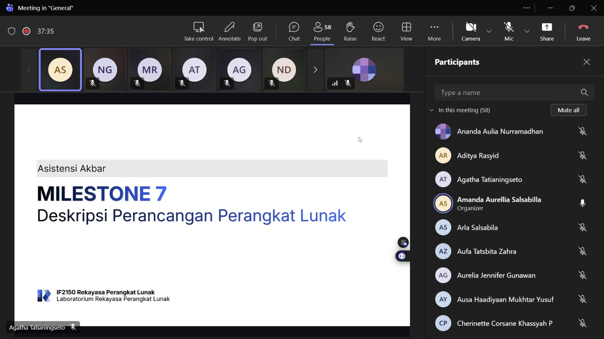

# Form Asistensi

## Tugas Besar IF2150 - Rekayasa Perangkat Lunak

| Informasi | Keterangan |
| --- | --- |
| **Hari** | Jumat |
| **Tanggal** | 09/10/2026 |
| **Kelas** | 03 |
| **Nomor Kelompok** | 03 |
| **Nama Kelompok** | 0x43 |
| **Nama Perangkat Lunak** | Commitment Issues  |
| **Dokumen** | K03_G03_DPPL.md |

### Anggota Kelompok

| NIM | Nama |
| --- | --- |
| 13525012 | Steve Bradley Hoeij |
| 13525072 | Fahrezy Fitriansyah |
| 13525084 | Ariq Ulwan Hammam |
| 13525132 | Zidane Uland Fakhry |
| 13525135 | Ananda Aulia Nurramadhan |
| 10124063 | Dominick Vincent Devict |

### Catatan

| Catatan |
| --- |
| 1. Enkapsulasi atribut ataupun metode dapat diisi dengan nilai _public_ (+), _private_ (-), atau _protected_ (#). |
| 2. Jenis _message_ dalam _sequence diagram_ mencakup: <ul><li>_Synchronous message_, pesan yang membuat pengirim menunggu balasan (return/reply message) dari penerima.</li><li>_Asynchronous message_, pesan yang tidak membuat pengirim menunggu balasan dari penerima sebelum melanjutkan proses lain.</li><li>_Return/reply message_, pesan yang mengembalikan hasil atau data.</li><li>_Create message_, pesan yang membuat objek baru (biasa diberi label `<<create>>`).</li><li>_Destroy/delete message_, pesan yang mengakhiri keberadaan objek, diberi label `<<destroy>>` dan diakhiri dengan tanda X di ujung _lifeline_ objek.</li><li>_Self message_, pesan yang dikirim objek kepada dirinya sendiri.</li><li>_Recursive message_, pesan yang dikirim objek kepada dirinya sendiri demi memanggil operasi yang sama dengan dirinya sendiri (biasa digambar dengan _activation bar_ yang menumpuk).</li><li>_Found message_, pesan yang pengirimnya tidak diketahui/ditampilkan.</li><li>_Lost message_, kebalikan dari _found message_, pesan yang pengirimnya tidak diketahui.</li><li>_Guard_, kondisi _boolean_ (dalam kurung siku) yang menentukan apakah pesan atau fragmen boleh dijalankan atau tidak.</li></ul> |
| 3. Jenis operator fragmen dalam _sequence diagram_ mencakup: <ul><li>_Alternative_ (`alt`), fragmen yang dijalankan ketika memenuhi guard, serupa dengan klausa if-else.</li><li>_Optional_ (`opt`) fragmen yang hanya dijalankan jika guard benar, setara dengan `alt` yang satu jalur (klausa if).</li><li>_Parallel_ (`par`), fragmen yang menjalankan semua proses yang tercakup secara simultan.</li><li>_Loop_ (`loop`), fragmen yang dijalankan secara berulang berdasarkan _guard_.</li><li>_Critical_ (`critical`), fragmen yang hanya memperbolehkan satu proses terjadi dalam satu waktu. (Fragmen ini digunakan untuk proses yang tidak dapat diinterupsi.)</li><li>_Negative_ (`neg`), fragmen yang menunjukkan interaksi tidak valid.</li><li>_Reference_ (`ref`), fragmen yang merujuk interaksi yang sudah didefinisikan di diagram lain, sesuai dengan nama interaksi tersebut di _sequence diagram_ yang berkoresponden.</li></ul> |
| 4. Setiap _sequence diagram_ untuk suatu _use case_ sudah mencakup skenario normal dan alternatif, namun jika satu diagram tidak muat semua skenario, diagram boleh dipisah. |

## Dokumentasi

<!--  -->

  

  <i>Gambar 1. Dokumentasi kegiatan asistensi.</i>

