<h1>
IF2150 REKAYASA PERANGKAT LUNAK
<br>
TUGAS 5
<br>
DESKRIPSI PERANCANGAN PERANGKAT LUNAK (DPPL)
</h1>
<br>

## *Commitment Issues*


### Untuk: *Made Branenda Jordhy*

Dipersiapkan oleh:
| Informasi | Keterangan |
| --- | --- |
| Kelas | 03 |
| Kelompok | 03 |

| NIM | Nama |
|---|---|
| 13525012 | Steve Bradley Hoeij |
| 13525072 | Fahrezy Fitriansyah |
| 13525084 | Ariq Ulwan Hammam |
| 13525132 | Zidane Uland Fakhry |
| 13525135 | Ananda Aulia Nurramadhan |
| 10124063 | Dominick Vincent Devict |
---

## Daftar Perubahan

| Revisi | Deskripsi |
| :--- | :--- |
| - | - |

---

<br>

---


# BAB 1: Pendahuluan

## 1.1 Tujuan Penulisan Dokumen

Dokumen DPPL ini dibuat sebagai titik acuan atau panduan selama proses pengembangan perangkat lunak _Commitment Issues_. Dokumen ini diperuntukan para pengembang perangkat lunak _Commitment Issues_ dan semua guru, dosen, atau pengajar lainnya yang ingin menggunakan perangkat lunak _Commitment Issues_ dalam proses pengajaran Git.

## 1.2 Lingkup Masalah

Git adalah sistem kendali versi yang memungkinkan penggunanya untuk melacak perubahan pada kode dan mengatur proyek menggunakan perintah-perintah sederhana. Menurut Stack Overflow Developer Survey pada 2022 yang mengakumulasi jawaban dari 70.000 developer, 93,87% responden mengadopsi Git sebagai sistem kendali versi. _Commitment Issues_ bertujuan untuk menyediakan sarana pembelajaran interaktif yang menyimulasikan penerapan Git dalam suatu proyek yang realistis, sehingga memberikan pengalaman belajar yang lebih relevan dan mudah diterapkan bagi pelajar. Perangkat lunak ini akan berfokus untuk menguji pelajar dalam menghadapi skenario-skenario yang sering ditemukan saat menggunakan Git, contohnya penanganan konflik.

## 1.3 Definisi, Istilah, dan Singkatan

Tabel 1.3. Definisi Istilah dan Singkatan

| Singkatan, Akronim, atau Istilah | Penjelasan |
| :--- | :--- |
| *P/L* | *Singkatan dari Perangkat Lunak, yaitu aplikasi yang memberikan perintah kepada komputer untuk menjalankan tugas tertentu.* |
| *SKPL* | *Singkatan dari Spesifikasi Kebutuhan Perangkat Lunak, yaitu dokumen yang merangkum kriteria-kriteria yang diperlukan untuk membangun aplikasi menjalankan tugasnya.* |
| *APL* | *Singkatan dari Arsitektur Perangkat Lunak.* |
| *DPPL* | *Singkatan dari Deskripsi Perancangan Perangkat Lunak.* |
| *KF* | *Singkatan dari Kebutuhan Fungsional.* |
| *UC* | *Singkatan dari Use Case.* |
| *CLI* | *Singkatan dari Command Line Interface, yaitu antarmuka berbasis teks tempat pengguna mengetikkan command Git.* |
| *Sandbox* | *Lingkungan terisolasi di sisi server tempat repositori tantangan diekstrak dan command Git dijalankan dengan hak akses terbatas.* |
| *Setup/reset/verify script* | *Script di dalam arsip tantangan (`setup.sh`, `reset.sh`, `verify.sh`) untuk menyiapkan kondisi awal repositori, mengulang pengerjaan, dan memeriksa jawaban.* |
| *Boundary, Control, Entity* | *Stereotipe kelas perancangan: boundary menangani interaksi dengan pengguna, control mengatur alur use case, dan entity menyimpan informasi domain.* |
| *Sequence Diagram* | *Diagram UML yang menggambarkan urutan pesan antarobjek dalam satu skenario use case.* |

## 1.4 Aturan Penomoran

Tabel 1.4. Aturan Penomoran

| Hal/Bagian | Penomoran | Keterangan |
| :--- | :--- | :--- |
| *Kebutuhan Fungsional* | *KFXX* | KF merupakan singkatan dari kebutuhan fungsional. XX merupakan nomor urut kebutuhan fungsional, dimulai dari 01. Contoh: KF01, KF99, dan sebagainya. |
| *Use Case* | *UCXX* | UC merupakan singkatan dari use case. XX merupakan nomor urut use case yang teridentifikasi di dalam sistem, dimulai dari 01. Contoh: UC01, UC02, dan sebagainya. |
| *Kelas* | *CXX* | C merupakan singkatan dari kelas. XX merupakan nomor urut kelas yang teridentifikasi di dalam sistem, dimulai dari 01. Contoh: C01, C02, dan sebagainya. |

## 1.5 Referensi

- SKPL Commitment Issues
- APL Commitment Issues
- Chacon, S. & Straub, B. (2014). Pro Git (edisi ke-2). Apress. Tersedia di: [https://git-scm.com/book/en/v2](https://git-scm.com/book/en/v2)
- Git Practice. (t.thn.). Git Practice: Interactive Git Learning. Diakses pada 30 Agustus 2026, dari [https://git-practice.com](https://git-practice.com)
- Peter C. (t.thn.). Learn Git Branching. Diambil kembali dari [https://learngitbranching.js.org](https://learngitbranching.js.org)
- Object Management Group. (2017). Unified Modeling Language (UML) Version 2.5.1. Tersedia di: [https://www.omg.org/spec/UML/2.5.1/](https://www.omg.org/spec/UML/2.5.1/)
- PlantUML. (t.thn.). Sequence Diagram dan Class Diagram. Tersedia di: [https://plantuml.com](https://plantuml.com)

## 1.6 Deskripsi Umum Dokumen (Ikhtisar)
> Tuliskan sistematika pembahasan dokumen ini secara ringkas dan runut, dengan maksimal 1 paragraf.

<br>

---

# BAB 2: Perancangan Arsitektur

## 2.1 Rancangan Lingkungan Implementasi

Lingkungan implementasi mengikuti lingkungan operasi pada SKPL (Tabel 2.2) dan APL (Tabel 1.1).

Tabel 2.1. Rancangan Lingkungan Implementasi

| Komponen | Spesifikasi |
| :--- | :--- |
| *Operating system* | Server: NixOS 25.06. Client: lintas platform, cukup mendukung web browser Mozilla Firefox 150+. |
| *DBMS* | PostgreSQL 18, untuk data persisten: data pengguna, tantangan, riwayat pengerjaan, percobaan, nilai, dan status kelulusan. |
| *Bahasa pemrograman* | JavaScript di atas runtime NodeJS 24 LTS untuk sisi server; HTML, CSS, dan JavaScript untuk sisi client yang berjalan di web browser. |
| *Development tools* | Git 2.54.0 dan GitHub untuk kendali versi kode; Nginx sebagai server web; draw.io/StarUML dan PlantUML untuk pemodelan UML. |
| *Filing system* | Data terstruktur disimpan di PostgreSQL. Arsip tantangan (`.zip`) disimpan pada sistem berkas server (direktori arsip), lalu diekstrak ke direktori kerja Sandbox yang terpisah untuk setiap pengguna. Repositori simulasi tidak disimpan di perangkat pengguna (Batasan 4 SKPL). |

## 2.2 Style/Pattern Arsitektur Acuan

<p align="center">
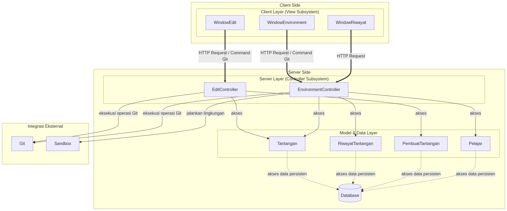
</p>
<p align="center">
<i>Gambar 2.2. Arsitektur Client-Server</i>
</p>

Untuk P/L ini, dipilih style/pattern **Client-Server**. Style/pattern ini dipilih karena perangkat lunak ini berbasis web yang didesain digunakan banyak pengguna yang dapat saling berinteraksi, melalui pembuatan dan pengerjaan tantangan, secara sekaligus. Selain itu, proses penggunaan pelajar ataupun pembuat tantangan terbatas pada mengirimkan request berupa command Git (KF04 dan KF06) atau pembaharuan data tantangan (KF01 dan KF02) kepada server, sehingga style/pattern ini sangat cocok. 

Server bertanggung jawab untuk menjalankan setup tantangan, memproses command Git yang dikirim pengguna saat pengerjaan tantangan atau evaluasi tantangan, memeriksa validitas jawaban pelajar, memperbaharui riwayat pengerjaan, dan menyimpan perubahan tantangan.

## 2.3 Identifikasi Komponen / Modul / Subsistem

Tabel 2.3. Identifikasi Komponen/Modul/Subsistem

| Nama Komponen/Modul/Subsistem | Jenis                 | Penjelasan                                                                                                           |
| :---------------------------- | :-------------------- | :------------------------------------------------------------------------------------------------------------------- |
| *WindowEdit*                  | *Client*              | *Menyediakan antarmuka untuk membuat, mengubah, dan mengunggah berkas tantangan bagi PembuatTantangan.* |
| *WindowEnvironment*           | *Client*              | *Menyediakan antarmuka lingkungan pengerjaan dan pengujian tantangan sehingga pengguna dapat mengerjakan tantangan atau menguji tantangan.* |
| *WindowRiwayat*               | *Client*              | *Menampilkan riwayat pengerjaan, hasil, nilai, dan status kelulusan tantangan kepada Pelajar atau PembuatTantangan.* |
| *EditController*              | *Server*              | *Menangani proses dari WindowEdit, yaitu menerima unggahan berkas tantangan, memproses data tantangan, menjalankan proses setup, dan menyimpan informasi tantangan.* |
| *EnvironmentController*       | *Server*              | *Menangani proses eksekusi lingkungan tantangan, melakukan verifikasi kondisi repositori, serta memproses hasil pengerjaan pengguna.* |
| *PembuatTantangan*            | *Model*               | *Merepresentasikan data dan informasi Pembuat Tantangan yang menggunakan sistem untuk membuat, menguji, mengelola, dan memantau hasil tantangan.* |
| *Pelajar*                     | *Model*               | *Merepresentasikan data dan informasi Pelajar yang menggunakan sistem untuk memilih, mengerjakan, mengirimkan hasil, dan melihat riwayat tantangan.* |
| *Tantangan*                   | *Model*               | *Merepresentasikan data sebuah tantangan, seperti judul, deskripsi, aturan pengerjaan, berkas repositori, serta arsip yang diperlukan untuk proses setup, pengujian, dan verifikasi.* |
| *RiwayatTantangan*            | *Model*               | *Menyimpan dan merepresentasikan hasil pengerjaan tantangan, termasuk riwayat percobaan, hasil pengumpulan, nilai, dan status kelulusan Pelajar.* |
| *Database*                    | *Data*                | *Menyimpan data persisten sistem, seperti biodata pengguna, informasi tantangan, riwayat pengerjaan, hasil percobaan, nilai, dan status kelulusan.* |
| *Git*                         | *Integrasi Eksternal* | *Menyediakan mekanisme pengelolaan repositori dan eksekusi perintah Git yang digunakan dalam proses pengujian dan pengerjaan tantangan.* |
| *Sandbox*                     | *Integrasi Eksternal* | *Menyediakan lingkungan terisolasi di sisi server untuk menyimpan dan menjalankan repositori tantangan sehingga repositori simulasi tidak disimpan pada perangkat pengguna dan proses eksekusi dapat dibatasi.* |

## 2.4 Model Arsitektur Perangkat Lunak

### 2.4.1 Logical View

Logical view digunakan untuk menggambarkan struktur logis perangkat lunak ini. View ini dipilih karena dapat memperlihatkan pemisahan tanggung jawab antara sisi client dan server.

<p align="center">
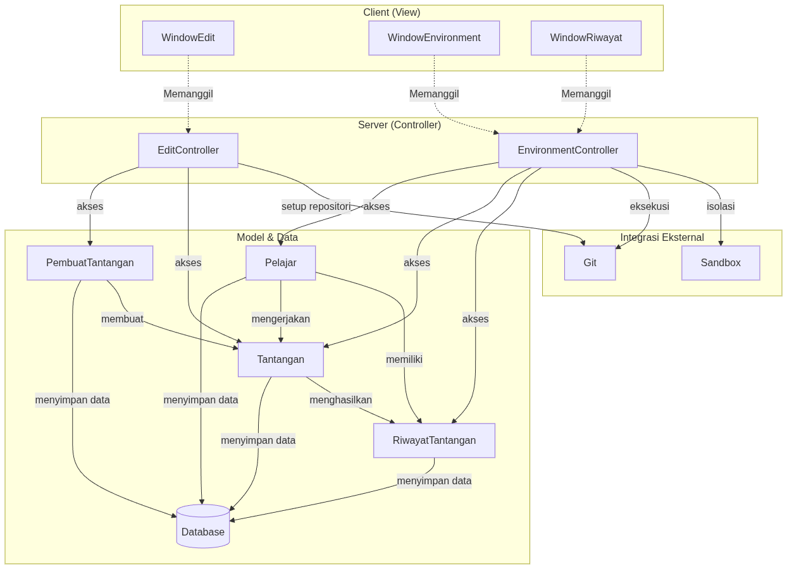
</p>
<p align="center">
<i>Gambar 2.4. Logical View Sistem</i>
</p>

<br>

---


# BAB 3: Realisasi Use Case

Kelas perancangan pada bab ini mengikuti sembilan kelas analisis pada SKPL (C01–C09) dengan nama yang sama. Pada tahap perancangan, setiap atribut dan operasi dilengkapi visibilitas, parameter, dan tipe data, serta ditambahkan beberapa operasi yang diperlukan oleh skenario use case. Kelas *Window* berperan sebagai *boundary* (sisi client), kelas *Controller* sebagai *control* (sisi server), dan kelas lainnya sebagai *entity*.

## 3.1 Use Case Mengembangkan Tantangan

**ID Use Case:** *UC01*  
**Nama Use Case:** *Mengembangkan Tantangan*

### 3.1.1 Identifikasi Kelas

Tabel 3.1. Identifikasi Kelas Use Case UC01

| No | Nama Kelas Perancangan | Nama Kelas Analisis Terkait |
|:--- | :--- | :--- |
| 1 | PembuatTantangan | C01 - PembuatTantangan |
| 2 | WindowEdit | C04 - WindowEdit |
| 3 | EditController | C05 - EditController |
| 4 | Tantangan | C03 - Tantangan |

### 3.1.2 Sequence Diagram

- **Skenario Normal**

<p align="center">
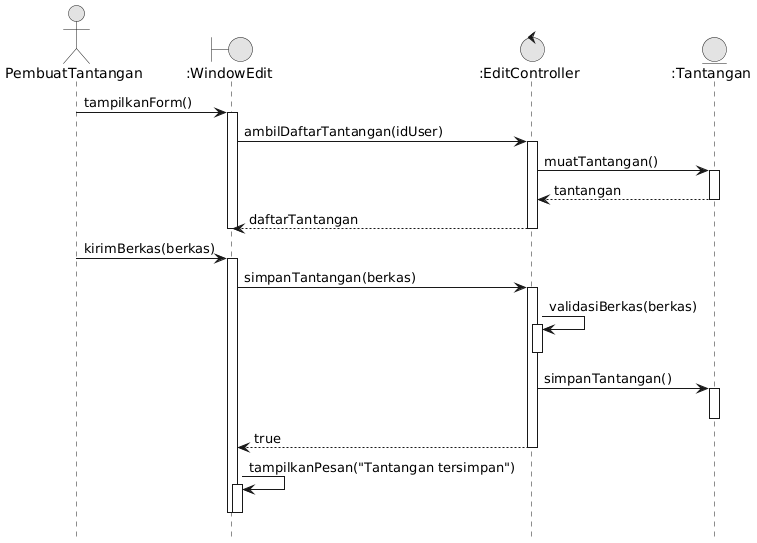
</p>
<p align="center">
<i>Gambar 3.1.2.1. Sequence Diagram UC01</i>
</p>

- **Skenario Alternatif 1: Berkas Tantangan Gagal Diproses**

<p align="center">
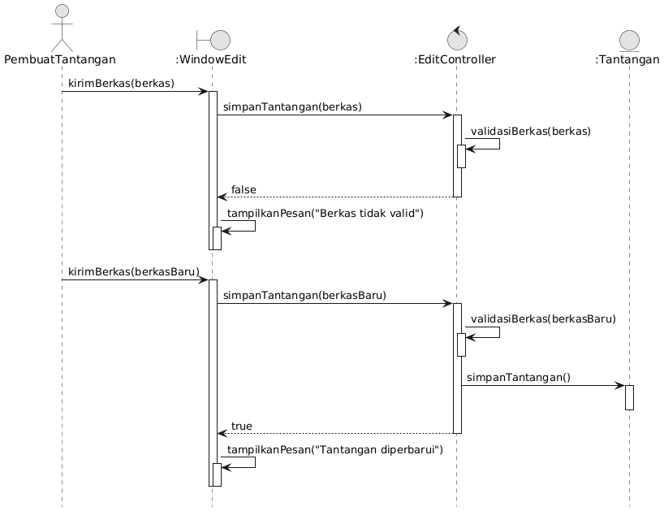
</p>
<p align="center">
<i>Gambar 3.1.2.2. Sequence Diagram UC01 - Berkas Tantangan Gagal Diproses</i>
</p>

### 3.1.3 Diagram Kelas

<p align="center">

</p>
<p align="center">
<i>Gambar 3.1.3. Diagram Kelas Mengembangkan Tantangan</i>
</p>

## 3.2 Use Case Mengevaluasi Tantangan

**ID Use Case:** *UC02*  
**Nama Use Case:** *Mengevaluasi Tantangan*

### 3.2.1 Identifikasi Kelas

Tabel 3.2. Identifikasi Kelas Use Case UC02

| No | Nama Kelas Perancangan | Nama Kelas Analisis Terkait |
|:--- | :--- | :--- |
| 1 | PembuatTantangan | C01 - PembuatTantangan |
| 2 | WindowEnvironment | C06 - WindowEnvironment |
| 3 | EnvironmentController | C07 - EnvironmentController |
| 4 | Tantangan | C03 - Tantangan |

### 3.2.2 Sequence Diagram

- **Skenario Normal, Alternatif 1 (Mengubah Tantangan yang Sudah Dipublikasikan), dan Alternatif 2 (Menghapus Tantangan yang Sudah Dipublikasikan)**

<p align="center">
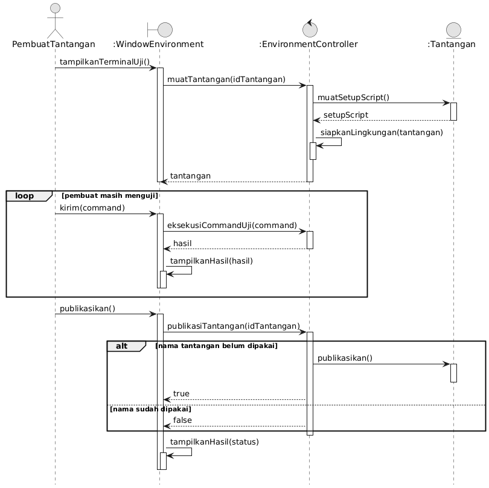
</p>
<p align="center">
<i>Gambar 3.2.2.1. Sequence Diagram UC02</i>
</p>

- **Skenario Alternatif 1: Mengubah Tantangan yang Sudah Dipublikasikan**

<p align="center">
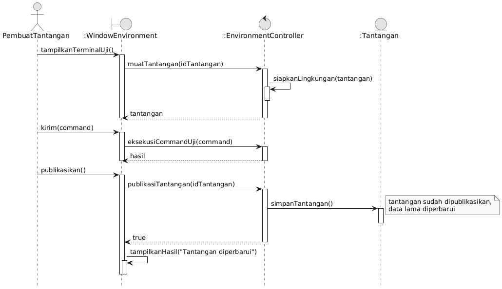
</p>
<p align="center">
<i>Gambar 3.2.2.2. Sequence Diagram UC02 - Mengubah Tantangan yang Sudah Dipublikasikan</i>
</p>

- **Skenario Alternatif 2: Menghapus Tantangan yang Sudah Dipublikasikan**

<p align="center">

</p>
<p align="center">
<i>Gambar 3.2.2.3. Sequence Diagram UC02 - Menghapus Tantangan yang Sudah Dipublikasikan</i>
</p>

### 3.2.3 Diagram Kelas

<p align="center">
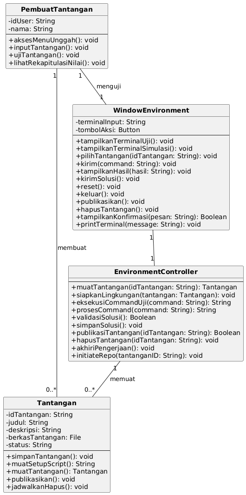
</p>
<p align="center">
<i>Gambar 3.2.3. Diagram Kelas Mengevaluasi Tantangan</i>
</p>

## 3.3 Use Case Mengerjakan Tantangan

**ID Use Case:** *UC03*  
**Nama Use Case:** *Mengerjakan Tantangan*

### 3.3.1 Identifikasi Kelas

Tabel 3.3. Identifikasi Kelas Use Case UC03

| No | Nama Kelas Perancangan | Nama Kelas Analisis Terkait |
|:--- | :--- | :--- |
| 1 | Pelajar | C02 - Pelajar |
| 2 | WindowEnvironment | C06 - WindowEnvironment |
| 3 | EnvironmentController | C07 - EnvironmentController |
| 4 | Tantangan | C03 - Tantangan |
| 5 | RiwayatTantangan | C09 - RiwayatTantangan |

### 3.3.2 Sequence Diagram

- **Skenario Normal**

<p align="center">

</p>
<p align="center">
<i>Gambar 3.3.2.1. Sequence Diagram UC03</i>
</p>

- **Skenario Alternatif 1: Pelajar Keluar di Tengah Pengerjaan**

<p align="center">

</p>
<p align="center">
<i>Gambar 3.3.2.2. Sequence Diagram UC03 - Pelajar Keluar di Tengah Pengerjaan</i>
</p>

- **Skenario Alternatif 2: Pelajar Mengulang Pengerjaan**

<p align="center">

</p>
<p align="center">
<i>Gambar 3.3.2.3. Sequence Diagram UC03 - Pelajar Mengulang Pengerjaan</i>
</p>

### 3.3.3 Diagram Kelas

<p align="center">
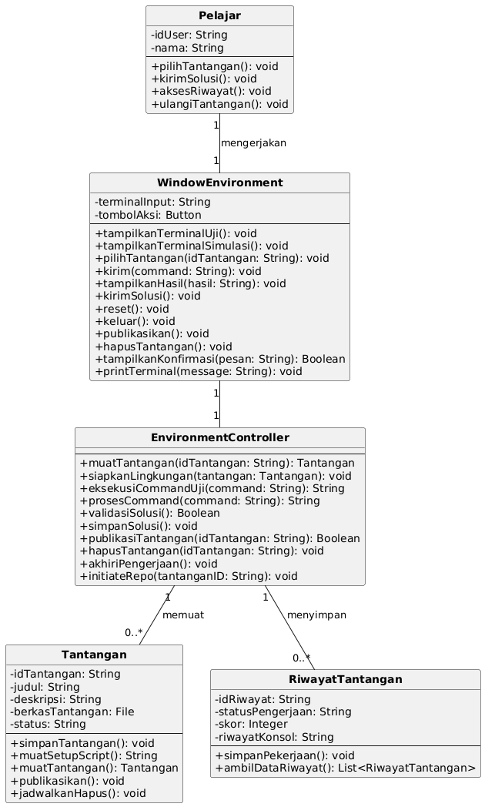
</p>
<p align="center">
<i>Gambar 3.3.3. Diagram Kelas Mengerjakan Tantangan</i>
</p>

## 3.4 Use Case Cek Riwayat

**ID Use Case:** *UC04*  
**Nama Use Case:** *Cek Riwayat*

### 3.4.1 Identifikasi Kelas

Tabel 3.4. Identifikasi Kelas Use Case UC04

| No | Nama Kelas Perancangan | Nama Kelas Analisis Terkait |
|:--- | :--- | :--- |
| 1 | PembuatTantangan | C01 - PembuatTantangan |
| 2 | Pelajar | C02 - Pelajar |
| 3 | WindowRiwayat | C08 - WindowRiwayat |
| 4 | RiwayatTantangan | C09 - RiwayatTantangan |
| 5 | WindowEnvironment | C06 - WindowEnvironment (alternatif 1) |

### 3.4.2 Sequence Diagram

- **Skenario Normal**

<p align="center">
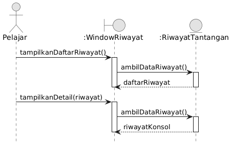
</p>
<p align="center">
<i>Gambar 3.4.2.1. Sequence Diagram UC04</i>
</p>

- **Skenario Alternatif 1: Pelajar Mengulang Tantangan**

<p align="center">

</p>
<p align="center">
<i>Gambar 3.4.2.2. Sequence Diagram UC04 - Pelajar Mengulang Tantangan</i>
</p>

### 3.4.3 Diagram Kelas

<p align="center">

</p>
<p align="center">
<i>Gambar 3.4.3. Diagram Kelas Cek Riwayat</i>
</p>

<br>

---

# BAB 4: Diagram Kelas Keseluruhan

## 4.1 Diagram Kelas

<p align="center">

</p>
<p align="center">
<i>Gambar 4.1. Diagram Kelas Perancangan Keseluruhan Commitment Issues</i>
</p>

Atribut `status` pada Tantangan bernilai `DRAF`, `TERPUBLIKASI`, atau `DIJADWALKAN_HAPUS`.

Tabel 4.1. Daftar Kelas Perancangan Keseluruhan

| ID Kelas | Nama Kelas | Atribut | Metode/Operasi |
| :--- | :--- | :--- | :--- |
| C01 | PembuatTantangan | - idUser: String<br>- nama: String | + aksesMenuUnggah(): void<br>+ inputTantangan(): void<br>+ ujiTantangan(): void<br>+ lihatRekapitulasiNilai(): void |
| C02 | Pelajar | - idUser: String<br>- nama: String | + pilihTantangan(): void<br>+ kirimSolusi(): void<br>+ aksesRiwayat(): void<br>+ ulangiTantangan(): void |
| C03 | Tantangan | - idTantangan: String<br>- judul: String<br>- deskripsi: String<br>- berkasTantangan: File<br>- status: String | + simpanTantangan(): void<br>+ muatSetupScript(): String<br>+ muatTantangan(): Tantangan<br>+ publikasikan(): void<br>+ jadwalkanHapus(): void |
| C04 | WindowEdit | - formUnggah: Form | + tampilkanForm(): void<br>+ kirimBerkas(berkas: File): void<br>+ tampilkanPesan(pesan: String): void<br>+ periksaValiditas(): Boolean |
| C05 | EditController | - | + ambilDaftarTantangan(idUser: String): List&lt;Tantangan&gt;<br>+ validasiBerkas(berkas: File): Boolean<br>+ simpanTantangan(berkas: File): Boolean |
| C06 | WindowEnvironment | - terminalInput: String<br>- tombolAksi: Button | + tampilkanTerminalUji(): void<br>+ tampilkanTerminalSimulasi(): void<br>+ pilihTantangan(idTantangan: String): void<br>+ kirim(command: String): void<br>+ tampilkanHasil(hasil: String): void<br>+ kirimSolusi(): void<br>+ reset(): void<br>+ keluar(): void<br>+ publikasikan(): void<br>+ hapusTantangan(): Boolean<br>+ tampilkanKonfirmasi(pesan: String): Boolean<br>+ printTerminal(message: String): void |
| C07 | EnvironmentController | - | + muatTantangan(idTantangan: String): Tantangan<br>+ siapkanLingkungan(tantangan: Tantangan): void<br>+ eksekusiCommandUji(command: String): String<br>+ prosesCommand(command: String): String<br>+ validasiSolusi(): Boolean<br>+ simpanSolusi(): void<br>+ publikasiTantangan(idTantangan: String): Boolean<br>+ hapusTantangan(idTantangan: String): void<br>+ akhiriPengerjaan(): void<br>+ initiateRepo(idTantangan: String): void |
| C08 | WindowRiwayat | - daftarRiwayatTampilan: List&lt;RiwayatTantangan&gt; | + tampilkanDaftarRiwayat(): void<br>+ tampilkanDetail(riwayat: RiwayatTantangan): void<br>+ kerjakanUlang(): void<br>+ tampilkanKonfirmasi(pesan: String): Boolean |
| C09 | RiwayatTantangan | - idRiwayat: String<br>- statusPengerjaan: String<br>- skor: Integer<br>- riwayatKonsol: String | + simpanPekerjaan(): void<br>+ ambilDataRiwayat(): List&lt;RiwayatTantangan&gt; |

---

# BAB 5: Perancangan Rinci Kelas

Bagian ini diisi dengan daftar seluruh kelas dalam tabel berikut:

Tabel 5.1. Daftar Kelas Perancangan dan Kelas Analisis Terkait

| No | Nama Kelas Perancangan | Nama Kelas Analisis Terkait |
| :--- | :--- | :--- |
| 1 | PembuatTantangan | C01 - PembuatTantangan |
| 2 | Pelajar | C02 - Pelajar |
| 3 | Tantangan | C03 - Tantangan |
| 4 | WindowEdit | C04 - WindowEdit |
| 5 | EditController | C05 - EditController |
| 6 | WindowEnvironment | C06 - WindowEnvironment |
| 7 | EnvironmentController | C07 - EnvironmentController |
| 8 | WindowRiwayat | C08 - WindowRiwayat |
| 9 | RiwayatTantangan | C09 - RiwayatTantangan |

Untuk **setiap kelas**, identifikasi operasi berdasarkan tanggung jawab kelas beserta *visibility*-nya, serta atribut beserta *visibility* dan tipenya. Buat subbab tersendiri untuk setiap kelas.

## 5.1 Kelas PembuatTantangan

**Nama Kelas:** PembuatTantangan
**ID Kelas:** C01

Tabel 5.1.1. Operasi Kelas PembuatTantangan

| Nama Operasi | Visibility (private, public) | Keterangan |
| :--- | :--- | :--- |
| aksesMenuUnggah(): void | public | Mengakses menu untuk memulai pengunggahan tantangan baru |
| inputTantangan(): void | public | Memasukkan rincian data tantangan |
| ujiTantangan(): void | public | Melakukan pengujian terhadap tantangan yang dibuat |
| lihatRekapitulasiNilai(): void | public | Melihat rekapitulasi nilai dari peserta/pelajar |

Tabel 5.1.2. Atribut Kelas PembuatTantangan

| Nama Atribut | Visibility (private, public) | Tipe |
| :--- | :--- | :--- |
| idUser | private | String |
| nama | private | String |

## 5.2 Kelas Pelajar

**Nama Kelas:** Pelajar
**ID Kelas:** C02

Tabel 5.2.1. Operasi Kelas Pelajar

| Nama Operasi | Visibility (private, public) | Keterangan |
| :--- | :--- | :--- |
| pilihTantangan(): void | public | Memilih tantangan yang ingin dikerjakan |
| kirimSolusi(): void | public | Mengirimkan solusi pengerjaan tantangan |
| aksesRiwayat(): void | public | Mengakses riwayat pengerjaan tantangan |
| ulangiTantangan(): void | public | Mengulang kembali pengerjaan suatu tantangan |

Tabel 5.2.2. Atribut Kelas Pelajar

| Nama Atribut | Visibility (private, public) | Tipe |
| :--- | :--- | :--- |
| idUser | private | String |
| nama | private | String |

## 5.3 Kelas Tantangan

**Nama Kelas:** Tantangan
**ID Kelas:** C03

Tabel 5.3.1. Operasi Kelas Tantangan

| Nama Operasi | Visibility (private, public) | Keterangan |
| :--- | :--- | :--- |
| simpanTantangan(): void | public | Menyimpan berkas dan data tantangan ke dalam sistem |
| muatSetupScript(): String | public | Memuat _setup script_ untuk lingkungan tantangan |
| muatTantangan(): Tantangan | public | Mengambil dan memuat berkas tantangan |
| publikasikan(): void | public | Mengubah status tantangan menjadi terpublikasi |
| jadwalkanHapus(): void | public | Menjadwalkan tantangan untuk dihapus |

Tabel 5.3.2. Atribut Kelas Tantangan

| Nama Atribut | Visibility (private, public) | Tipe |
| :--- | :--- | :--- |
| idTantangan | private | String |
| judul | private | String |
| deskripsi | private | String |
| berkasTantangan | private | File |
| status | private | String |

### 5.3.1 Algoritma/Query

Bagian ini diisi untuk kerangka algoritma proses yang dianggap cukup penting. Algoritma dapat dituliskan sebagai *pseudocode*. Implementasi *skeleton code* juga dapat digunakan untuk kelas yang sudah terdefinisi pada bahasa pemrograman tertentu.

**Nama Kelas:** Tantangan
**Nama Operasi:** + publikasikan(): void
**ID Algoritma:** AG-01

```text
    public publikasikan()
    IF status == 'DRAF' THEN
        status = 'TERPUBLIKASI';
        simpanTantangan();
    ELSE
        TampilkanPesan("Tantangan tidak dapat dipublikasikan.");
    ENDIF
```

## 5.4 Kelas WindowEdit

**Nama Kelas:** WindowEdit
**ID Kelas:** C04

Tabel 5.4.1. Operasi Kelas WindowEdit

| Nama Operasi | Visibility (private, public) | Keterangan |
| :--- | :--- | :--- |
| tampilkanForm(): void | public | Menampilkan formulir edit atau unggah tantangan |
| kirimBerkas(berkas: File): void | public | Mengirimkan berkas tantangan yang diunggah pengguna |
| tampilkanPesan(pesan: String): void | public | Mengirimkan pesan status atau validasi kepada pengguna |
| periksaValiditas(): Boolean | public | Memeriksa validitas data pada form sebelum dikirim |

Tabel 5.4.2. Atribut Kelas WindowEdit

| Nama Atribut | Visibility (private, public) | Tipe |
| :--- | :--- | :--- |
| formUnggah | private | Form |

## 5.5 Kelas EditController

**Nama Kelas:** EditController
**ID Kelas:** C05

Tabel 5.5.1. Operasi Kelas EditController

| Nama Operasi | Visibility (private, public) | Keterangan |
| :--- | :--- | :--- |
| ambilDaftarTantangan(idUser: String): List<Tantangan> | public | Mengambil daftar tantangan yang dibuat oleh pengguna tertentu |
| validasiBerkas(berkas: File): Boolean | public | Memvalidasi format dan isi berkas yang diunggah |
| simpanTantangan(berkas: File): Boolean | public | Mengontrol proses penyimpanan data dan berkas tantangan |

## 5.6 Kelas WindowEnvironment

**Nama Kelas:** WindowEnvironment  
**ID Kelas:** C06

Tabel 5.6.1. Operasi Kelas WindowEnvironment

| Nama Operasi | Visibility (private, public) | Keterangan |
| :--- | :--- | :--- |
| tampilkanTerminalUji(): void | public | Menampilkan terminal pengujian |
| tampilkanTerminalSimulasi(): void | public | Menampilkan terminal simulasi |
| pilihTantangan(idTantangan: String): void | public | Memilih tantangan yang akan dijalankan |
| kirim(command: String): void | public | Mengirimkan perintah dari terminal |
| tampilkanHasil(hasil: String): void | public | Menampilkan hasil eksekusi perintah ke layar |
| kirimSolusi(): void | public | Mengirimkan solusi pengerjaan tantangan |
| reset(): void | public | Mengembalikan lingkungan terminal ke kondisi awal |
| keluar(): void | public | Keluar dari lingkungan pengujian, simulasi, atau pengerjaan |
| publikasikan(): void | public | Mempublikasikan tantangan dari antarmuka lingkungan |
| hapusTantangan(): void | public | Menghapus tantangan yang dipilih |
| tampilkanKonfirmasi(pesan: String): Boolean | public | Meminta pengguna untuk mengonfirmasi tindakannya |
| printTerminal(message: String): void | public | Mencetak pesan keluaran ke terminal |

Tabel 5.6.2. Atribut Kelas WindowEnvironment 

| Nama Atribut | Visibility (private, public) | Tipe |
| :--- | :--- | :--- |
| terminalInput | private | String |
| tombolAksi | private | Button |

## 5.7 Kelas EnvironmentController

**Nama Kelas:** EnvironmentController
**ID Kelas:** C07

Tabel 5.7.1. Operasi Kelas EnvironmentController

| Nama Operasi | Visibility (private, public) | Keterangan |
| :--- | :--- | :--- |
| muatTantangan(idTantangan: String): Tantangan | public | Memuat data tantangan berdasarkan IDnya |
| siapkanLingkungan(tantangan: Tantangan): void | public | Menyiapkan lingkungan untuk tantangan |
| eksekusiCommandUji(command: String): String | public | Menjalankan perintah uji di lingkungan |
| prosesCommand(command: String): String | public | Memproses perintah yang dimasukkan oleh pengguna |
| validasiSolusi(): Boolean | public | Memvalidasi kebenaran solusi yang dikirimkan |
| simpanSolusi(): void | public | Menyimpan solusi dari tantangan yang sudah dikerjakan |
| publikasiTantangan(idTantangan: String): Boolean | public | Mengubah status publikasi tantangan |
| hapusTantangan(idTantangan: String): Boolean | public | Memproses penghapusan tantangan |
| akhiriPengerjaan(): void | public | Mengakhiri sesi pengerjaan tantangan |
| initiateRepo(idTantangan: String): void | public | Menginisialisasi repositori untuk tantangan terkait |

## 5.8 Kelas WindowRiwayat

**Nama Kelas:** WindowRiwayat
**ID Kelas:** C08

Tabel 5.8.1. Operasi Kelas WindowRiwayat

| Nama Operasi | Visibility (private, public) | Keterangan |
| :--- | :--- | :--- |
| tampilkanDaftarRiwayat(): void | public | Menampilkan daftar seluruh riwayat pengerjaan |
| tampilkanDetail(riwayat: RiwayatTantangan): void | public | Menampilkan detail dari suatu riwayat pengerjaan tertentu |
| kerjakanUlang(): void | public | Memilih untuk mengerjakan ulang tantangan dari riwayat |
| tampilkanKonfirmasi(pesan: String): Boolean | public | Menampilkan menu konfirmasi untuk tindakan pada riwayat |

Tabel 5.8.2. Atribut Kelas WindowRiwayat

| Nama Atribut | Visibility (private, public) | Tipe |
| :--- | :--- | :--- |
| daftarRiwayatTampilan | private | List<RiwayatTantangan> |

## 5.9 Kelas RiwayatTantangan

**Nama Kelas:** RiwayatTantangan
**ID Kelas:** C09

Tabel 5.9.1. Operasi Kelas RiwayatTantangan

| Nama Operasi | Visibility (private, public) | Keterangan |
| :--- | :--- | :--- |
| simpanPengerjaan(): void | public | Menyimpan data pengerjaan tantangan ke dalam riwayat |
| ambilDataRiwayat(): List<RiwayatTantangan> | public | Mengambil kumpulan data riwayat pengerjaan dari database |

Tabel 5.9.2. Atribut Kelas RiwayatTantangan

| Nama Atribut | Visibility (private, public) | Tipe |
| :--- | :--- | :--- |
| idRiwayat | private | String |
| statusPengerjaan | private | String |
| skor | private | Integer |
| riwayatKonsol | private | String |


<!-- Ignore this, this is for copy pasting

## 5.1 Kelas [Nama Kelas 1]

**Nama Kelas:** *[Nama kelas]*  
**ID Kelas:** *[ID kelas]*

Tabel 5.1.1. Operasi Kelas [Nama Kelas 1]

| Nama Operasi | Visibility (private, public) | Keterangan |
| :--- | :--- | :--- |
| *[Signature operasi, termasuk parameter dan tipe kembalian]* | *[Visibility]* | *[Tanggung jawab operasi]* |
| *...* | *...* | *...* |

Tabel 5.1.2. Atribut Kelas [Nama Kelas 1]

| Nama Atribut | Visibility (private, public) | Tipe |
| :--- | :--- | :--- |
| *[Nama atribut]* | *[Visibility]* | *[Tipe sesuai bahasa pemrograman yang digunakan]* |
| *...* | *...* | *...* |

### 5.1.1 Algoritma/Query

Bagian ini diisi untuk kerangka algoritma proses yang dianggap cukup penting. Algoritma dapat dituliskan sebagai *pseudocode*. Implementasi *skeleton code* juga dapat digunakan untuk kelas yang sudah terdefinisi pada bahasa pemrograman tertentu.

**Nama Kelas:** *[Nama kelas]*  
**Nama Operasi:** *[Signature operasi]*  
**ID Algoritma:** *[Algo-001]*

```text
[Tuliskan pseudocode algoritma operasi di sini.]
```

Jika operasi mengacu pada query tertentu, lengkapi tabel berikut. 

Tabel 5.1.1. Query Operasi [Nama Operasi]

| No Query | Query | Keterangan |
| :--- | :--- | :--- |
| *[Q-001]* | *[Tuliskan query]* | *[Fungsi query]* |
| *...* | *...* | *...* |


### 5.1.2 Algoritma/Query

*[Ulangi pola 5.1.1 untuk operasi penting berikutnya pada kelas yang sama, jika ada.]*

## 5.2 Kelas [Nama Kelas Berikutnya]

*[Ulangi pola 5.1: nama dan ID kelas, tabel operasi, tabel atribut, serta subbab algoritma/query untuk operasi penting jika diperlukan.]*

-->

<br>

---

# BAB 6: Perancangan Antarmuka

## 6.1 Rancangan Antarmuka I-01

**Antarmuka:** *I-01*

**Nama Layar:** *Landing Page*

<p align="center">

</p>
<p align="center">
<i>Gambar 6.1. Rancangan Antarmuka I-01 - Landing Page</i>
</p>

Tabel 6.1. Spesifikasi Objek Antarmuka I-01

| Id_Objek | Jenis | Konten | Keterangan |
| :--- | :--- | :--- | :--- |
| b_join | Button | Join Now | Jika ditekan, sistem akan mengarahkan pengguna ke layar I-02 (Signup) |
| b_login_scr | Button | Log in | Jika ditekan, sistem akan mengarahkan pengguna ke layar I-03 (Login) |

## 6.2 Rancangan Antarmuka I-02

**Antarmuka:** *I-02*

**Nama Layar:** *Signup*

<p align="center">
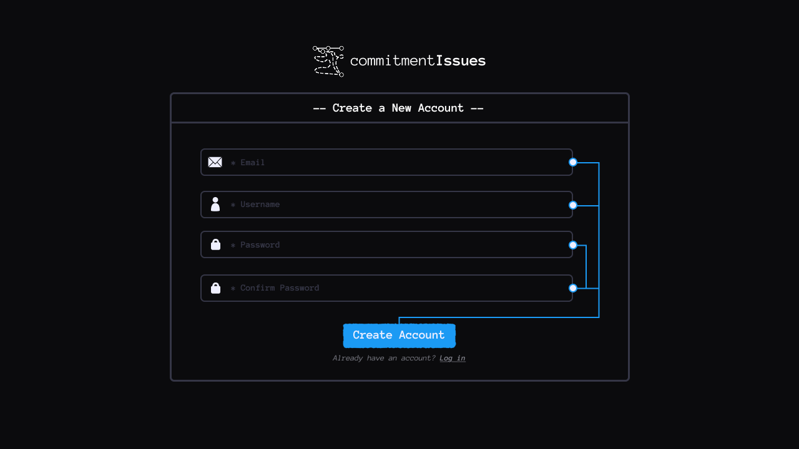
</p>
<p align="center">
<i>Gambar 6.2. Rancangan Antarmuka I-02 - Signup</i>
</p>

Tabel 6.2. Spesifikasi Objek Antarmuka I-02

| Id_Objek | Jenis | Konten | Keterangan |
| :--- | :--- | :--- | :--- |
| i_email | Email input | * Email | Pengguna dapat mengetik di dalam kotak input ini. Sistem memvalidasi apakah email yang dimasukkan merupakan email yang valid. |
| i_username | String input | * Username | Pengguna dapat mengetik di dalam kotak input ini. Sistem memvalidasi apakah username yang dimasukkan memiliki panjang 3-12 karakter. |
| i_password | Password input | * Password | Pengguna dapat mengetik di dalam kotak input ini, dengan inputnya disembunyikan. |
| i_confirm_pass | Password input | * Confirm Password | Pengguna dapat mengetik di dalam kotak input ini, dengan inputnya disembunyikan. Sistem akan memastikan isi input ini sesuai dengan input pada Password input. |
| b_create_account | Button | Create Account | Jika ditekan saat semua input sudah terisi dan valid, sistem akan membuat akun baru dengan detail yang sesuai dengan input pengguna lalu mengarahkan pengguna ke layar I-04 (Main Menu). |
| b_login_scr | Button | Log in | Jika ditekan, sistem akan mengarahkan pengguna ke layar I-03 (Login). |

## 6.3 Rancangan Antarmuka I-03

**Antarmuka:** *I-03*

**Nama Layar:** *Login*

<p align="center">
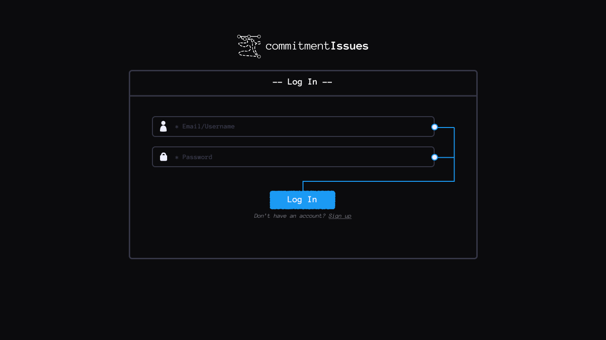
</p>
<p align="center">
<i>Gambar 6.3. Rancangan Antarmuka I-03 - Login</i>
</p>

Tabel 6.3. Spesifikasi Objek Antarmuka I-03

| Id_Objek | Jenis | Konten | Keterangan |
| :--- | :--- | :--- | :--- |
| i_email_usn | String input | * Email/Username | Pengguna dapat mengetik di dalam kotak input ini. |
| i_password | Password input | * Password | Pengguna dapat mengetik di dalam kotak input ini, dengan inputnya disembunyikan. |
| b_login | Button | Log in | Jika ditekan, sistem akan memeriksa email/username dan password pada database pengguna. Jika terdapat pengguna yang sesuai, pengguna akan diarahkan ke layar I-04 (Main Menu). Jika tidak, layar akan menampilkan error message. |
| b_join | Button | Join Now | Jika ditekan, sistem akan mengarahkan pengguna ke layar I-02 (Signup). |

## 6.4 Rancangan Antarmuka I-04

**Antarmuka:** *I-04*

**Nama Layar:** *Main Menu*

<p align="center">

</p>
<p align="center">
<i>Gambar 6.4. Rancangan Antarmuka I-04 - Main Menu</i>
</p>

Tabel 6.4. Spesifikasi Objek Antarmuka I-04

| Id_Objek | Jenis | Konten | Keterangan |
| :--- | :--- | :--- | :--- |
| challenge_card | Button | Menampilkan nama tantangan, pembuat tantangan, deskripsi tantangan, dan tingkat kesulitan tantangan | Untuk setiap tantangan yang berada di server, akan dibuat sebuah challenge card yang berisikan detail tantangan. Jika suatu challenge card ditekan pengguna, sistem akan mengarahkan pengguna ke I-09 (Challenge Environment) dan menjalankan setup script dari tantangan yang dipilih. |
| b_filter | Button | Ikon filter di sebelah tulisan "Available Challenges" | Jika ditekan, sistem akan menampilkan I-05 (Filter Challenges Modal) |
| created_ch_cards | Button | Menampilkan nama tantangan, pembuat tantangan, deskripsi tantangan, tingkat kesulitan tantangan, serta status tantangan dari tantangan yang dibuat pengguna | Untuk setiap tantangan yang dibuat oleh pengguna yang berada di server, akan dibuat sebuah challenge card yang berisikan detail tantangan. Jika ditekan, sistem akan mengarahkan pengguna I-10 (Evaluation Environment) untuk tantangan yang dipilih. |
| b_profile_badge | Button | Silhouette orang pada kanan atas page | Ketika ditekan, sistem akan memunculkan 3 tombol: b_profile, b_history, b_logout. |
| b_profile | Button | Teks "Profile" dan ikon roda gigi | Ketika ditekan, sistem menampilkan I-06 (Profile Options Modal). |
| b_history | Button | Teks "History" dan ikon gulungan | Ketika ditekan, sistem mengarahkan pengguna ke I-07 (History). |
| b_logout | Button | Teks "Logout" dan ikon pintu merah | Ketika ditekan, sistem me-logout pengguna dan mengarahkan pengguna ke I-03 (Login) |

## 6.5 Rancangan Antarmuka I-05

**Antarmuka:** *I-05*

**Nama Layar:** *Filter Challenges Modal*

<p align="center">

</p>
<p align="center">
<i>Gambar 6.5. Rancangan Antarmuka I-05 - Filter Challenges</i>
</p>

Tabel 6.5. Spesifikasi Objek Antarmuka I-05

| Id_Objek | Jenis | Konten | Keterangan |
| :--- | :--- | :--- | :--- |
| difficulty_slider | Slider | Slider dengan 2 buah ujung, dengan ujung 1 dibatasi agar tidak melewati ujung 2. | Kedua ujung dapat ditekan dan digeser oleh pengguna. Ujung 1 akan menjadi batas bawah dari tantangan yang akan ditampilkan, dan ujung 2 menjadi batas atas. |
| search_bar | String input | Kotak input dengan ikon kaca pembesar | Pengguna dapat mengetik dalam kotak input ini. Isi dari kotak input ini akan digunakan untuk menyaring tantangan yang akan ditampilkan. |
| b_back | Button | Ikon silang | Ketika ditekan, sistem akan menutup modal ini. Filter-filter yang diinput oleh pengguna tidak akan tersimpan |
| b_save_filters | Button | Tombol dengan tulisan "Save Filters" | Jika ditekan, modal ini akan tertutup dan sistem akan menerapkan filter untuk menampilkan tantangan pada main menu (I-04). |


## 6.6 Rancangan Antarmuka I-06

**Antarmuka:** *I-06*

**Nama Layar:** *Profile Options Modal*

<p align="center">

</p>
<p align="center">
<i>Gambar 6.6. Rancangan Antarmuka I-06 - Profile Options</i>
</p>

Tabel 6.6. Spesifikasi Objek Antarmuka I-06

| Id_Objek | Jenis | Konten | Keterangan |
| :--- | :--- | :--- | :--- |
| b_edit_pf | Button | Tulisan "Edit" yang digarisbawahi | Ketika ditekan, pengguna bisa meninjau informasi yang berkoresponden. Di antarmuka ini, tombol ini dapat digunakan untuk memicu peninjauan username, email, password, dan profile picture. |
| b_delete_pfp | Button | Tulisan "Delete" yang digarisbawahi | Ketika ditekan, profile picture pengguna akan dihapus dan diganti dengan profile picture yang default. |
| b_back | Button | Ikon silang | Ketika ditekan, sistem akan menutup modal ini. |

## 6.7 Rancangan Antarmuka I-07

**Antarmuka:** *I-07*

**Nama Layar:** *History*

<p align="center">
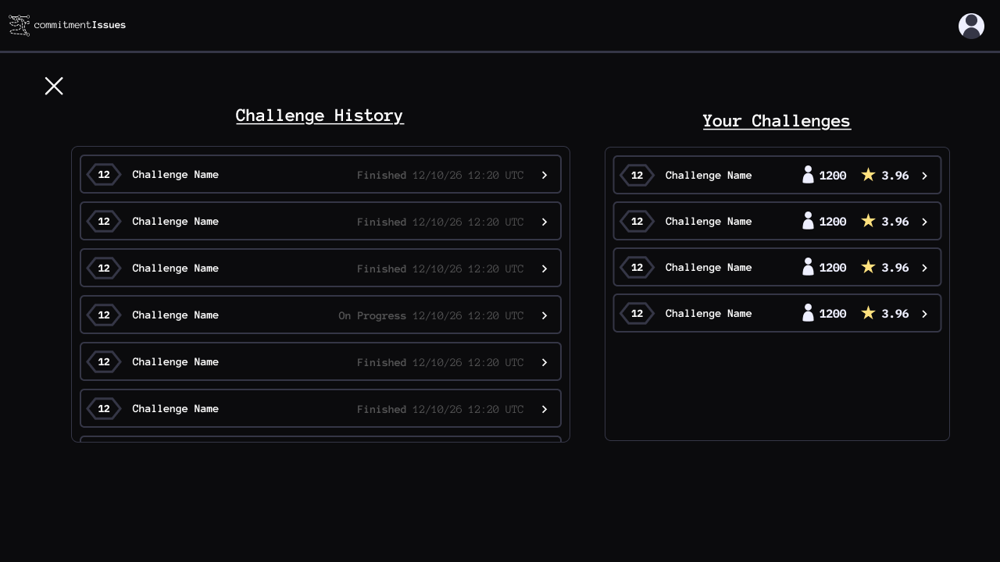
</p>
<p align="center">
<i>Gambar 6.7. Rancangan Antarmuka I-07 - History</i>
</p>

Tabel 6.7. Spesifikasi Objek Antarmuka I-07

| Id_Objek | Jenis | Konten | Keterangan |
| :--- | :--- | :--- | :--- |
| history_card | Button | Menampilkan nama tantangan, waktu pengerjaan tantangan, status pengerjaan tantangan, dan tingkat kesulitan tantangan | Untuk setiap riwayat pengerjaan dari pengguna, akan dibuat sebuah history card yang berisikan detail riwayat pengerjaan. Ketika ditekan, sistem akan mengarahkan pengguna ke I-09 (Challenge Environment), menjalankan setup script, serta mengembalikan tantangan ke state terakhir riwayat yang tercatat. |
| created_ch_card_alt | Button | Menampilkan nama tantangan, tingkat kesulitan tantangan, banyak pengerjaan, dan rating rata-rata tantangan. | Untuk setiap tantangan yang dibuat oleh pengguna, akan dibuat sebuah card yang menampilkan detail tantangan. Ketika ditekan, sistem akan mengarahkan pengguna ke I-10 (Evaluation Environment) untuk tantangan yang dipilih. |
| b_button | Button | Ikon silang | Ketika ditekan, sistem akan mengarahkan pengguna ke I-04 (Main Menu). |
| b_profile_badge | Button | Silhouette orang pada kanan atas page | Ketika ditekan, sistem akan memunculkan 3 tombol: b_profile, b_history, b_logout. |

## 6.8 Rancangan Antarmuka I-08

**Antarmuka:** *I-08*

**Nama Layar:** *Challenge Upload*

<p align="center">

</p>
<p align="center">
<i>Gambar 6.8. Rancangan Antarmuka I-08 - Challenge Upload</i>
</p>

Tabel 6.8. Spesifikasi Objek Antarmuka I-08

| Id_Objek | Jenis | Konten | Keterangan |
| :--- | :--- | :--- | :--- |
| b_file_choice | Button | Tombol dengan tulisan "Upload your challenges here (.zip)" | Tombol ini digunakan untuk memicu proses pemilihan file tantangan untuk diunggah. |
| difficulty_slider | Slider | Slider dengan 2 buah ujung, dengan ujung 1 dibatasi agar tidak melewati ujung 2. | Kedua ujung dapat ditekan dan digeser oleh pengguna. Ujung 1 akan menjadi batas bawah dari tantangan yang akan ditampilkan, dan ujung 2 menjadi batas atas. |
| i_title | String input | Kotak teks dengan tulisan sementara "* Title" | Pengguna dapat mengetik judul tantangan dalam kotak input ini. Sistem memvalidasi bahwa teks input tidak melebihi 50 karakter. |
| i_desc | String input | Kotak teks dengan tulisan sementara "* Description" | Pengguna dapat mengetik deskripsi tantangan dalam kotak input ini. Sistem memvalidasi bahwa teks input tidak melebihi 300 karakter. |
| b_upload | Button | Tombol dengan tulisan "Upload" | Tombol ini digunakan untuk memicu proses pengunggahan file tantangan, judul tantangan, dan deskripsi tantangan. |

## 6.9 Rancangan Antarmuka I-09

**Antarmuka:** *I-09*

**Nama Layar:** *Challenge Environment*

<p align="center">

</p>
<p align="center">
<i>Gambar 6.9. Rancangan Antarmuka I-09 - Challenge Environment</i>
</p>

Tabel 6.9. Spesifikasi Objek Antarmuka I-09

| Id_Objek | Jenis | Konten | Keterangan |
| :--- | :--- | :--- | :--- |
| b_hint | Button | Teks "Hint" yang digarisbawahi | Ketika ditekan, tombol ini akan memunculkan petunjuk pengerjaan tantangan. |
| b_give_up | Button | Teks "Give Up" yang digarisbawahi | Ketika ditekan, tombol ini akan memunculkan solusi untuk tantangan. |
| b_restart  | Button | Tombol dengan teks "Restart" | Ketika ditekan, tombol ini akan menyebabkan lingkungan tantangan menjadi keadaan semula saat tantangan baru dimulai. |
| b_submit  | Button | Tombol dengan teks "Submit" | Tombol ini akan memicu pemeriksaan lingkungan tantangan oleh sistem. |
| b_back | Button | Ikon silang | Ketika ditekan, sistem akan menutup modal ini dan mengarahkan pengguna ke menu utama (I-04). |

## 6.10 Rancangan Antarmuka I-10

**Antarmuka:** *I-10*

**Nama Layar:** *Evaluation Environment*

<p align="center">

</p>
<p align="center">
<i>Gambar 6.10. Rancangan Antarmuka I-10 - Evaluation Environment</i>
</p>

Tabel 6.10. Spesifikasi Objek Antarmuka I-10

| Id_Objek | Jenis | Konten | Keterangan |
| :--- | :--- | :--- | :--- |
| challenge_description | RTF Box | Berisikan deskripsi tantangan yang telah dimasukkan oleh pembuat tantangan. | - |
| b_delete_challenge | Button | Tulisan "Delete Challenge" | Jika ditekan, sistem akan mengubah status dari tantangan yang sedang dievaluasi menjadi "dijadwalkan dihapus". |
| b_unpublish | Button | Tulisan "Unpublish" | Jika ditekan, sistem akan mengubah status dari tantangan yang sedang dievaluasi menjadi "Draf". |
| b_edit_hint | Button | Tulisan  "Edit Hint" | Jika ditekan, akan memunculkan modal dengan String input untuk mengubah hint dari tantangan. |
| terminal | TBA | TBA | TBA | 

## 6.11 Rancangan Antarmuka Keseluruhan

Tuliskan daftar gambar seluruh antarmuka. Berikan ID unik untuk setiap tampilan dan gunakan ID yang sama pada subbab perancangan antarmuka masing-masing.

Tabel 6.11. Rancangan Antarmuka Keseluruhan

| No | Tampilan Antarmuka |
| :--- | :--- |
| *[I-01]* |  |
| *[I-02]* |  |
| *[I-03]* |  |
| *[I-04]* |  |
| *[I-05]* |  |
| *[I-06]* |  |
| *[I-07]* |  |
| *[I-08]* |  |
| *[I-09]* |  |
| *[I-10]* |  |


<br>

---

# BAB 7: Matriks Kerunutan

Matriks berikut mengacu pada Tabel 6.1 SKPL dan disesuaikan dengan realisasi use case pada BAB 3.

Tabel 7.1. Matriks Kerunutan Kelas terhadap Use Case

| Kelas | Use Case Terkait |
| :--- | :--- |
| C01 - PembuatTantangan | UC01 - Mengembangkan Tantangan, UC02 - Mengevaluasi Tantangan, UC04 - Cek Riwayat |
| C02 - Pelajar | UC03 - Mengerjakan Tantangan, UC04 - Cek Riwayat |
| C03 - Tantangan | UC01 - Mengembangkan Tantangan, UC02 - Mengevaluasi Tantangan, UC03 - Mengerjakan Tantangan |
| C04 - WindowEdit | UC01 - Mengembangkan Tantangan |
| C05 - EditController | UC01 - Mengembangkan Tantangan |
| C06 - WindowEnvironment | UC02 - Mengevaluasi Tantangan, UC03 - Mengerjakan Tantangan, UC04 - Cek Riwayat |
| C07 - EnvironmentController | UC02 - Mengevaluasi Tantangan, UC03 - Mengerjakan Tantangan |
| C08 - WindowRiwayat | UC04 - Cek Riwayat |
| C09 - RiwayatTantangan | UC03 - Mengerjakan Tantangan, UC04 - Cek Riwayat |
