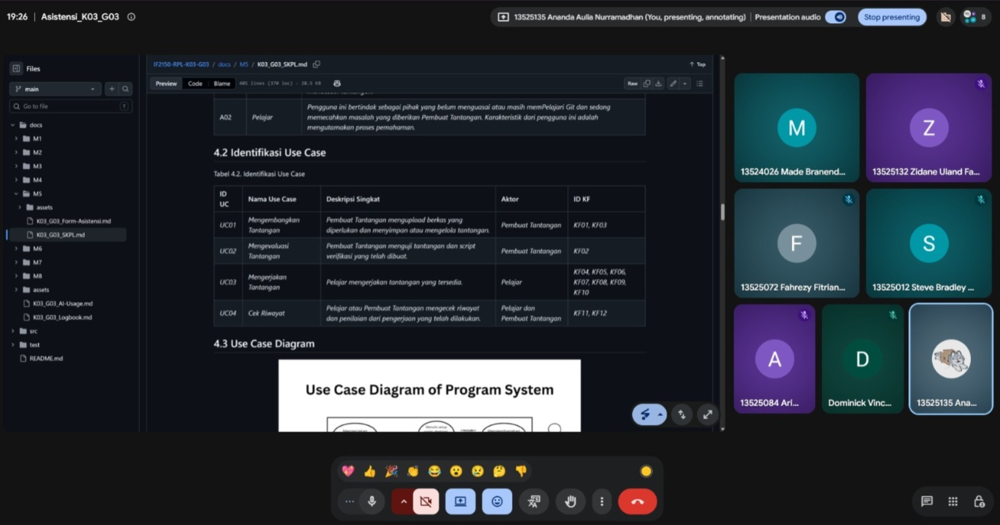

# Form Asistensi

## Tugas Besar IF2150 - Rekayasa Perangkat Lunak

| Informasi | Keterangan |
| --- | --- |
| **Hari** | Selasa |
| **Tanggal** | 27/10/2026 |
| **Kelas** | 03 |
| **Nomor Kelompok** | 03 |
| **Nama Kelompok** | 0x43 |
| **Nama Perangkat Lunak** | Commitment Issues  |
| **Dokumen** | K03_G03_DPPL2.md |

### Anggota Kelompok

| NIM | Nama |
| --- | --- |
| 13525012 | Steve Bradley Hoeij |
| 13525072 | Fahrezy Fitriansyah |
| 13525084 | Ariq Ulwan Hammam |
| 13525132 | Zidane Uland Fakhry |
| 13525135 | Ananda Aulia Nurramadhan |
| 10124063 | Dominick Vincent Devict |

### Catatan

| Catatan |
| --- |
| 1. _Pseudocode_ di BAB 5 tidak harus rinci dan tidak harus mengikuti notasi algoritmik standar. |
| 2. _Query_ di BAB 5 harus mengikuti _syntax_ yang sudah didefinisikan. |
| 3. Fitur QoL (_Quality of Life_) secara umum dapat ditambahkan, selama tidak melanggar KF maupun KNF yang ada. |
| 4. KF dan KNF pada fase ini sudah tidak boleh diubah, ditambah, maupun dikurangi. |

## Dokumentasi

<!--  -->

  

  <i>Gambar 1. Dokumentasi kegiatan asistensi.</i>

