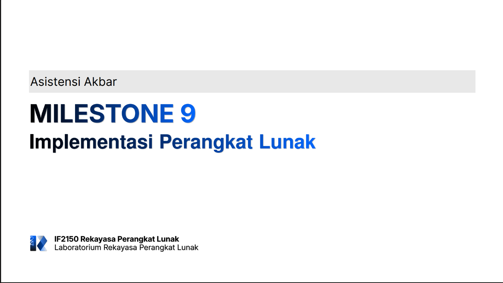

# Form Asistensi

## Tugas Besar IF2150 - Rekayasa Perangkat Lunak

| Informasi | Keterangan |
| --- | --- |
| **Hari** | Selasa |
| **Tanggal** | 02/11/2026 |
| **Kelas** | 03 |
| **Nomor Kelompok** | 03 |
| **Nama Kelompok** | 0x43 |
| **Nama Perangkat Lunak** | Commitment Issues  |
| **Dokumen** | K03_G03_Implementasi.md |

### Anggota Kelompok

| NIM | Nama |
| --- | --- |
| 13525012 | Steve Bradley Hoeij |
| 13525072 | Fahrezy Fitriansyah |
| 13525084 | Ariq Ulwan Hammam |
| 13525132 | Zidane Uland Fakhry |
| 13525135 | Ananda Aulia Nurramadhan |
| 10124063 | Dominick Vincent Devict |

### Catatan

| Catatan |
| --- |
| 1. README sekurang-kurangnya berisi deskripsi, prasyarat instalasi, konfigurasi, cara menjalankan, akun data uji, dan daftar modul pembagian tugas. |
| 2. Pull request harus di-_review_ oleh anggota lain sebelum di-_merge_. |
| 3. Branch main berisi kode yang siap dirilis; branch develop digunakan untuk integrasi dan pengujian fitur; branch feature digunakan untuk mengembangkan fitur secara independen; branch release digunakan untuk persiapan rilis dan pengujian akhir; branch hotfix digunakan untuk perbaikan _bug_. |
| 4. _Database_ disarankan berbasis lokal. |

## Dokumentasi

<!--  -->

  

  <i>Gambar 1. Dokumentasi kegiatan asistensi.</i>

